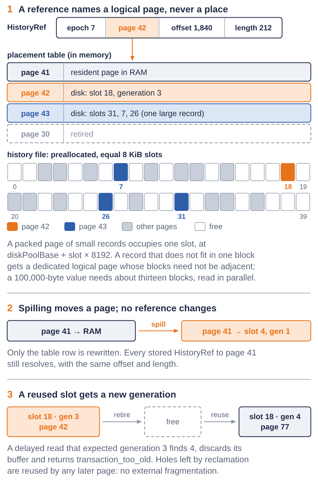
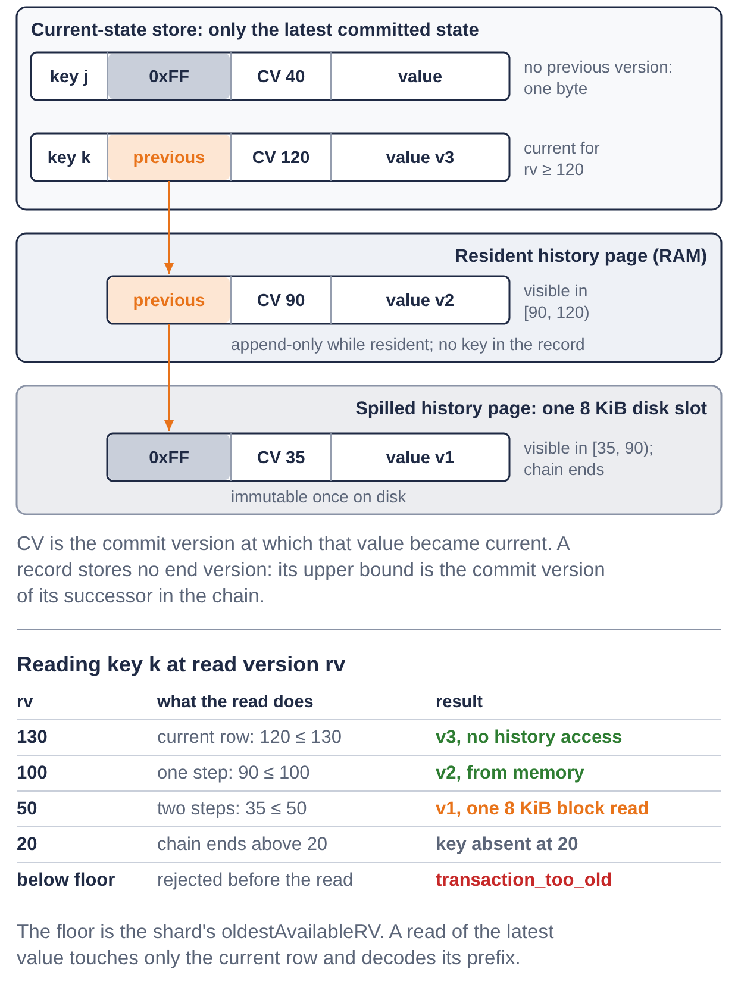
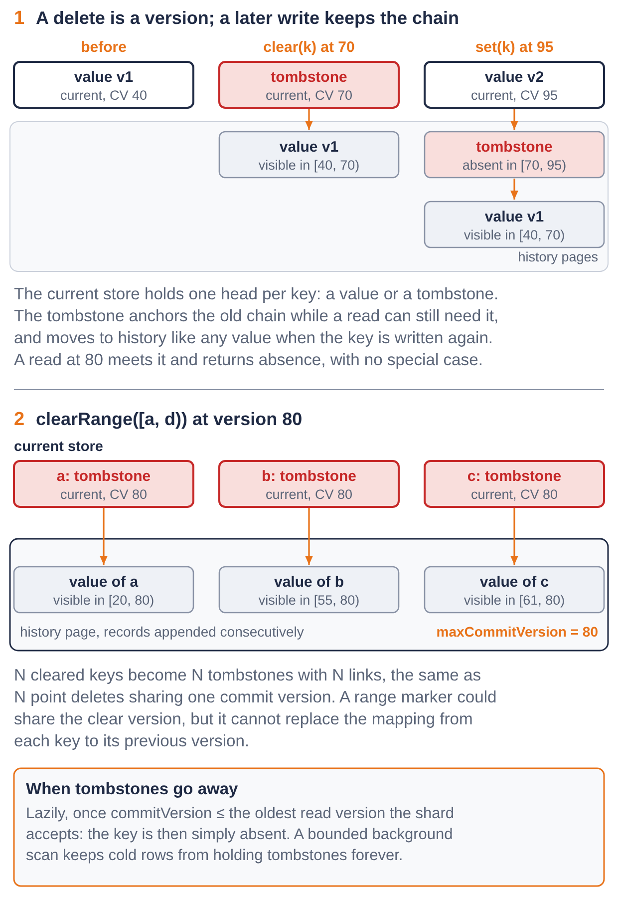
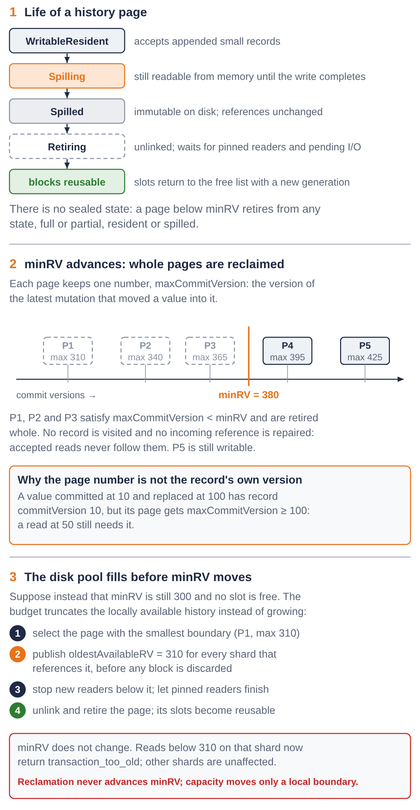
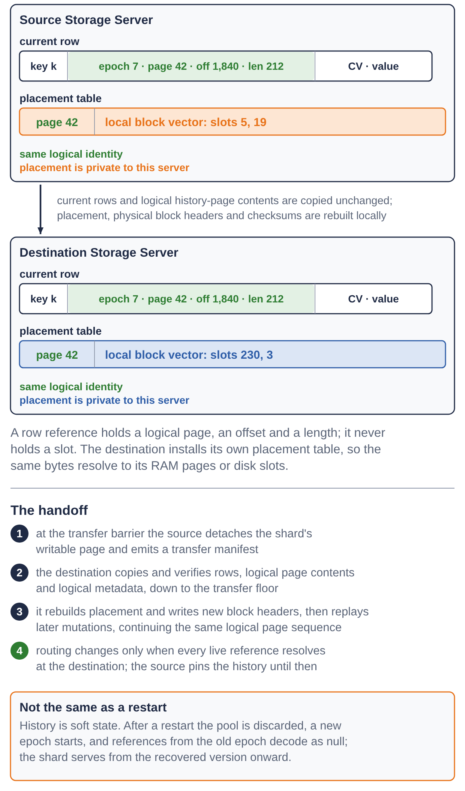

# Paged Version History for FoundationDB Storage Servers

**Status:** Initial design, core representation decided  
**Date:** 12 November 2026  
**Scope:** Storage Server MVCC representation and reclamation

## Baseline and current behaviour

The design baseline for existing FoundationDB internals is
`apple/foundationdb` main at `a443d3ee60`.

At that baseline, a Storage Server combines durable state in its selected
storage engine with newer mutations retained in an in-memory `VersionedMap`.
Point and range reads select the tree version for the requested read version
and merge it with the durable state. The retained window is bounded by
`MAX_READ_TRANSACTION_LIFE_VERSIONS`; as `oldestVersion` advances, reads below
it return `transaction_too_old`.

`forgetVersionsBeforeAsync` removes obsolete `VersionedMap` roots and schedules
nodes that are no longer referenced for deferred destruction, yielding after
bounded cleanup work. The Storage Server does not call
`VersionedMap::compact()` for this reclamation.

The paged-history path described below is not implemented yet. Its row codec,
page pool, spill path, per-shard availability boundaries, shard transfer and
end-to-end validation remain implementation work behind a configuration gate.
This document supersedes the earlier draft based on two circular arrays and
allocation-order recycling.

## 1. Objective

FoundationDB Storage Servers currently retain several committed versions in an
in-memory versioned tree. The retained window is therefore coupled to RAM and
is normally limited to a few seconds. This design removes that versioned tree
from the new Storage Server path rather than retaining a smaller copy of it.

This design separates the current committed state from historical versions:

- the selected key-value store contains only the latest committed state of each
  key, encoded as an opaque current row;
- replaced and deleted values are appended to history pages backed by fixed
  8 KiB blocks;
- recent history pages are resident in memory;
- older history pages spill to fixed slots in a preallocated disk area;
- history capacity is bounded by explicit memory and disk budgets;
- reclamation removes complete logical pages and returns their individual
  physical slots to a free list;
- the minimum retained read version determines which history is still needed.

The intended result is a bounded-memory Storage Server whose snapshot-retention
window can grow with disk capacity instead of RAM.

## 2. Design principles

1. **The current path does not traverse old versions.** A read of the latest
   committed value accesses the current-state store directly and only decodes
   its row prefix.
2. **Historical references are location-independent.** Moving a page from RAM
   to disk does not change any stored reference.
3. **History is append-only within a live page.** A page moved to disk receives
   no more records; a page does not need to be full or have a special sealed
   state before it can be reclaimed.
4. **Reclamation is logical-page-granular.** Retiring a logical page returns all
   of its fixed physical blocks without visiting or repairing its records or
   incoming links.
5. **Capacity is explicit.** RAM and disk use fixed page budgets and do not grow
   with the duration of the retained window.
6. **Unavailable history fails safely.** A read below the local availability
   boundary returns `transaction_too_old`.
7. **Deletes are versions.** Point deletes and every key removed by
   `clearRange` create a tombstone that anchors the previous version chain.
8. **Physical allocation uses fixed blocks.** The history file is divided into
   reusable 8 KiB slots. A large historical value uses a vector of slots that
   need not be physically consecutive.
9. **One historical lookup reads one historical version.** Small records share
   packed single-block pages. A record that does not fit is placed in its own
   multi-block logical page so unrelated small records are not pulled in with
   it.

## 3. High-level architecture

```text
                      latest committed state
                    +--------------------------+
                    |   current-state store    |
                    | value or tombstone heads |
                    +------------+-------------+
                                 | previous
                                 v
                    +--------------------------+
                    | resident history pages   |
                    | writable packed pages    |
                    +------------+-------------+
                                 | spill full/selected page
                                 v
                    +--------------------------+
                    | fixed 8 KiB disk slots   |
                    | free-slot allocator      |
                    +------------+-------------+
                                 | reclaim logical page
                                 v
                      advance availability boundary
```

New records enter a writable page owned by their shard. Full pages normally
spill to disk; a partially filled page may also spill under memory pressure and
can be reclaimed directly when it lies below `minRV`. Disk placement is not a
byte-packed variable-size ring. It is a fixed-slot pool, so reclamation may
leave holes and any later logical page can reuse them without external
fragmentation.

FoundationDB already has an in-memory object associated with every Storage
Server shard: `StorageServer::shards` is a
`KeyRangeMap<Reference<ShardInfo>>`. The new state is attached to `ShardInfo`
through a reference to a separate `ShardHistoryState`; it is not persisted as
Storage Server metadata:

```cpp
struct ShardHistoryState : ReferenceCounted<ShardHistoryState> {
    HistoryEpoch epoch;
    std::vector<Reference<HistoryChain>> inheritedChains;
    Reference<HistoryChain> writableChain;
    Version maxCommitVersion;
    Version oldestAvailableRV;
};

struct HistoryChain : ReferenceCounted<HistoryChain> {
    HistoryPageID firstPage;
    HistoryPageID lastPage;
    HistoryPageID writablePage;
};
```

The separate reference is needed because shard split and merge operations must
share or combine existing immutable history before new private tails are
created. `ShardInfo` must not contain raw disk positions.

## 4. Version representation

### 4.1 Stable historical references

No persistent object stores a raw pointer to page memory. A historical link is
a logical reference:

```cpp
struct HistoryRef {
    HistoryEpoch epoch;
    HistoryPageID page;
    uint32_t offset;
    uint32_t length;
};
```

`HistoryPageID` is a stable logical identity within a shard history epoch.
`offset` and `length` identify the record's exact logical byte range. The epoch
belongs to the shard's transferable history namespace, not to a particular
Storage Server process. A shard move preserves it; a restart or reset that
discards history creates a new epoch so old references cannot resolve into
unrelated data.

Physical blocks use reusable identifiers containing a slot and generation:

```cpp
struct BlockID {
    uint32_t slot;
    uint32_t generation;
};
```

Reusing a slot increments its generation. Consequently a delayed read or stale
descriptor cannot interpret the new contents as the former block.

A placement structure resolves a live `HistoryPageID` to a descriptor and the
descriptor resolves its logical bytes to one of:

- an in-memory page;
- a page currently being spilled;
- one 8 KiB disk block for an ordinary packed page;
- a vector of non-contiguous 8 KiB blocks for a large record;
- a retired page.

The first implementation uses an explicit compact placement table. Physical
block slots are reusable and a logical page can span non-contiguous blocks, so
direct arithmetic from `HistoryPageID` to file position is not a valid mapping.

For a single-block packed page, the physical block begins at:

```text
diskPoolBase + BlockID.slot * 8192
```

For a large historical record, the descriptor's local placement contains the
complete `vector<BlockID>`. This follows Redwood's multipage-node
representation: one logical page is placed in independently allocated physical
blocks rather than a linked list or a contiguous disk extent. Reads of its
blocks can therefore be issued in parallel.



*Figure 1. A `HistoryRef` names a logical page, an offset and a length. The placement table resolves the page to resident memory, one 8 KiB disk slot or a vector of non-contiguous slots; spilling rewrites only the placement, and a reused slot carries a new generation. Page identities, slots and offsets are illustrative.*

A point lookup reads only the block range belonging to the addressed historical
record. It does not reconstruct an unrelated larger B+ tree page. The operating
system or device may perform larger aligned reads internally, but the database
does not need to load other historical records merely because they were created
nearby.

### 4.2 Current rows

The underlying key-value store keeps the latest committed state. It sees an
opaque byte string; a Storage Server row codec interprets it as:

```cpp
struct CurrentEntry {
    Key key;
    Version commitVersion;
    ValueOrTombstone state;
    // previous is encoded only when hasPrevious is set
};
```

The storage engine already frames each physical row or value with its size. The
private history prefix goes immediately after that engine-owned framing and
before the original value payload:

```text
physical row = engine size/framing | encoded value
encoded value = history prefix | user value

history prefix = previous reference | commitVersion (when not supplied elsewhere)
previous reference = 0xFF
                   | 64-bit logical location | encoded record length
```

The history layer does not duplicate the outer row length. At the
`IKeyValueStore` boundary, engine framing has already been removed and a
`ValueRef` supplies the encoded value's address and total size; byte zero of
that `ValueRef` is the start of the history prefix. On write, the engine
recomputes its own physical row size from the longer opaque value.

The first byte therefore determines how much of the reference must be decoded.
Once the remaining fixed or self-delimiting metadata fields have been read, all
remaining bytes are the user value; arbitrary user bytes cannot be mistaken for
metadata. The storage engine compares and indexes only the key and treats the
complete encoded row as opaque bytes.

All read paths interpret and remove the prefix before returning a value to
Storage Server MVCC or to a client. All write paths prepend it before calling
the underlying `IKeyValueStore`.

A tombstone is the latest committed state of a deleted key. It remains in the
current-state store while an accepted historical read can still need the value
to which it points.

#### Sparse previous-reference encoding

Most current rows may have no historical predecessor. A fixed C++ field such as
`Optional<HistoryRef>` would still reserve and align space close to the maximum
reference size in every row. The physical current-row representation therefore
encodes the predecessor sparsely.

The encoding reserves `0xFF` as a byte value that is forbidden at the start of
every valid encoded logical location:

```text
first byte = 0xFF                                no previous version; stop
first byte = 0x00..0xFE                          64-bit location; length follows
```

Locations use a canonical eight-byte big-endian representation. If the first
byte is not `0xFF`, it is already the first byte of the location; the decoder
reads the remaining seven bytes and then the encoded record length. Thus the
null reference field costs one byte, while the non-null case pays no separate
tag byte.
Only the interval whose high byte is `0xFF` is excluded, preserving 255/256 of
the 64-bit address space: about 15.94 EiB for byte addressing.

This restriction is comfortably outside FoundationDB's storage limits. Its
`IAsyncFile` interface uses a signed `int64_t` file offset, so a non-negative
physical offset already cannot start with `0xFF` in big-endian form. The bundled
SQLite defaults to a limit of 1,073,741,823 pages, has an internal pager ceiling
of 2,147,483,647 pages and permits pages no larger than 64 KiB. Even the hard
combination is below 128 TiB; at the configured 4 KiB B-tree page size, the
default limit is below 4 TiB. The logical-history namespace can enforce the same
reserved high-byte rule independently of physical placement.

The logical location must contain enough page identity -- including the epoch
or generation needed to reject a stale reference -- plus the offset within the
page. No length bytes are present after the `0xFF` null marker.

This saving must exist in the serialized current row. Expressing the choice as
a fixed-size C++ union or `Optional<HistoryRef>` would still make every in-memory
row reserve the maximum aligned size and would not provide the intended space
reduction.

The `0xFF` nullable-location form is part of each self-contained encoded row.
No leaf-level side bitmap is used: it would couple the representation to one
storage engine's internal page format and prevent the row codec from wrapping
all `IKeyValueStore` implementations unchanged.

`HistoryRef` itself should be encoded without structure padding. The 8 KiB
physical block size bounds an in-block offset to 13 bits. A logical history-page
identifier and offset can potentially share one 64-bit logical location; length
can use a fixed 32-bit field or a varint because one value can be as large as
100,000 bytes. Exact bit allocation remains an encoding decision, but page and
large-value layout no longer do.

### 4.3 Historical records

```cpp
struct HistoricalEntry {
    HistoryEpoch epoch;
    HistoryPageID pageID;
    uint32_t encodedLength;
    Version commitVersion;
    ValueOrTombstone state;
    // optional previous reference uses the same sparse encoding
    Checksum checksum;
};
```

The key is not stored in the historical record. It remains in the current B+
tree entry -- including a current tombstone -- and every older version is
reached by following that key's chain.

`commitVersion` is the version at which that value or tombstone became current.
To read at
`readVersion`, traversal returns the first entry satisfying
`commitVersion <= readVersion`; otherwise it follows `previous`.

No second timestamp is stored in the record. The upper bound of one version is
the `commitVersion` of its successor:

```text
current commitVersion = W
    previous record commitVersion = V       -> visible in [V,W)
        previous record commitVersion = U   -> visible in [U,V)
```



*Figure 2. One key's chain. The current row holds the latest state and an optional previous reference; older states are reached through history pages in memory and on disk. A read returns the first entry whose `commitVersion` is not greater than its read version. Versions are illustrative.*

When commit `C` moves a value to history, the page builder updates a single
page-level value:

```cpp
page.maxCommitVersion = C;
```

Commits are applied in order, so assignment is sufficient while a page is open.
No per-record end timestamp is stored.

These are two different timestamps:

- `entry.commitVersion` selects the value visible to a read;
- `page.maxCommitVersion` is the most recent mutation version during which the
  page received an old value and determines when the complete page is
  reclaimable.

The in-memory descriptor identifies the required block vector. Every physical
block and record carries enough identity and integrity information to validate
the read after suspension. A small record normally costs one 8 KiB block read;
a dedicated large record costs only its own block vector. Compression or
authenticated encryption must therefore be record-granular or independently
decodable per block rather than spanning unrelated logical pages.

## 5. Mutation semantics

### 5.1 Set and overwrite

For `set(k, value)` at version `W`:

1. Read the current row for `k`, first from the current pending write set and
   otherwise from the underlying store.
2. Append that row's value or tombstone, `commitVersion` and previous link to
   the writable history page; set the page's `maxCommitVersion` to `W`.
3. Obtain the appended record's `HistoryRef`.
4. Encode the new current row as the new value, `commitVersion = W` and that
   `HistoryRef`.
5. Install the encoded row as the sole current head for `k`.

In pseudocode:

```text
old = currentHead(k)
previous = historyPage.append(old)
currentHead(k) = encode(value, W, previous)
```

If `k` is mutated again before the storage batch becomes durable, the second
mutation reads the pending head installed by the first mutation and moves it to
history in exactly the same way. There is still only one current head per key;
all older states live in history pages.

```text
new value @W
    |
    v
old value [V,W)
    |
    v
older history
```

### 5.2 Point delete

For `clear(k)` at version `D`:

1. Move the current value into history and set the writable page's
   `maxCommitVersion` to `D`.
2. Replace the current row with a tombstone at `commitVersion = D`.
3. Point the tombstone at the historical value.

```text
tombstone @D
    |
    v
old value [V,D)
    |
    v
older history
```

The tombstone can be removed lazily when `D` is no greater than the oldest read
version the Storage Server will accept. Removing it makes the key naturally
absent from the current store. Its old records may remain physically present
until their pages reach the head of the history queue.

### 5.3 Range clear

`clearRange([a,b), C)` processes every current key in the range. For each key:

1. Move the current value into history and set the writable page's
   `maxCommitVersion` to `C`.
2. Replace the current value with a tombstone at `commitVersion = C`.
3. Store one `HistoryRef` from that tombstone to the removed value.

This is semantically the same operation as a set of point deletes sharing one
commit version:

```text
clearRange of N current keys
    -> N historical heads ending at C
    -> N current tombstones beginning at C
```

There is no representation that removes the per-key reference while preserving
the per-key version chains, unless another key-indexed historical structure or a
persistent old subtree is introduced. A range marker can share `clearVersion`, group
cleanup or compress representation, but it cannot replace the mapping from each
cleared key to its previous version.

All versions moved by the range clear enter history during version `C`.
Appending them consecutively produces pages whose `maxCommitVersion` is `C`,
without repeating that timestamp in every record.

### 5.4 Writing a key after it was cleared

If key `k` was cleared at `C` and written again at `W`:

1. Move the current tombstone to history as `[C,W)`.
2. Insert the new current value at `W`.
3. Point the new value at the historical tombstone.

```text
new value @W
    |
    v
tombstone [C,W)
    |
    v
value before the clear [V,C)
```

This chain represents absence between the clear and the later write without a
special case in the read path.



*Figure 3. Deletes are versions. A cleared key keeps a current tombstone that anchors its previous chain; a later write moves the tombstone to history like any other state. A range clear produces one tombstone and one link per removed key. Versions are illustrative.*

### 5.5 Atomic batches and progress

A mutation batch may need several pages. The Storage Server must reserve enough
history capacity to complete every indivisible state transition before changing
the current-state store. Capacity exhaustion must not leave a current head installed
without its historical predecessor, or history installed without the matching
current mutation.

The minimum supported pool size must cover the largest indivisible mutation,
including large values and the boundary work of `clearRange`.

## 6. Page organization

### 6.1 Physical blocks and logical pages

The physical allocation unit is fixed at 8 KiB, matching Redwood's default
logical page size. The preallocated history file is an array of equal slots:

```text
slot 0: 8192 bytes
slot 1: 8192 bytes
slot 2: 8192 bytes
...
```

Slots are not required to be consecutive. The descriptor deliberately
separates transferable logical metadata from process-local placement:

```cpp
struct HistoryPageMetadata {
    HistoryEpoch epoch;
    HistoryPageID pageID;
    HistoryChainID chainID;

    Version maxCommitVersion;
    uint32_t usedBytes;
    uint32_t recordCount;

    HistoryPageID previous;
    HistoryPageID next;
};

struct HistoryPagePlacement {
    PlacementState state;
    std::vector<BlockID> blocks;
};

struct HistoryPageDescriptor {
    HistoryPageMetadata metadata;
    HistoryPagePlacement placement;
};
```

`HistoryPagePlacement` also owns any resident-buffer handle, I/O transition
state and pins required by the implementation; none is serialized as logical
page content. The `previous` and `next` fields link logical history pages
belonging to the shard. They do not link the physical blocks of one page. The
placement's vector plays that role, just as Redwood represents a multipage B+
tree node with a `BTreeNodeLinkRef` vector of independently allocated page IDs.

This follows the current Redwood implementation rather than merely its naming:
`REDWOOD_DEFAULT_PAGE_SIZE` is 8,192 bytes; `PageToBuild` grows a logical node by
increasing its block count; the writer obtains every page ID separately from
`newPageID()`; and the reader issues the vector's physical reads in parallel
before reconstructing the logical node. History reuses the fixed-block and
non-contiguous-vector ideas, but not Redwood's policy of reading the complete
logical node for one row.

The logical page header -- epoch, page identity, chain links,
`maxCommitVersion`, used length and record count -- belongs to the logical page
contents and becomes immutable when the page stops accepting appends. The local
`HistoryPagePlacement` and its `vector<BlockID>` do not. Each disk block wraps
one fragment in a physical header containing the logical page identity, the
block's local slot generation and its fragment index. The first fragment also
contains the logical page header. The authoritative live placement directory
remains in memory because history is discarded on process restart.

### 6.2 Small and large records

Small historical records are packed into an ordinary one-block logical page.
If a record does not fit in one 8 KiB block, it receives a dedicated multipage
logical page:

```text
small page:  [record][record][record]...
large page:  descriptor -> [block 18, block 407, block 91, ...]
```

A large page is dedicated to that historical version. A small partially filled
page is not enlarged merely because a large record arrives next. This differs
deliberately from Redwood's B+ tree node policy: Redwood may combine a small row
and a large row into one multipage logical node and reads the complete node;
history lookups know the exact version required and should not read unrelated
records.

A FoundationDB value is at most 100,000 bytes. Including record metadata, a
maximum-sized historical value needs approximately thirteen 8 KiB blocks. The
block vector remains small, and its reads can be issued in parallel.

Only the final block of a logical page can contain unused physical capacity.
There is no external fragmentation: every released block returns independently
to the fixed-slot free list.

### 6.3 Page lifecycle

There is no semantic `sealed` or `closed` state and a page need not be full to
be reclaimed:

```text
WritableResident
    -> Spilling
    -> Spilled
    -> Retiring
    -> blocks reusable
```

- A writable resident page accepts appended small records.
- Full resident pages normally spill to disk.
- Under memory pressure a partial page can be detached from further appends and
  spilled; the shard allocates another writable page on its next mutation.
- A partial resident page whose `maxCommitVersion` is below `minRV` can be
  reclaimed directly.
- A spilling page remains readable from memory until its disk write completes.
- A physical slot is not reusable while any read or write can still complete
  against its previous generation.

Detaching a page from the writable tail is an I/O synchronization action, not a
precondition for reclamation and not part of the logical history format.

### 6.4 Timestamp meanings and ordering

Historical values do not have monotonic own commit timestamps. For example, a
value committed at version 10 can be moved to history by a write at version 100
after a different key's much newer value was already stored elsewhere.

The two timestamp uses must not be confused:

- `HistoricalEntry.commitVersion` is the version at which that stored value
  became current and is used to select the value visible to a read.
- `HistoryPageMetadata.maxCommitVersion` is updated with the current commit
  being applied when that commit appends a record to the page.

For a value committed at 10 and replaced at 100:

```text
record.commitVersion = 10
page.maxCommitVersion = max(page.maxCommitVersion, 100)
```

Using 10 as the page reclamation boundary would be incorrect because a read at
50 still needs the old value. Pages belonging to different shards fill and
spill at different rates, so disk reclamation must permit holes rather than
depend on a globally packed variable-size FIFO layout.

## 7. Memory and disk budgets

### 7.1 Resident history

Each shard owns at most one writable packed page plus any dedicated large
record pages being constructed. The Storage Server has a global memory budget
for resident page contents and descriptors. Full pages normally spill first;
partial pages may spill when necessary.

Spilling allocates one or more fixed disk slots, installs their block vector in
the descriptor's placement, writes and validates the blocks, and then releases
the resident payload. `HistoryRef` values do not change.

### 7.2 Fixed-slot disk pool

The reserved history file is divided into 8 KiB slots. Allocation uses a free
bitmap or free stack; it is not a variable-size circular allocator:

```cpp
struct DiskBlockState {
    uint32_t generation;
    bool allocated;
};

std::vector<DiskBlockState> diskBlocks;
std::vector<uint32_t> freeSlots;
```

When a slot is reused, its generation is incremented. A logical page of N
blocks consumes any N free slots. Reclaiming it returns those N slots
independently, so pages can disappear from the middle of the allocation order
without creating unusable holes.

Every disk block's physical header records its epoch, logical page identity,
local slot generation, fragment index and checksum. The checksum covers the
physical header and fragment bytes. A delayed read validates them after I/O
completes. When a page moves to another Storage Server, its logical contents
are unchanged, but the destination writes new physical headers with its own
slots and generations and recomputes their checksums.

### 7.3 Reclamation index and accounting

Logical pages are indexed by `maxCommitVersion`, for example with a global
min-heap containing `(maxCommitVersion, HistoryPageID)`. The per-shard
doubly-linked list supports movement, ownership and unlinking; the heap finds
pages made reclaimable by an advancing `minRV`. A writable page whose maximum
changes uses a lazy/versioned heap entry or is inserted when detached from the
writable tail.

Capacity accounting distinguishes:

- writable resident pages;
- resident pages waiting to spill;
- pages being spilled;
- spilled logical pages and their physical block count;
- logically retired pages awaiting outstanding I/O;
- reusable memory and disk slots;
- descriptors and temporary read/spill buffers.

A page in transition can temporarily occupy both resident memory and disk
slots. Both count against their corresponding budgets.

## 8. Retention and reclamation

### 8.1 Boundaries

The design distinguishes:

- `minRV`: the oldest active read version communicated to the Storage Server;
- `oldestAvailableRV[shard]`: the oldest version the shard can actually serve;
- `oldestResidentRV[shard]`: the oldest version guaranteed to require no disk
  read from the history pool.

All are monotonic during a shard's local lifetime. `minRV` drives normal
garbage collection; reclaiming a page does not cause `minRV` to advance.

During feature-gated implementation stages 3 to 7, the existing Storage Server
`oldestVersion` is the temporary reclamation floor. The server already rejects
reads below that version, so reclaiming pages whose `maxCommitVersion` is below
`oldestVersion` preserves the baseline read semantics. Tests may inject a
synthetic floor. This does not make `oldestVersion` the final minRV protocol:
it retains the legacy fixed-window behaviour. Stage 8 replaces this temporary
input with cluster-wide `minRV`, so history is retained according to active
reads. Capacity retirement may still advance a shard's `oldestAvailableRV`
above either floor.

### 8.2 Reclaiming history below minRV

Whenever `minRV` advances, reclaim every logical page satisfying:

```cpp
page.maxCommitVersion < minRV
```

The page can be full or partial, resident or spilled. Reclamation unlinks its
logical descriptor, waits for pinned readers, removes its placement and returns
all physical blocks. It does not visit records or repair their incoming
`HistoryRef` values. Accepted reads never follow those stale references.

### 8.3 Capacity-forced retirement

If the disk pool has no free blocks before `minRV` makes enough pages
reclaimable, the configured budget truncates locally available history:

1. Select the logical page with the smallest reclamation boundary.
2. Publish an advanced `oldestAvailableRV` for every shard history that
   references the page before discarding any block.
3. Stop new readers below that boundary and let already pinned readers finish.
4. Unlink and retire the logical page.
5. Return `transaction_too_old` for subsequent or resumed reads below the new
   boundary.

This does not redefine or advance the cluster's `minRV`; it records that the
affected shard or shards can no longer honor all of it. A later admission
protocol may coordinate such pressure cluster-wide, but the local
representation must remain safe on its own.



*Figure 4. Page lifecycle and the two ways history is retired. When `minRV` passes a page's `maxCommitVersion` the whole page is reclaimed; when the disk pool fills first, the page with the smallest boundary is retired after `oldestAvailableRV` has advanced for the affected shards. Versions are illustrative.*

### 8.4 Tombstone cleanup

When the row codec encounters a tombstone during a read, write or bounded
maintenance scan, it may remove it if it satisfies:

```cpp
tombstone.commitVersion <= effectiveReadFloor
```

where `effectiveReadFloor` is the oldest version the server will accept for the
shard. It may also clear `previous` links that refer to retired pages.

Lazy cleanup is sufficient for correctness. A bounded background key-range scan
is needed to prevent permanently cold rows from retaining tombstones forever.
It must call the same engine-independent cleanup routine used by ordinary row
operations.

## 9. Read path

### 9.1 Point reads

For a point read at `rv`:

1. Resolve the owning shard.
2. Reject if `rv < oldestAvailableRV[shard]`.
3. Read and decode the current row.
4. If `commitVersion <= rv`, return its value or absence.
5. Otherwise, follow `previous` references until a record containing `rv` is
   found or the chain establishes absence.

A missing current entry means that the key has no retained history. A retained
deleted key remains represented by a current tombstone until its earlier
versions are no longer servable.

### 9.2 Range reads

Range scans enumerate current values and tombstone heads in key order. For each
head they resolve the version visible at `rv`. Tombstones whose old histories
are still retained therefore keep historically visible keys discoverable.

Once a tombstone is removed, no accepted range read may require the key it used
to anchor.

### 9.3 Resident history

Resident history traversal does not suspend. No direct page-memory pointer is
retained across a suspension point.

### 9.4 Spilled history

For one spilled historical record:

1. Check the shard boundary and resolve the `HistoryPageID` to its descriptor.
2. Map `offset..offset+length` onto the placement's `vector<BlockID>`.
3. Issue reads for only the required fixed blocks. A large dedicated record can
   read all of its non-contiguous blocks in parallel.
4. After resumption, recheck `oldestAvailableRV`.
5. Validate the encoded length, epoch, logical page ID, slot generations,
   fragment indices and checksums.
6. Interpret the record only if all checks still hold.

If reclamation overtook the read while it was suspended, the buffer is
discarded and the read returns `transaction_too_old`.

Device and API alignment may require 8 KiB block reads even when the requested
record is smaller. This is intentional. Unlike Redwood's B+ tree multipage
node, which reconstructs the complete logical node, a history lookup does not
read blocks belonging only to unrelated records.

### 9.5 Adaptive range I/O

Exact-record reads are the default for a point lookup and for a range scan that
needs only one historical value from a page. A range scan may need several
records from the same or adjacent pages. The read planner should then choose
among:

- one record read;
- a coalesced read covering several nearby records;
- a complete page read when most of the page will be consumed.

This avoids turning a historical range scan into one disk operation per key
while preserving low read amplification for isolated point lookups. A small
cache of decoded or raw spilled pages is an optional later optimization and is
not part of correctness.

### 9.6 Multi-shard reads

A request spanning several shards must satisfy the availability check for every
shard it accesses. The result is limited by the least-retentive participating
shard.

## 10. Recovery and shard movement

### 10.1 Process restart

Historical pages are deliberately transient soft state:

- the latest committed encoded rows remain durable through the existing
  storage engine;
- memory and disk history pages are discarded on restart;
- a new `HistoryEpoch` is created;
- previous references from the old epoch are ignored;
- each shard initializes `oldestAvailableRV` from the recovered current state;
- obsolete current tombstones can be removed because their history no longer
  exists.

The fixed-slot disk pool is a capacity extension for a running Storage Server,
not durable database state. It is not recovered after process termination. A
current row may still contain a serialized reference from the old epoch, but decoding treats
that reference as null. When the row is next mutated, its current value is
appended to the new epoch with no link to the discarded history.

### 10.2 Checkpoints, bulk loading and shard movement

A checkpoint used only to recover a stopped Storage Server may contain the
latest encoded rows without the transient history pool. Restore then creates a
new shard history epoch, rejects the serialized old references and advances the
shard's `oldestAvailableRV` to the recovered version.

A live shard move has a different contract: it transfers every historical page
still needed at the transfer floor, together with the current encoded rows,
shard history epoch, logical page identities and non-placement metadata, next
`HistoryPageID` and availability boundary. The transfer manifest may name the
source block vectors so their bytes can be read, but those vectors are not
installed as destination placement. The destination must be able to serve
every read version that remains valid at cutover.

Neither rows nor references are recoded. Current rows are copied byte for byte,
and immutable logical history-page contents are copied unchanged. The
destination re-encodes only each block's local physical header and checksum.
Logical identity remains stable:

```text
source placement:      (epoch, HistoryPageID 42) -> source block vector A
destination placement: (epoch, HistoryPageID 42) -> destination block vector B
```

The destination installs a new local placement table that resolves the same
logical references to its own RAM pages or disk slots. `offset` and `length`
remain unchanged. Physical slot positions never appear in a row reference.

At the transfer barrier, the source detaches the shard's writable page from new
appends and emits a transfer manifest. The destination copies and verifies the
current rows, immutable logical history-page contents and logical metadata,
rebuilds its local placement descriptors and block vectors, writes new physical
block headers and checksums, and then replays later mutations while continuing
the transferred logical page sequence. No row or logical page is recoded: a
logical page may receive a different local `vector<BlockID>` at the destination
while every row keeps the same `HistoryPageID`, offset and length. Routing
changes only after every live reference resolves at the destination. The source
retains or pins the transferred history until cutover and the handoff safety
interval complete.



*Figure 5. A live shard move. Current rows and logical history-page contents are copied unchanged; the destination rebuilds placement, physical block headers and checksums, so the same reference resolves to its own block vector. Page identities and slots are illustrative.*

BulkLoad is not treated as a sequence of ordinary row mutations, even when it
overwrites a non-empty target range. FoundationDB locks the range against
concurrent writes, clears the destination shard, ingests its SST files (or uses
`replaceRange`), waits for durability and does not make the loaded shard
readable below its `transferredVersion`. The overwritten destination contents
do not become historical records.

Accordingly, every loaded row starts a new chain:

```text
commitVersion = transferredVersion
previous = null
```

The old serving shard and its history remain available only for the existing
MVCC handoff interval. Once no accepted read can require that old assignment,
its current rows and history pages are discarded together. Direct SST ingestion
must provide values already carrying the new row prefix, or preprocess the SST
before ingestion; the generic `replaceRange` fallback applies the prefix while
loading.

### 10.3 Shard split and merge

A shard normally has one writable chain. Shard-boundary changes must not force
the recoding of current rows or historical references:

- **Split.** Detach the parent's current writable tail. Both children retain
  references to the parent's immutable chains and create independent writable
  chains for later mutations.
- **Merge.** The merged shard retains the chain sets of both inputs and creates
  a new writable chain. It need not merge old physical pages.
- **Reclamation.** A page below `minRV` is physically reusable only after no
  shard history, transfer manifest or pinned reader references it.

Because historical records intentionally omit their keys, an inherited chain
cannot be partitioned by key without traversing current rows and recoding
references. The first implementation therefore permits a child shard move to
copy a shared inherited chain wholesale. This can transfer records belonging
to the sibling range, but they are unreachable from the moved child's current
rows and do not affect correctness. Reference sharing and the extra transfer
bytes must be measured; key-tagged repartitioning is a possible later
optimization, not part of the initial format.

## 11. Integration strategy

### 11.1 Storage-engine boundary

FoundationDB supports several `KeyValueStoreType` implementations:

- `SSD_BTREE_V1` and `SSD_BTREE_V2` use the SQLite B-tree store;
- `SSD_REDWOOD_V1` uses Redwood;
- `SSD_ROCKSDB_V1` and `SSD_SHARDED_ROCKSDB` use RocksDB variants;
- `MEMORY` and `MEMORY_RADIXTREE` are memory stores.

The existing Storage Server keeps its MVCC semantics above this storage-engine
boundary. Paged history belongs in that layer rather than inside SQLite,
Redwood or RocksDB. Retention, minRV, shard ownership, historical reads and
`transaction_too_old` are Storage Server semantics.

Implement a `HistoryKeyValueStore`-style decorator around `IKeyValueStore`:

```text
Storage Server
    |
    | user key + decoded current row
    v
history row codec and page pool
    |
    | key + opaque encoded row
    v
IKeyValueStore
    |
    +-- SQLite B-tree
    +-- Redwood
    +-- RocksDB / Sharded RocksDB
    +-- memory engines
```

The write side intercepts `set`, `writeKeyValue`, range replacement, shard
ingestion and every other path that creates a data row. It prepends the private
prefix and passes ordinary bytes to the selected engine. The read side wraps
`readValue`, `readValuePrefix` and `readRange`, strips the prefix, exposes the
user value and retains the decoded `commitVersion` and `HistoryRef` for MVCC.
Private Storage Server metadata keys are outside this row format.

There is no `VersionedMap` in this path. The row codec and history pages are the
only MVCC representation. Because current `IKeyValueStore` implementations do
not uniformly expose uncommitted `set()` operations to `readValue()` and
`readRange()`, the decorator keeps a non-versioned ordered pending write set
until the underlying `commit()` completes. It contains at most one encoded
current head per modified key plus current tombstones. It has no root per
version, no versioned child pointers and no historical values; every displaced
pending head is appended to the same history pages before replacement.

Point reads consult the pending write set before the durable store. Range reads
merge the two ordered current-row sources, with the pending head winning for a
duplicate key. Once a storage commit succeeds, the corresponding pending heads
are removed unless a later batch has already replaced them.

For `readValuePrefix(key, n)`, the wrapper asks the underlying store for enough
bytes to cover the maximum encoded prefix plus `n`, decodes the prefix and
returns at most the first `n` user bytes. Range-result byte accounting must
distinguish physical encoded bytes from the logical key/value bytes exposed to
the Storage Server.

FoundationDB already contains the same architectural pattern in
`KeyValueStoreCompressTestData`: its `IKeyValueStore` wrapper packs values on
`set` and unpacks `readValue`, `readValuePrefix` and `readRange` while the
underlying store remains unaware of the transformation.

`clearRange` cannot simply be forwarded through the decorator. The history
layer must enumerate the current data rows in the range, append each displaced
state to history, and replace each row with its current tombstone. Physical
range deletion happens later when those tombstones no longer anchor retained
history. This is the price of preserving per-key version chains while keeping
the storage engine generic.

The same row and history formats can therefore work with every
`IKeyValueStore`. The first implementation and performance campaign target
`SSD_REDWOOD_V1`. Redwood is already a B+ tree with fixed 8 KiB pages and
non-contiguous multipage nodes, making it the closest existing implementation
reference. Support for SQLite, RocksDB and the memory engines is subsequent
work; the serialized row format must not depend on Redwood internals.

The wrapper must also cover paths that can bypass ordinary `set` calls,
including checkpoint restore, bulk loading, external SST ingestion and
shard-aware `replaceRange`. BulkLoad installs a new base with null history
references; ordinary live shard movement transports already encoded rows and
logical history-page contents without recoding, while rebuilding physical
placement and its manifest at the destination. Mixing those two contracts is a
format error.

The storage file must declare the row-format version so that an old raw value
whose first byte happens to resemble a history prefix is never misinterpreted.
An in-place upgrade must either rewrite all data rows before changing the format
marker or use a separate, non-colliding old/new namespace. A freshly recruited
Storage Server can start directly in the prefixed format.

### 11.2 Staged activation

The new path is developed and validated without instantiating `VersionedMap`.
A simple complete-history reference model in tests supplies the comparison
oracle; TSS and deterministic simulation supply system-level comparison.

Suggested implementation stages:

1. In-memory pages, non-versioned pending write set, point sets, point deletes
   and point reads.
2. `clearRange`, merged range reads and tombstone cleanup.
3. Bounded memory pool and page retirement.
4. Fixed-slot disk pool, spill and asynchronous historical reads.
5. Recovery, shard acquisition and tiny-capacity progress.
6. Integration in a real Storage Server behind a configuration gate.
7. TSS and simulation comparison against an unmodified Storage Server.
8. Connect cluster-wide minRV and capacity-aware admission.

## 12. Correctness invariants

1. Every current value or tombstone has at most one previous reference.
2. Every historical record stores its `commitVersion`; its successor supplies the
   exclusive upper bound, and commit versions increase strictly along the chain
   from older to newer entries.
3. Replacing a current head appends it to history and updates the destination
   page's `maxCommitVersion` with the replacing mutation's commit version.
4. Every key removed by `clearRange` receives a tombstone and retains one link
   to its previous chain.
5. Writable resident pages change only by append. A page moved to disk is
   immutable.
6. `HistoryPageID` is never reused within a history epoch. Physical block slots
   can be reused only with a new generation.
7. A physical slot is not reused while prior I/O or a pinned reader can access
   its previous generation.
8. A boundary advances before the corresponding history is retired.
9. No read interprets page bytes after suspending without revalidating its
   version and page identity.
10. A tombstone is not removed while any accepted read can need its key's
    preceding value.
11. The current-state store remains usable after the history pool is discarded;
    stale prefix references are ignored according to the availability boundary.
12. Applying one committed mutation batch is atomic with respect to its current
    heads and historical predecessors.
13. A multipage historical record is described by a vector of fixed 8 KiB
    `BlockID` values; physical contiguity is never assumed.
14. Advancing `minRV` causes reclamation. Reclamation does not itself advance
    `minRV`; capacity eviction advances only the affected local availability
    boundary.

## 13. Validation plan

### 13.1 Reference-model testing

Compare point and range reads with a simple map of complete version histories.
Cover:

- repeated overwrites;
- point deletes and recreations;
- empty values and empty ranges;
- range clears with and without existing keys;
- overlapping and adjacent range clears;
- writes after range clears;
- several operations on one key in the same commit version;
- reads immediately below, at and above every mutation boundary;
- keys present historically but absent currently.

### 13.2 Page and capacity testing

Use very small block pools to force:

- partially filled writable-page reclamation;
- spill of full and partial pages;
- non-contiguous allocation of every multipage record;
- repeated disk-slot reuse;
- slot-generation changes and stale-generation rejection;
- reclamation while chains still contain stale links;
- capacity-forced `oldestAvailableRV` advances;
- large values and batches spanning pages;
- range clears filling several pages at one version.

### 13.3 Asynchronous I/O testing

Delay disk reads and writes across:

- page retirement;
- disk-slot reuse;
- cancellation;
- history-pool reset;
- process or role failure.

Verify that late completion cannot publish stale placement, overwrite a reused
slot or return history below the new availability boundary.

### 13.4 FoundationDB validation

- Complete-history reference-model comparisons without `VersionedMap`.
- Deterministic simulation with failures and shard movement.
- TSS-style comparison where both implementations retain the requested
  snapshot.
- Long-running reads whose history moves from RAM to disk.
- Reads that correctly end in `transaction_too_old` after capacity eviction.
- Feature-off runs proving byte-for-byte or decision-for-decision compatibility
  with the existing Storage Server path.

## 14. Measurements

Measure separately:

- latest-value row-codec latency and underlying-store throughput;
- resident historical point and range reads;
- spilled historical point and range reads;
- physical bytes read per requested historical byte;
- frequency of record, coalesced and full-page disk reads;
- history bytes generated per mutation type;
- tombstone bytes generated by `clearRange`;
- memory and disk page occupancy;
- spill bandwidth and write amplification;
- logical page-retirement and physical slot-reuse latency;
- retained version span under different write distributions;
- tombstone accumulation in cold leaves;
- cleanup-cursor work;
- `transaction_too_old` rates under capacity pressure.

No general throughput improvement is assumed. The primary claims to validate
are bounded RAM, budgeted disk usage, correct historical reads and page-level
reclamation.

## 15. Relation to Oracle and PostgreSQL

Oracle retains before-images in undo segments and reconstructs older block
images for consistent reads. A range `DELETE` generates undo for the affected
rows rather than installing one range tombstone. Undo space is circular, and
overwriting required undo produces `snapshot too old`.

PostgreSQL keeps old tuple versions in heap pages. A delete marks the existing
tuple with deletion-transaction metadata; indexes can continue to reference
dead tuples until opportunistic cleanup or `VACUUM`. This provides MVCC but
causes heap and index bloat and requires tuple-level cleanup.

This design preserves the same irreducible information -- one link to the old
state for every removed key -- while separating historical records from the
current-state store. It replaces general vacuum traversal with page-granular
reclamation driven by `minRV` and fixed-slot reuse.

## 16. Initial non-goals

- Persisting historical snapshots across a Storage Server restart; history is
  intentionally transient.
- Re-encoding current rows or historical references during shard movement;
  logical references remain stable and only placement changes.
- Restoring reclaimed history from TLogs.
- Eliminating the per-key history reference created by `clearRange`.
- Supporting reads below a shard's advertised availability boundary.
- Optimizing page placement without first validating an explicit placement
  table.
- Enabling the implementation before reference-model comparison, simulation
  and capacity-failure behavior are complete.
- Preserving engine-specific zero-copy or external-ingestion fast paths before
  their interaction with the common row codec has been validated.

## 17. Open decisions

1. Whether diagnostics require an optional key fingerprint. Correctness and
   traversal do not require storing a key in historical records.
2. Encoding of current tombstones and whether a clear-version shared header can
   compress tombstones produced by one `clearRange`.
3. Exact bit allocation inside the 64-bit logical location, including page
   identity/generation and in-page offset, and the length encoding. `0xFF` is
   reserved as the one-byte null marker.
4. Exact row-prefix field order, commit-version representation and upgrade
   protocol. The prefix begins with the `0xFF` nullable-reference encoding, so
   its boundary is determined without inspecting user bytes.
5. Compact placement-table and descriptor representation for single-block and
   multipage logical pages.
6. Reservation protocol for mutation batches requiring several history pages.
7. Cluster admission policy when local disk capacity advances a shard's
   `oldestAvailableRV` beyond the communicated `minRV`.
8. Frequency and work budget of the cold-row tombstone-cleanup scan.
9. How the implementation reports per-shard `oldestAvailableRV` for routing and
   admission.
10. Whether a later release should recover the disk history after restart.

## 18. Figures

Five diagrams accompany the text, each derived directly from the
representation and invariants above:

1. **Figure 1 (§4.1). Logical page and physical placement.** A `HistoryPageID`
   resolved through the placement table to memory, one 8 KiB disk slot or a
   vector of non-contiguous slots for a large value.
2. **Figure 2 (§4.3). Current state and historical chain.** One current row
   pointing to an in-memory historical record and then to a spilled record,
   with the `commitVersion` values used to select the visible version.
3. **Figure 3 (§5.4). Delete, range clear and later rewrite.** A value becoming
   a current tombstone, then moving to history when the key is written again,
   and why each key removed by a range clear keeps its own historical link.
4. **Figure 4 (§8.3). Page lifecycle and reclamation.** Append in memory, spill
   without changing references, reclamation when `minRV` passes
   `maxCommitVersion`, and capacity-forced advancement of `oldestAvailableRV`.
5. **Figure 5 (§10.2). Shard movement.** Current rows and logical history-page
   contents copied without recoding, while the same logical references are
   resolved to a new local block vector at the destination.

Versions, page identities, slots and offsets shown in the figures are
illustrative. The figures explain the design; they do not imply that the
implementation or its performance has been validated. Measured results belong
in a separate implementation and evaluation report.
