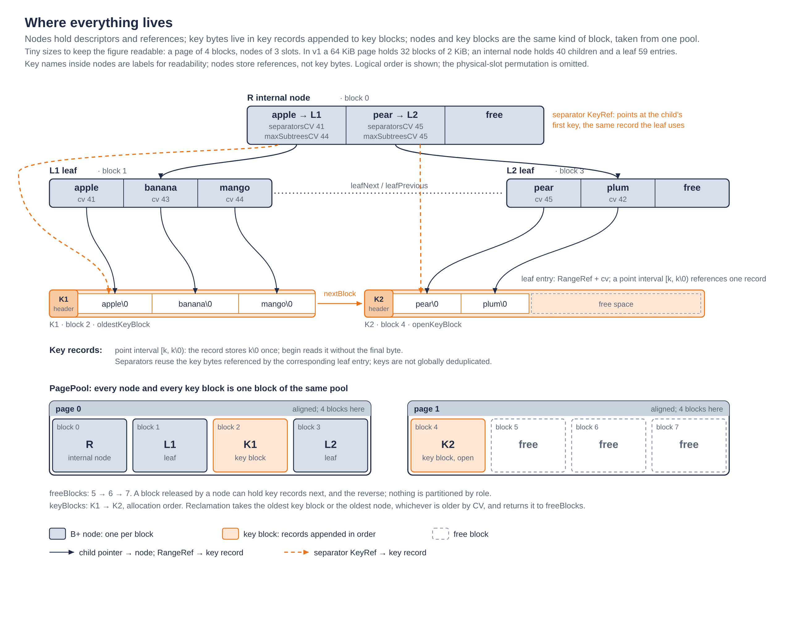
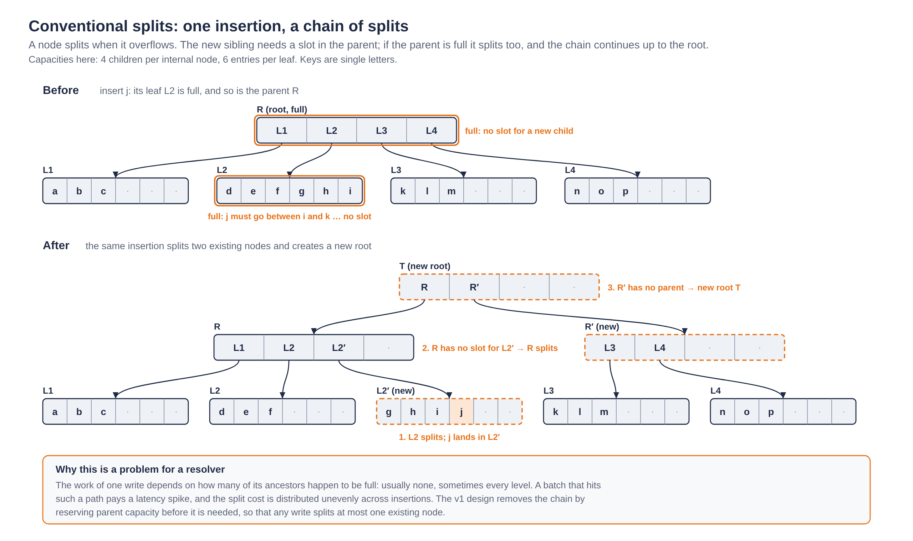
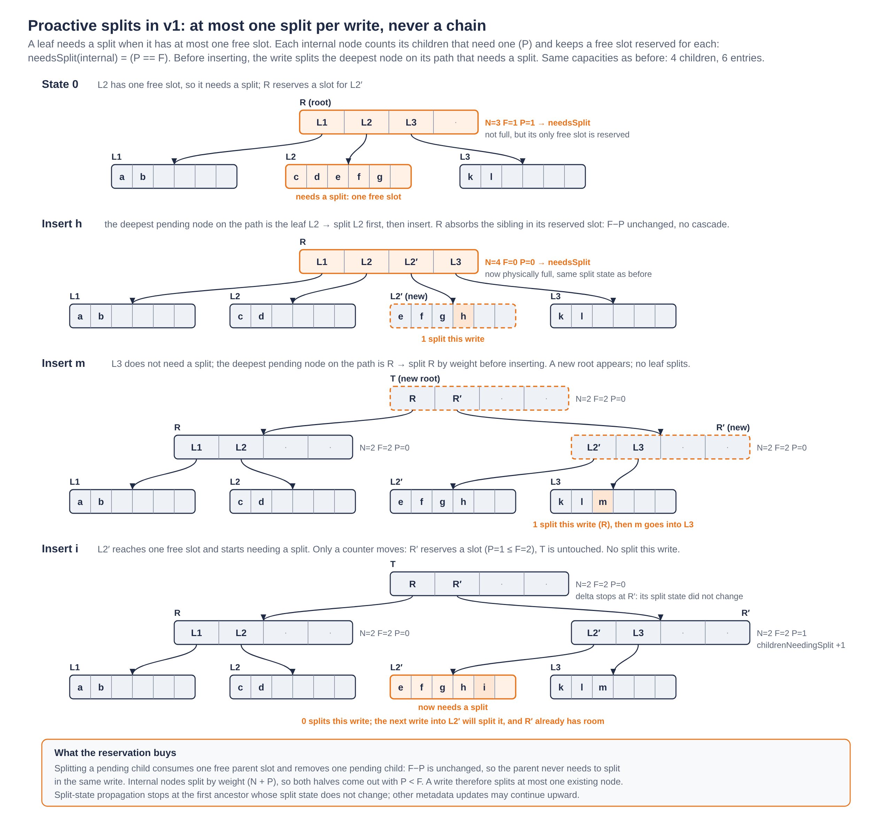
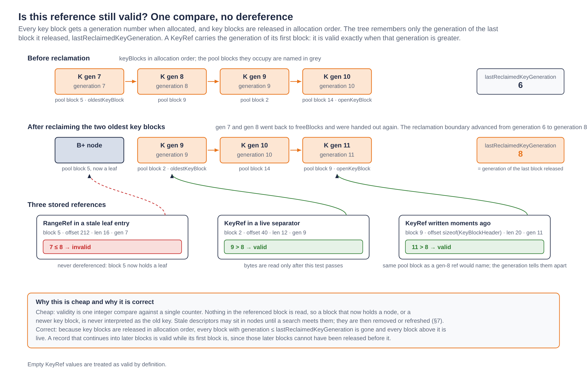

# Temporal conflict B+ tree · Resolver v1 design

[Documentation index](README.md) · [Evidence register](07-evidence-and-validation.md)

## What the resolver does

A transaction reads at a database version and, when attempting to commit, declares its read- and write-conflict ranges. The resolver checks whether writes committed after its read version overlap the ranges it declares as read. If they do, the transaction is marked conflicting and cannot commit on the basis of that read snapshot.

The resolver's history does not contain database values. It records **which regions of the key space have been written and at which commit versions**. For an admitted read at version RV, finding an overlapping write interval with CV greater than RV establishes a conflict. When a new write overlaps a write interval already stored in the history, the resolver updates the overlapping portion to the new commit version and preserves the portions outside the write with their original versions. Read-conflict checks then search this history for overlapping writes committed after the transaction’s read version.

The two kinds of ranges translate into different operations on the underlying data structure:

| Input | Operation on conflict history |
|---|---|
| Write-conflict ranges from accepted transactions | Materialize them by modifying the structure: insert new coverage and replace or trim existing coverage |
| Read-conflict ranges | Turn them into range queries: search for overlapping writes newer than the read version |

Reads are not inserted as entries in write history. Checking reads and materializing accepted writes remain separate operations. 

## Materializing writes: interiors and exteriors

Writes from different transactions and versions may overlap. The history maintains an ordered representation of disjoint intervals, associating each covered region with its most recent relevant write version. **The semantic rule is the same as in the skip-list resolver:** overlay a new write on existing history, identify the intersection, and preserve what lies outside it. The structure used to represent and update the boundaries changes; the meaning of the update does not.

Relative to a new write, the **interior** of an old interval is the portion covered by that write. Its **exteriors** are the portions outside the write, which must retain their old versions. There may be a left exterior, a right exterior, both, or neither. These terms describe overlap with the write; they are unrelated to internal tree nodes.

For example, suppose history contains `[10,90)` at CV 100 and a new write covers `[30,60)` at CV 120. Numeric keys are used for readability; the implementation orders keys lexicographically.

| Part of the old interval | Range | Treatment |
|---|---|---|
| Left exterior | `[10,30)` | Preserve at CV 100 |
| Interior: intersection with the new write | `[30,60)` | Covered by the new write at CV 120 |
| Right exterior | `[60,90)` | Preserve at CV 100 |

The materialized result is **`[10,30)@100`, `[30,60)@120`, `[60,90)@100`**. Assigning CV 120 to the entire old interval could introduce false conflicts on the exteriors; keeping CV 100 on the interior could miss a real conflict.

When a write spans several old intervals, fully covered entries are removed and the surviving exteriors at its boundaries are preserved:

| State | Intervals |
|---|---|
| Before | `[10,40)@100`, `[50,90)@110` |
| New write | `[30,60)@120` |
| After | `[10,30)@100`, `[30,60)@120`, `[60,90)@110` |

The new write also covers the former gap `[40,50)`. Materialization therefore does not merely store intersections with existing entries: it represents **the entire new write**, preserving only the old portions outside it. The possibility of two exteriors explains why insertion may need space for the new write and an additional right exterior. Section 9 develops the algorithm.

## Checking reads: range searches

A read interval becomes an overlap query against history. Using the first example above, a transaction at RV 110 reading `[20,70)` encounters regions at CV 100, 120 and 100. The CV 120 region is sufficient to establish a conflict. Reading only `[10,30)` would not conflict with those writes: CV 100 is not newer than RV 110, and endpoint 30 is excluded.

The query must consider both writes beginning inside the read interval and a write beginning before it but extending into it. Locating the read's start is therefore not sufficient: the possible predecessor must also be checked, followed by candidates up to the end of the range or an early conflict.

In a tree, **a read interval may span several leaves, covering regions reached through different root-to-leaf paths**. It is not necessarily a point lookup resolved entirely in the first leaf. An implementation could descend through the affected subtrees. V1 reaches those regions by locating the start with a descent and then scanning through linked leaves, checking the predecessor at the begin of the interval.

This separates the query's logical extent from its physical traversal: a read can visit multiple leaves without restarting at the root for each one. The scan stops as soon as an overlap with CV greater than RV is found. Otherwise, it examines the required candidates up to the read boundary. Section 8 explains the exact conditions and how expired keys are avoided.

## Overall approach: a B+ tree for a longer conflict history

Resolver v1 uses a **temporal B+ tree** to represent write-conflict history. Its goal is to retain more history within a fixed memory budget while providing an efficient foundation for checking batches of read ranges. Leaves hold ranges and their commit versions; internal nodes locate the relevant part of history by key.

The reference structure is FDB's skip list. The expectation behind the B+ tree is to **group many entries and navigation decisions in each node**, amortizing metadata and index accesses. Higher fanout allows a shallower structure, and block organization offers opportunities for locality and reuse across searches. The goal is not to change logarithmic key-search complexity, but to improve practical behavior and the amount of history that fits in memory.

These expectations have costs. A B+ tree requires in-node searches and maintenance of splits, separators and occupancy. In this design, key bytes also live outside the nodes. Fewer levels therefore do not automatically imply fewer memory stalls or higher speed than the skip list. Retention and resolution time are separate measured outcomes.

| Aspect | B+ tree design expectation | Cost or condition to evaluate |
|---|---|---|
| Memory per entry | Amortize headers and links over multiple entries | Depends on actual occupancy and reference sizes |
| Navigation | Reduce levels through higher fanout | In-node comparisons access external keys |
| Locality | Reuse nodes containing nearby entries | Their key bytes need not be adjacent or already cached |
| Reclamation | Release blocks and subtrees instead of searching separately for every expired entry | References and separators must remain safe |
| Batch processing | Use independent searches to anticipate accesses | Grouped traversal is a subsequent version, not a v1 feature |

V1 is the sequential foundation of this architecture. Its representation already anticipates a later grouped-read implementation with selective prefetch. The [evaluation](06-evaluation.md) measures the resulting trade-off: substantially greater retention under the same counted-history budget, at a higher execution cost than FDB's skip list.

## Principal design decisions

### Separate nodes from key bytes

Nodes hold index structure, versions, and references to ranges or separators. Key bytes reside in separate record blocks. Node size and capacity therefore do not depend directly on the lengths of their keys: a long key does not enlarge each entry descriptor.

This separation also decouples index order from key-record placement. Bytes are appended sequentially; the tree orders references. Splitting a node moves descriptors without copying all the key bytes they reference.

**The separation is one of representation, not memory budgets:** both block types come from the same pool. Figure 1 shows a small tree, the key records its entries and separators reference, and the pool blocks that hold both.



*Figure 1. Nodes hold descriptors and references; key bytes live in key records appended to key blocks; both kinds of block come from one pool. Separators reference the same record as the first entry of their child.*

### Reference separator keys instead of storing an inline prefix

An internal separator references the key representing its child's minimum. It stores neither a copy of that key nor an inline prefix of its bytes. Conceptually it is a pointer to the key; the implementation uses a `KeyRef` containing a block pointer, offset, length and generation.

The motivation is **to reduce overhead** by avoiding reserved and duplicated prefix bytes in every separator. The same key can represent minima at several levels, with those occurrences reusing its stored bytes. Relative to adding an inline prefix alongside the reference, this avoids that extra space; it does not claim that `KeyRef` is smaller than every possible alternative representation.

The trade-off is explicit: comparing a separator generally requires accessing external bytes. An inline prefix could resolve some comparisons within the node. Omitting it means addressing that additional latency. Reference size, prefix savings and external accesses must be evaluated together.

### Avoid cascading splits through proactive split preparation

An insertion into a conventional B+ tree can trigger a leaf split followed by splits all the way up to the root. The structural work of an individual insertion therefore depends on how many ancestors are also full, causing latency spikes and distributing split costs unevenly across insertions. Figure 2 shows one such insertion.



*Figure 2. Conventional splits. Inserting j into a full leaf under a full root splits the leaf, then the root, and creates a new root: the work of one insertion depends on how many of its ancestors are full.*

To make this work more predictable and distribute it more evenly (at most one split per insert), the tree prepares for splits proactively using the `needsSplit` predicate. A leaf needs splitting when it has at most one free slot, since a write may insert both a new interval and a surviving right exterior. Each internal node tracks how many of its immediate children need splitting through `childrenNeedingSplit`. The internal node itself needs splitting when that count equals its number of free slots: all remaining capacity is already reserved for those potential child splits.

Before inserting a write, the tree splits the deepest node on the search path that satisfies `needsSplit`, if any. Splitting a child consumes one reserved parent slot and removes one pending child split, leaving the parent's balance between free slots and reservations unchanged. This allows each write to split at most one existing node, avoiding a cascade of structural splits within the same insertion.

During descent, the search records internal nodes that need splitting. After cleanup, it selects the deepest node that still needs a split, giving priority to the leaf. Splitting a child consumes one free slot in its parent but also removes one child from the parent's pending-split count. The parent's own split status therefore remains unchanged, avoiding a cascade.

This mechanism makes split work more predictable by preparing capacity before it is exhausted. It does not make the entire write constant-time: key copying, overlap removal, cleanup and reclamation still depend on the affected data. Figure 3 follows three writes through the mechanism, with `F`, `P` and `needsSplit` at each internal node.



*Figure 3. Proactive splits. A pending leaf is split before the write that targets it; the parent absorbs the sibling in a reserved slot and its split state is unchanged. The parent is split by a later write, before it is full of demand, and a leaf that starts needing a split only moves a counter.*

### Minimize update overhead with slot permutations and a free-slot bitmap

Entries occupy physical slots within each node, while an `order` array represents their logical key order. Each element of `order` is a one-byte slot index. Inserting or deleting an entry therefore shifts bytes in this array rather than moving complete entry descriptors.

A bitmap tracks free physical slots. Insertion selects a free slot, writes the new entry there, and inserts its index into `order`. Deletion removes the index from `order` and marks the slot free, without compacting the remaining entries. Subsequent insertions can reuse that slot.

Together, the permutation array and bitmap keep surviving entries in place during ordinary insertions and deletions, reducing data movement. Splits still move entries between nodes. Figure 4 compares the bytes moved by an insertion and a deletion with those of a sorted descriptor array.

![Insertion and deletion in a node: a sorted descriptor array shifts whole 32-byte descriptors, while v1 shifts one-byte slot indices in order[] and leaves descriptors in their physical slots.](figs/fig-order-bytes.png)

*Figure 4. What moves on an insertion or a deletion. A sorted array shifts descriptors of 32 bytes; v1 writes the new descriptor into a free slot and shifts one-byte indices in `order[]`, leaving every surviving descriptor in place.*

### Prepare for grouped traversal and selective prefetch

The separation also anticipates the next version: keep several searches in flight, determine which keys each needs to compare, and prefetch those keys while advancing other searches in the group.

The intent is to **overlap external-key latency with useful work on other reads**, without allocating prefixes in every separator whether needed or not. The traversal anticipates the keys it will use; it need not copy keys into nodes or fetch every key referenced by every visited node.

V1 processes reads individually. This motivation explains the intended evolution; it does not attribute the subsequent grouped implementation or its measured improvements to v1. Nor does it guarantee hiding all latency: prefetch distance, dependencies, keys actually compared and available bandwidth matter.

### One shared physical storage pool for keys and nodes

A single memory pool, organized into reusable pages and blocks, holds both nodes and key records. The classes separate responsibilities over that common storage:

| Element | Responsibility | Relationship to memory |
|---|---|---|
| `PagePool` | Maintain pages, free blocks and the budget | The common physical pool |
| `KeyStore` | Manage key records, references, comparisons and key-block reclamation | Uses blocks from the common pool |
| `BNodeStore` | Manage nodes, slots, local operations and age tracking | Uses blocks from the same pool |
| `TempConflictBTree` | Coordinate searches, writes, topology and reclamation | Combines both forms of management under the shared budget |

There is no fixed quota for either data type. A block released by a node can hold keys next, and vice versa. `KeyStore` and `BNodeStore` name specialized managers, not independent physical memory reservations. Section 2 explains allocation in detail.

### Separate logical order, version and physical lifetime

Within a node, descriptors occupy slots and a small array expresses key order. Order can change without moving every descriptor. Versions determine which history remains relevant; generations identify references to reclaimed blocks. These are distinct concerns: an expired entry's bytes do not necessarily disappear immediately.

Reclamation coordinates all three. It must recover memory without comparing freed keys, preserve correct navigation, and maintain the semantics of admitted reads. The following sections develop the invariants and algorithms.

### Keep point intervals compact by sharing endpoint bytes

Point writes should not pay for two copies of the same key. FDB's resolver skip list represents an isolated point interval `[k, k\0)` with separate boundary nodes for `k` and `k\0`, duplicating the bytes of `k`. Resolver v1 instead represents the interval with one leaf entry and shares the stored bytes between its begin and end keys.

The goal is to retain the general half-open range model while avoiding this redundancy for points. The record stores `k\0` once; the begin key is its prefix `k`. This reduces endpoint storage for point intervals, leaving more of the shared memory budget available for retained history. Section 4 explains the encoding and its byte savings.

## Organization of the technical detail

After the resolver's role, write materialization, read queries and overall decisions, this document describes the semantic contract, physical representation, invariants and operations. The rationale for separating key bytes, omitting inline prefixes and planning grouped reads connects these mechanisms to the overall design.

## 1. Semantic contract

The tree stores retained write-conflict intervals in lexicographic key order. Intervals are half-open, `[begin,end)`, and live entries are disjoint. Each entry has a commit version, CV. A read at version RV conflicts when it overlaps an entry whose CV is greater than RV. 

The logical representation retains the relevant most recent write information per covered key range, not every historical write as a separate overlapping record. Accepted writes arrive sorted and disjoint within a call, share the same CV, and use nondecreasing CVs across calls. Replacing an overlap with the new CV is valid under that contract; portions outside the write retain their previous CV.

The caller must reject reads older than the retained-history boundary before `checkReads`. The code assumes no reclamation while key bytes are in use. 

## 2. Shared pool, responsibilities and allocation

`TempConflictBTree` owns the common physical pool (`PagePool`), the key manager (`KeyStore`), the node manager (`BNodeStore`), the root pointer, and `reclaimCV_`. Both managers obtain blocks from the same pool; they are not independent physical stores. `BNodeStore` also uses `KeyStore` to compare referenced keys. The tree coordinates topology and reclamation; each manager implements local operations for its data type.

`common.h` fixes `PageSize = 64 * KiB` and `BlockSize = 2 * KiB`. A page contains 32 blocks. `Page` is aligned to the page size; its size is statically checked. The pool allocates `floor(budget / PageSize)` pages and initializes an intrusive free-block list. Allocation pops its head; release puts a `FreeBlock` record in the freed storage and pushes it back. Both are constant-time local list operations.

A block can be reused for either a node or key records. There is no fixed partition between those uses. The pool's `allocatedBytes()` counts page storage; it does not measure total process memory, allocator bookkeeping, or transient vectors. The tree uses a path vector during search and `KeyStore` uses a vector during append, so “shared bounded pool” must not be misrepresented as “no allocations outside the pool.”

## 3. Node layout and ordering

`BNodeHeader` contains a generation, conservative `maxCV`, intrusive age-list links, parent pointer, node kind, count, parent slot, and `childrenNeedingSplit`. Counts and slots are represented with 8-bit fields; capacity calculation caps a node at 255 slots.

| Internal node | Leaf |
|---|---|
| `maxSubtreesCV[]` | `cv[]` |
| `separatorsCV[]` | `ranges[]` of `RangeRef` |
| `separators[]` of `KeyRef` | Left/right leaf links |
| `children[]` | Free-slot bitmap |
| Free-slot bitmap and `order[]` | `order[]` |

`order[rank]` maps logical sorted position to physical slot. Insertions allocate the lowest free slot and shift only the order array; deletion shifts that array and marks the physical slot free. Surviving descriptors stay in place during these local operations. Splits do move descriptors to a different node.
For example, suppose a node contains keys `10`, `30`, and `50` in physical slots `2`, `0`, and `4`:

| Logical rank | `order[rank]` | Key |
|---|---|---|
| 0 | 2 | 10 |
| 1 | 0 | 30 |
| 2 | 4 | 50 |

To insert key `20`, the node allocates slot `1`, the lowest free slot, and inserts its slot number at logical rank `1`. The order array changes from `[2, 0, 4]` to `[2, 1, 0, 4]`. The existing entries remain in slots `2`, `0`, and `4`.
Deleting key `30` then removes slot number `0` from the order array, leaving `[2, 1, 4]`, and marks physical slot `0` free. The remaining keys—`10`, `20`, and `50`—stay in their physical slots.

`FreeSlots<C>` uses one 64-bit word for capacities up to 64 and multiple words for larger capacities. It uses population count and count-trailing-zero operations for counts and allocation. The layouts are chosen by a compile-time search for the largest capacity whose `sizeof` fits the block. The 2 KiB campaign configuration supports 40 children and 59 leaf entries. These capacities are ABI-dependent layout results, not universal mathematical constants.

`parentSlot` names a physical slot, not a rank. Reordering `order` does not change that slot. `parentRank()` scans the parent's order array to recover the logical rank; it is not an O(1) rank lookup. Moved children have their parent and parent slot updated during splitting.

## 4. Key and range storage

`KeyBlockHeader` carries `nextBlock`, a generation and `maxCV`. Records append sequentially into the open block, continuing through linked blocks when necessary. Logical record bytes skip block headers; physical address arithmetic alone cannot locate a distant byte across a block boundary.

`KeyRef` holds a first-block pointer, 16-bit offset and length, and a generation. `RangeRef` holds a first-block pointer, offset, begin length, end start, end length and generation; a compile-time assertion fixes its size at 24 bytes.

For a general range, begin bytes are followed by end bytes in the logical record stream. A point range `[k,k\0)` stores only the bytes of its end: the begin is the prefix of that same record, and `endStart` is zero. Both endpoint references therefore address the same starting byte, with different lengths.

For example, the point interval `["abc", "abc\0")` has the following encoding:

| Field | Value |
|---|---|
| Stored record bytes | `61 62 63 00` (hexadecimal) |
| Begin length | 3 bytes |
| End start | 0 bytes from the record start |
| End length | 4 bytes |

The begin key reads the first three bytes; the end key reads all four. The record contains one copy of `abc`, not two.

This realizes the point-efficiency decision introduced above. For a point key of length `L`, separate copies of the two endpoints require `2L + 1` key bytes; the shared representation requires only `L + 1`, saving `L` bytes per point interval. A 16-byte key therefore needs 17 endpoint bytes instead of 33. The interval also occupies one leaf descriptor, whereas an isolated point in FDB's skip-list history uses separate begin and end boundary nodes.

These figures compare endpoint payloads, not total memory: descriptors, block headers, node occupancy and allocation slack must also be counted. Existing boundaries and merged intervals can change the number of skip-list nodes required. Point endpoints share a single stored payload.

Append first computes the number of blocks required and allocates all required new blocks before modifying existing key storage. Failure returns the new allocations and reports `nullopt`. Copying accepts either external contiguous bytes or an existing stored key, traversing block links as necessary. Each touched block raises its maximum CV to include the record's supplied CV. A full block may be followed by a newly allocated empty open block when space permits.

Comparisons use `memcmp` on available chunks, continuing through linked blocks only when needed. Equal prefixes are ordered by total length. `locate` walks the record stream, skipping headers, to find the end key's start. References need not imply contiguous physical storage for the whole key.

## 5. Lifetime and generation checks

Key blocks are reclaimed in allocation order. `lastReclaimedKeyGeneration_` records the generation of the most recently released block. A nonempty key reference is valid when its recorded generation exceeds that boundary. A range uses the same generation test. Empty `KeyRef` values are treated specially as valid.

This test does not dereference the potentially reused block. Figure 5 shows it on three stored references after a reclamation. Reclamation order matters: while the first block of a record remains live, later continuation blocks cannot have been reclaimed ahead of it. Once the first block is reclaimed, the record is invalid even if some later bytes remain allocated.



*Figure 5. Validating a reference after reclamation. Key blocks are released in allocation order, so one counter bounds every released block; a reference whose generation is at or below it is invalid and is never dereferenced, even when its pool block has been reused.*

Age and physical lifetime are related but different. An entry can be logically expired even while its bytes are still allocated. A key block may contain several records and is governed by its maximum CV. The tree checks entry or separator CV before accessing bytes that could have been reclaimed.

## 6. Structural and temporal invariants

| Invariant | Why it matters |
|---|---|
| Live leaf entries are ordered and disjoint | A predecessor plus a forward scan suffices for overlap checking |
| Every live rank maps to an occupied physical slot | Order-array navigation and bitmap allocation agree |
| Each child points back to the correct parent slot | Upward propagation and removal locate the right descriptor |
| Each internal node has at least as many free slots as children needing a split | Every pending child split has a reserved parent slot |
| Leaf links follow global key order | Range scans and cross-leaf exterior handling remain correct |
| Separators represent child minima after required refresh | Descent selects the correct child |
| Expired separators are refreshed before comparison in v1 | Reclaimed key bytes are not compared |
| Node/subtree maximum CVs are conservative upper bounds | Removing an old subtree cannot discard newer entries than its bound |
| `reclaimCV_` never decreases | Previously discarded history is never advertised as restored |
| Only the root leaf may remain empty at an operation boundary | Neighbor traversal may assume nonempty linked leaves |
| No reclamation occurs while a stored key is being accessed | References used within an operation remain safe |

Separators can be stale between cleanup points. Their CV is the CV associated with their referenced minimum, not the commit that happened to promote that key during a split. Node allocation CV and node maximum CV serve a different, conservative accounting role.

## 7. Search and cleanup on descent

`findKey` descends from the root. Before searching an internal node it calls `refreshSeparators`, which visits all logical ranks in that node. An expired separator is refreshed recursively from its child; a leaf child is cleaned by removing expired entries, and an empty child is removed. If a removal exposes another child at the same rank, the iteration rechecks that rank.

After refresh, binary search returns an exact match or an insertion rank. For an inexact internal search, the preceding child is selected when the rank is positive. At the leaf, expired entries are cleaned and a binary search finds the position of the requested begin key.

The descent records internal nodes needing splits. After cleanup, `findSplitCandidate` prefers the leaf if it needs a split; otherwise it revisits recorded candidates from deepest to shallowest because cleanup may have changed their status.

`hasConflict` calls `findKey`, which cleans expired entries and can remove empty nodes during descent. Reads therefore may modify the physical structure through cleanup, but they do not add logical write history or invoke the pressure-reclamation loop.

## 8. Read-conflict checking

`checkReads` handles each input range individually. It skips a transaction whose status is already conflicting and does not clear an existing conflict flag. This API is a status-only sequential path; it is not by itself the full native FDB conflict-report adapter.

`hasConflict` locates the begin key. If no leaf exists it returns false. On an inexact match it examines the predecessor, potentially in the previous leaf. That predecessor conflicts if its CV exceeds the read version and its end is greater than the read begin. CV is tested first so an expired key is not accessed.

It then scans candidate entries in key order. Entries at or below `reclaimCV_` are skipped without reading their keys. The scan ends when a live entry's begin is at or beyond the read end. A live overlapping entry with CV greater than the read version returns conflict immediately; exhausting candidates returns false.

V1 performs sequential read searches without grouped scheduling or explicit prefetch. A scan may cross multiple leaves, and its cost depends on the number of candidate entries.

## 9. Write processing and exterior preservation

`addWrites` calls `addWrite` for each sorted disjoint input range. `addWrite` asks reclamation for a reserve of 35 blocks, finds the insertion location, splits a selected candidate if necessary, then appends the new range bytes. The reserve is an implementation constant sized for the key copies an update can require.

The write is inserted in the leaf prepared by `findKey`. A predecessor may reside in that leaf or its left neighbor. If it overlaps the write begin, the left exterior is copied with its original CV and replaces the predecessor's range reference. If the write ends strictly inside that predecessor, a right exterior is also copied with the original CV and inserted immediately after the new write in the prepared leaf.

Otherwise, after insertion, covered entries are erased moving forward. Expired entries are erased without reading their keys. The first partially covered survivor is trimmed to `[newEnd,oldEnd)` and keeps its old CV. If that changes the first entry, the separator is propagated upward.

Example: `[a,z)@10` plus `[c,g)@20` yields `[a,c)@10`, `[c,g)@20`, `[g,z)@10`. A later version is not assigned to surviving exteriors merely because their bytes were copied now. Their block's maximum CV still safely accounts for whatever records it contains.

An expired predecessor is removed after inserting the new write, avoiding a transient empty target that could invalidate the insertion position. Deletion helpers return a meaningful next position, which may be in the right neighbor or at the end of the last leaf.

## 10. Proactive split preparation and execution

### 10.1 Reserve capacity before a node overflows

The mechanism avoids a structural split cascade by tracking future demand for parent slots. `needsSplit` is a predicate computed from node state, rather than an independent flag. For a leaf it is:

```cpp
needsSplit(leaf) = (leaf->freeSlotCount() <= 1)
```

A write may add two entries to the prepared leaf: the new write interval and a surviving right exterior. Two free slots are therefore sufficient to perform the write without splitting during insertion. The resulting leaf may need a split for a future write; that transition is recorded immediately.

For an internal node, let `C` be its capacity, `N` its child count, `F = C - N` its free-slot count, and `P = childrenNeedingSplit` the number of immediate children for which `needsSplit` is true. The capacity invariant is:

```text
P <= F
needsSplit(internal) = (P == F)
```

Each pending child split reserves one parent slot. Equality means that every free slot is reserved, not necessarily that the node is physically full. This is the proactive threshold: splitting the internal node restores room before additional demand can exceed its capacity.

### 10.2 Select one split on the write's search path

`findKey` records internal nodes satisfying `needsSplit` as it descends. After cleaning the destination leaf, `findSplitCandidate` selects:

1. The leaf, if it needs a split.
2. Otherwise, the deepest recorded internal node that still needs a split.
3. No node if neither condition holds.

Candidates are checked again because cleanup can remove entries or children and release reserved capacity. `addWrite` then splits the selected node before inserting the write. If the selected node is internal, the destination leaf already has at least two free slots; splitting the internal node changes its ancestry, not the insertion position within the leaf.

Only one existing node is split by this preparation step for each `addWrite`, not one per level. Splitting the root additionally creates a new root. Searches performed for read checks do not execute this write-side split step.

### 10.3 Why a child split does not force its parent to split

The selected node already contributes one unit to its parent's `childrenNeedingSplit`. Splitting it creates two children that do not need splitting. Installing the new sibling consumes one free slot and removes the original child's pending-split contribution:

```text
F' = F - 1
P' = P - 1
F' - P' = F - P
```

The parent's spare capacity relative to reserved demand is unchanged. If `P == F` before the child split, equality remains true afterwards; if `P < F`, it remains strict. Consequently, the child split does not trigger a new split-state transition in the parent and requires no cascading structural split. Because the selected child was counted, `P >= 1`; the invariant guarantees the parent has at least one free slot for its new sibling.

A parent's split state may still change later when the write makes another child need splitting. That change propagates as metadata, not as an immediate chain of node splits. Choosing the deepest pending node means that the nodes below a selected internal candidate were not themselves pending after cleanup. Its split restores slack before the current insertion can propagate new demand upward.

### 10.4 Maintain the counters on state transitions

`propagateUpdates` carries a `splitDelta` of `+1` when a node changes from not needing a split to needing one, and `-1` for the reverse transition. Its parent adjusts `childrenNeedingSplit` and recomputes its own predicate. The delta continues to the next ancestor only if the parent's split state also changes.

Inserting an entry can raise the leaf's split demand. Deletion or cleanup can lower it. Removing a child also frees a parent slot and removes its pending contribution when applicable. Moving children during an internal split redistributes their pending counts between the two halves.

This bookkeeping may traverse ancestors, but it does not split those ancestors. The structural split and propagation of split-state changes are distinct operations.

### 10.5 Split the selected node while preserving reservations

A leaf splits at half its entry count. The upper half moves into a new leaf, neighbor links are repaired, and the caller's leaf/rank pair is adjusted. A missing key exactly at the cut rank remains at the end of the old leaf because it is below the new leaf's first key. An exact key at the cut rank moves with that entry. Both halves have enough free capacity to stop needing a split.

An internal node is split by **weight**, rather than child count alone. A child that needs splitting has weight two: one slot for itself and one reserved slot for its future sibling. Other children have weight one. Thus total weight is:

```text
W = N + P
```

At the proactive threshold, `P = C - N`, so `W = C`. The implementation chooses a prefix reaching approximately half the weight and moves the remaining children into a new internal node. Balancing this weight distributes both current occupancy and pending growth. In the supported layout, each half is left with `N + P < C`, equivalently `P < F`, so neither half needs splitting.

Moved children receive the new parent pointer and physical `parentSlot`. Their subtree bounds and separators move with them, and `childrenNeedingSplit` is redistributed. `insertSibling` installs the new sibling immediately after the old node. If the old node had no parent, a new root is created containing both minima. Otherwise, the parent consumes the reserved slot as described above.

### 10.6 Example: absorb a leaf split, then split its parent proactively

For readability, consider internal nodes with capacity **8 children**. These are illustrative capacities, not the 40-child capacity of the v1 build. Suppose internal node `A` contains six leaf children, two of which need splitting. `A` therefore has two free slots and two pending child splits: it already satisfies `needsSplit`, although it is not full.

Assume `A` has a parent `R` with capacity eight, five children, and no pending child other than `A`. Its state is `F = 3`, `P = 1`.

A write targets a pending leaf under `A`. Both `A` and the leaf are candidates, but the leaf is deeper and is selected. Its split creates a sibling that fits in a reserved slot of `A`:

| State of `A` | Children `N` | Free slots `F` | Pending children `P` | `needsSplit(A)` |
|---|---:|---:|---:|---|
| Before splitting the leaf | 6 | 2 | 2 | true |
| After installing the leaf's sibling | 7 | 1 | 1 | true |

`A` gains a child but remains in the same split state. `R` still counts `A` once. Neither internal node is split by that write. Assume the resulting leaf remains below its split threshold after insertion.

A later write targets a different leaf under `A` that has at least two free slots. That leaf does not need splitting, so `A` is now the deepest pending candidate. Its seven children include one pending child, giving total weight `7 + 1 = 8`.

For example, let the child weights in key order be `[1, 1, 2, 1, 1, 1, 1]`. The split cuts after the third child, producing:

| Half | Children `N` | Pending children `P` | Weight `N + P` | Free slots `F` | Needs split? |
|---|---:|---:|---:|---:|---|
| Original `A` | 3 | 1 | 4 | 5 | no |
| New sibling | 4 | 0 | 4 | 4 | no |

Installing the sibling changes `R` from five to six children. Its free slots decrease from three to two, while its pending count decreases from one to zero. Its spare capacity `F - P` stays at two. The internal split has again been absorbed without splitting the parent, and the current write can proceed in its already prepared leaf.

The two writes perform a leaf split and an internal split at different times instead of forcing both into one insertion. This example also shows why a node can remain marked by `needsSplit` after absorbing a child split: its existing reservations remain valid until a later write selects it for proactive preparation.

### 10.7 Scope of the predictability guarantee

The mechanism bounds the number of existing nodes structurally split by the preparation step of an individual `addWrite` to one, under the maintained invariants. A batch can contain many writes and therefore many such steps. Creating a root, moving entries within the selected split, and propagating metadata still require work.

It does not make the entire write constant-time or give a fixed latency bound: key copying, overlap removal, cleanup and reclamation depend on the affected data. The specific source of unpredictability removed here is the chain of structural splits caused by overflowing successively higher ancestors.

## 11. Propagating changes upward

`propagateUpdates` combines three independent effects in one ascent:

- A split-status delta changes `childrenNeedingSplit`; it continues only while an ancestor changes split status.
- A new minimum updates the parent's separator and its CV; it continues only while the affected child is the first child.
- A larger node maximum updates the parent's subtree bound and, if needed, raises the parent's own maximum and age-list position.

The minimum key and its CV are obtained once for separator propagation. Repetition along a first-child chain reuses that same reference. No additional reverse pointer in key records is needed for this ascent: parent and parent-slot links already exist.

## 12. Deletion and root normalization

Removing a leaf entry updates split state and, when appropriate, its minimum. An emptied nonroot leaf is unlinked and released; ancestors left empty are removed. The root is normalized: an empty root is released, and an internal root with one child is replaced by that child.

Removing an internal child detaches the subtree's contiguous run of leaves from the global leaf chain. The detached root loses its parent link. The subtree can then be released recursively, children first. This is bulk detachment, not constant-time physical release: releasing a subtree still visits its nodes.

The tree does not redistribute entries between siblings or merge partially filled nodes. It removes empty nodes and normalizes the root. Node occupancy under repeated insertions and deletions therefore depends on the workload; the tree does not enforce the minimum occupancy guaranteed by conventional B-tree rebalancing.

## 13. Age tracking and pressure reclamation

Nodes belong to an intrusive age list ordered by their conservative maximum CV. Allocation appends at a nondecreasing CV. Raising a node's maximum moves it to the tail unless already there. Deletions do not lower maxima. This avoids recomputing exact ages after every deletion but may delay reclamation of an otherwise old subtree.

`reclaimOldest` considers the oldest key block and the oldest node, chooses the smaller available CV, and raises `reclaimCV_` with `max(previousCut,chosenCV)`. It removes nodes at the chosen age, including their subtrees, and releases key blocks at that age. The cutoff remains monotone even when a later-allocated key block contains only older copied exteriors.

`reclaimUntilAvail(n)` repeats until enough free blocks exist or nothing remains reclaimable. Logical expiry can leave descriptors in surviving nodes whose keys have already gone; version checks and refresh prevent those descriptors from being used unsafely.

The policy discards history to satisfy a local budget. Integration with a protected distributed minRV is a separate contract, not a feature demonstrated by this local cutoff alone.

## 14. Costs, limits and review targets

Binary search within a node performs logarithmic key comparisons; each comparison can traverse multiple key blocks. Descent cost includes separator refresh and local cleanup. Range reads add the scanned entries. Writes add copied key bytes, covered entries removed, and structural work. Reclamation can release whole subtrees and is not bounded to one node.

The design trades pointer-dependent external key accesses for compact reusable node blocks and append-oriented key storage. Conservative ages trade prompt reclamation for cheaper metadata maintenance. Rank arrays trade a small indirection and order-array shifts for stable physical slots.

Allocation reserve sufficiency remains a validation target for maximum-length keys and small pools. The [evidence register](07-evidence-and-validation.md) separates campaign validation from remaining coverage requirements.


## Snapshot identity and source scope

**Scope:** sequential resolver v1, 2 KiB blocks. Resolver campaign revision `aff127286e68ea7933dc9ef502a7dbd760e1e43d`.
