# Temporal conflict B+ tree · Resolver v2 design

Resolver v2 checks read-conflict ranges in groups, sharing tree navigation among sorted reads and overlapping memory accesses through software prefetching. It retains v1's range representation, write application, proactive splitting and history reclamation.

The [project architecture](02-project-architecture.md) explains how the tree fits into FoundationDB's resolver and how conflict-history retention relates to transaction admission.

## Objective

The tree must keep write-conflict history within a fixed pool budget while checking read batches efficiently. V2 reduces repeated searches by routing nearby reads together and interleaving independent tasks.

Grouped checks must produce the same conflict decisions as a sequential scan of retained history, including half-open boundaries, transaction-level early rejection and optional reporting of every conflicting read. Correctness is independent of whether a prefetch completes before the data is needed.

## Background

A resolver stores conflict history, not database values. A read at version RV conflicts if a retained write `[wb,we)` at CV satisfies:

`read.begin < we && wb < read.end && CV > RV`.

History represents disjoint write intervals with their relevant commit versions. Overlaying `[30,60)@120` on `[10,90)@100` produces `[10,30)@100`, `[30,60)@120`, `[60,90)@100`. The two exteriors retain their original CV. Reads can overlap one another, have equal begins, and extend across arbitrarily many leaves; their ends need not be sorted.

V1 checks one read at a time using a root descent, an in-leaf search, a possible predecessor, and a forward leaf scan. V2 partitions a sorted sequence of read begins among children, shares work on nearby reads, and interleaves task continuations. Accepted writes are still materialized individually through `addWrite`.

Older snapshot reads require both resolver conflict history and the corresponding data versions on Storage Servers. Transaction admission and version protection must coordinate retention across those components.

## Requirements and contract

| Requirement | V2 behavior |
|---|---|
| Half-open intervals | Equality at either excluded boundary does not establish overlap |
| Temporal predicate | Only a write with CV strictly greater than RV conflicts |
| History cutoff | A read with RV below `reclaimCV_` marks its transaction too old; RV equal to the cutoff is admissible |
| Existing transaction status | Existing conflict flags are never cleared |
| Optional complete reporting | Other reads of a conflicted transaction remain eligible when their reporting pointer is non-null |
| Individual read completion | Once its conflict bit is set, that read needs no further checking |
| Stable batch view | Writes and key-block reclamation do not interleave with an active `checkReads` call |
| Cursor safety | Leaf ranks are compacted once before first use in a batch; empty-node release is deferred until tasks finish |
| Memory scope | The pool bounds history blocks; batch vectors and task queues are additional memory |

`checkReads<G>` receives sorted native endpoints (`points`), transaction records, read ranges, per-transaction offsets, existing transaction statuses, an output conflict bitmap, and a too-old counter. The pointed-to input records and key bytes must remain alive during the call. `G` is a positive compile-time task capacity.

The method resets the per-read conflict bitmap. It may set transaction status and `tooOld`, increment the too-old counter once per newly too-old transaction, refresh separators, compact expired leaf entries, and remove empty nodes after traversal. These maintenance changes modify the tree, but no writes are added and no key blocks are reclaimed during the call.

The method reports individual conflicts through `conflicts[rangeIndex]`. The FDB adapter must translate this bitmap into the native `conflictingKeyRange` indices. Inside the tree, a non-null reporting pointer keeps the transaction's remaining reads eligible; the tree itself does not append indices to that pointer.

`addWrites` accepts sorted, disjoint intervals from accepted transactions, all at the supplied CV; CVs must be nondecreasing across calls. It applies each interval through `addWrite`.

## Design overview

### Recursive partitioning of two ordered sequences

At each internal node, sorted read begins must be distributed among the children. The child boundaries and the read begins form two ordered sequences. Independent searches repeatedly compare reads with the same boundaries; recursive partitioning handles both sequences together:

1. Select the middle boundary key.
2. Binary-search the read sequence for the first begin at or above that key.
3. Recurse on the lower boundaries with the reads below the key, and on the upper boundaries with the remaining reads. The selected boundary is resolved and excluded from both recursive subproblems.
4. Skip a subproblem with no reads. A nonempty read slice with no boundary left belongs to one child.

For example, child minima `[5,20,40,60]` give boundary keys `[20,40,60]`; the first minimum is not a boundary between children. With read begins `[10,25,40,45,70]`, boundary 40 divides the problem into lower boundary `[20]` with reads `[10,25]`, and upper boundary `[60]` with reads `[40,45,70]`. Resolving those subproblems gives child slices `[10]`, `[25]`, `[40,45]` and `[70]`. Equal begins belong to the right of the matching boundary.

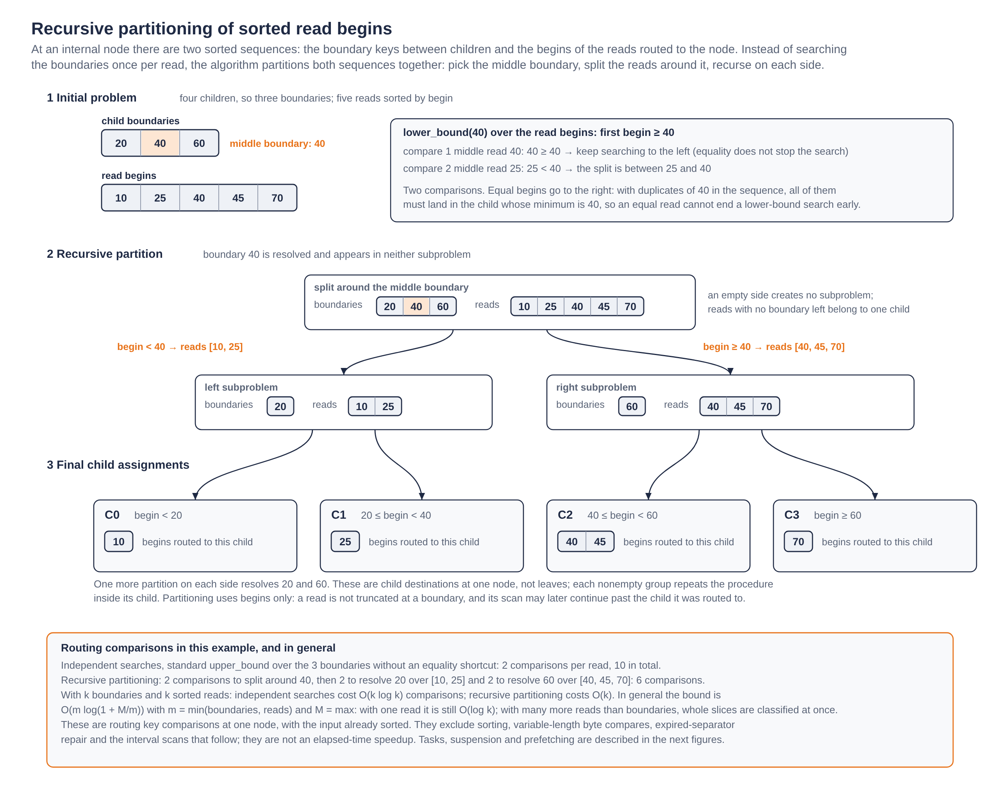

*Figure 1. Each middle boundary partitions the sorted read begins into smaller subproblems. Resolved boundaries are excluded from further searches, and equal begins go right. The example uses six comparisons, versus ten independent upper-bound comparisons. Each nonempty group continues inside its destination child.*

The same procedure is applied within each child reached by a nonempty slice, continuing down the tree until the starting leaves are known. This combines recursive partitioning *within* each node with descent *between* nodes. Partitions of one node can progress independently; no node-wide completion barrier is required.

### Routing comparison cost

At a node with s boundary keys and r read begins, independent binary searches use `O(r log(s+1))` key comparisons. Recursive partitioning searches progressively smaller read slices and skips empty subproblems. For positive s and r, its worst-case comparison bound is **`O(m log2(1+M/m))`**, where `m=min(s,r)` and `M=max(s,r)`.

When the sequences have comparable lengths k, this is `O(k)` rather than `O(k log k)`. With one read, it remains `O(log(s+1))`; there is little sharing to exploit. With many more reads than boundaries, the bound becomes `O(s log(1+r/s))`: a boundary search classifies whole read slices at once.

The bound counts **routing comparisons at one node**, assuming sorted input and live separators. Total batch time also includes input extraction and sorting, variable-length byte comparisons, expired-separator repair, and interval scans. Shared navigation reuses node data, while prefetching overlaps some of the remaining memory latency. Section 3 of the detailed design derives the bound.

### Example: 10,000 reads and a 6 GiB history pool

Consider a **synthetic tree model** with the same pool geometry as the [long-trace evaluation](06-evaluation.md#long-trace-equal-counted-history-budget): 98,300 pages of 64 KiB, divided into 2 KiB blocks. Its occupancy, height and entry count are assumptions for this example, rather than measurements of the tree in that run.

Assume a two-child root, four further internal levels with 28 children per node, and leaves with 41 intervals: about 70% of the respective 40-child and 59-entry capacities. This gives 1,229,312 leaves and 50,401,792 history intervals. Nodes use 2,610,878,464 bytes; 3,831,310,336 bytes remain for key blocks. After 24-byte key-block headers, filling that space corresponds to about 75 stored endpoint bytes per interval. This key size makes the assumed tree fit within the pool.

For 10,000 eligible read begins uniformly sampled over those intervals, the model gives the following key-comparison counts with seed 1:

| Location | Nodes in the modeled tree at that depth | Independent searches | Recursive partitioning |
|---|---:|---:|---:|
| Root, 2 children | 1 | 10,000 | 13 |
| Internal depth 1, 28 children | 2 | 48,624 | 508 |
| Internal depth 2, 28 children | 56 | 48,646 | 6,994 |
| Internal depth 3, 28 children | 1,568 | 48,543 | 35,013 |
| Internal depth 4, 28 children | 43,904 | 48,595 | 47,968 |
| **Internal routing subtotal** | | **204,408** | **90,496** |
| Initial in-leaf search, 41 entries | 1,229,312 | 54,683 | 54,460 |
| **Total to locate read starts** | | **259,091** | **144,956** |

Internal routing uses **55.7% fewer comparisons**. Including the initial leaf search, the reduction is **44.1%**, a comparison-count ratio of **1.79:1**. Upper levels provide most sharing; near the leaves, almost every visited node has only one read. The model reaches 9,959 distinct leaves, so sharing their initial searches saves little.

Locality changes the result. Keeping the same tree and batch size but sampling the begins within a contiguous region of 100,000 history intervals gives:

| Distribution of 10,000 read begins | Independent searches, including initial leaf search | Grouped searches, including initial leaf search | Comparison reduction |
|---|---:|---:|---:|
| Across the whole history | 259,091 | 144,956 | 44.1% |
| Within 100,000 consecutive history intervals | 261,795 | 23,643 | 91.0% |

The clustered case reaches 2,400 leaves and shares more work at every level. The counts assume live separators and reads that remain eligible throughout traversal. They exclude predecessor checks, overlap scans, eligibility checks, cleanup, task scheduling and prefetch instructions, so the comparison reduction need not translate into the same runtime speedup. Both methods search the same child boundaries and omit the redundant first-child minimum. The model also records v1-style searches that include that minimum.

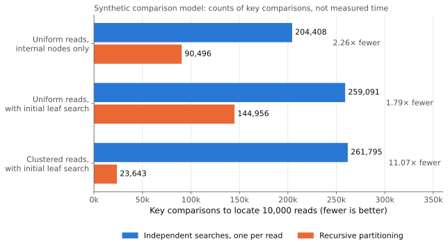

*Synthetic comparison model, not a measurement. Key comparisons needed to locate 10,000 read begins in the declared tree: 204,408 against 90,496 for internal routing with uniform reads, 259,091 against 144,956 including the initial leaf search, and 261,795 against 23,643 when the reads are clustered. Measured performance is in the [evaluation](06-evaluation.md).*

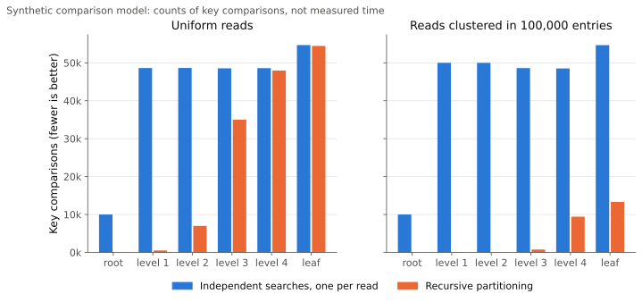

*The same synthetic model by level. With uniform reads, partitioning saves most comparisons near the root and almost none at the leaves, where nearly every visited node holds one read; clustered reads share work at every level.*

The batch contains **10,000 read intervals reaching the tree**; 10,000 transactions with four reads each would instead supply 40,000 intervals. Keys are represented by their sorted positions, without simulating byte lengths or cache behavior. The [Python model](analysis/partition-comparison-example.py) reproduces the counts; its [JSON output](analysis/partition-comparison-example.json) records the assumptions and subtotals.

### Resumable tasks

A **task** represents one unfinished subproblem of the recursive algorithm. It records the current node, a consecutive slice of the read sequence, the remaining separator subrange, and the bounds/state of any binary search in progress. Once it reaches a leaf, it instead retains the positions and unresolved reads needed for scanning. Read records stay in the input arrays; tasks refer to them by indices.

The initial task contains the root and all eligible reads. When partitioning produces two nonempty subproblems, the existing task keeps the left one and a new task receives the right one. Both initially reference the **same internal node**. When a task resolves its slice to one child, it replaces its current node with that child and continues there; descent itself does not require a new task. An empty half creates no task.

These logical tasks execute interleaved on one thread rather than through recursive C++ calls. Up to G reside in an array, with a separate order array determining their visitation sequence. Each visit consumes an access prefetched earlier, advances its handler, and normally hints its next access before yielding. New right tasks wait for round-end admission; excess tasks are suspended by value in a LIFO vector. Resident, new and suspended tasks together represent all unfinished traversal work.

Partitioning uses read **begins** to find starting leaves; it does not truncate intervals at child boundaries. At a leaf, a task locates its first read's start, checks a possible earlier write, and scans against its unresolved reads. A scan processes a whole leaf before yielding and hinting the right leaf, or finishes when no read remains or the chain ends. Long reads can therefore continue beyond their initial subtree. A root that is already a leaf enters this processing directly.

## Detailed design

### 1. Storage and key references

Nodes and key records use equal-size blocks from one `PagePool`. Pages are 64 KiB; the default block size is 2 KiB. `RESOLVER1_BLOCK_SIZE` selects the block size at compilation. Physical slots, one-byte logical-order indices, and `FreeSlots<C>` belong to each concrete node type. A set free-map bit means **free**. The map uses `(C+63)/64` words; counts and indices limit node capacity to 255 slots.

Node payloads use structures of arrays. A leaf keeps ranges and CVs; an internal node keeps separator ranges, separator CVs, child pointers and conservative child maximum CVs. `order[rank]` maps a logical sorted rank to its physical slot. Insertion and deletion shift these small indices rather than shifting every range descriptor. Splits still move descriptors between nodes.

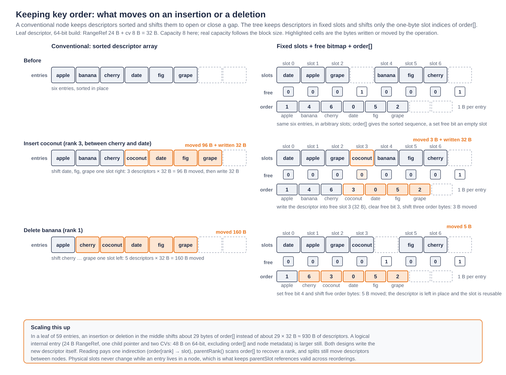

*Figure 2. Logical key order is maintained through one-byte slot indices. Inserting coconut shifts three order bytes instead of 96 descriptor bytes; deleting banana shifts five instead of 160. A set bitmap bit denotes a free slot. The byte counts exclude bitmap and counter updates and, on insertion, the new order-index byte.*

V2 uses one 24-byte `RangeRef` representation for leaf ranges and internal separators: first key-block pointer, offset, begin length, end offset, end length and first-block generation. A separator uses only the begin of the referenced range. It does not own separate key bytes or an inline prefix. A point range `[k,k\0)` stores the end once and reads its begin as the prefix without the final zero byte.

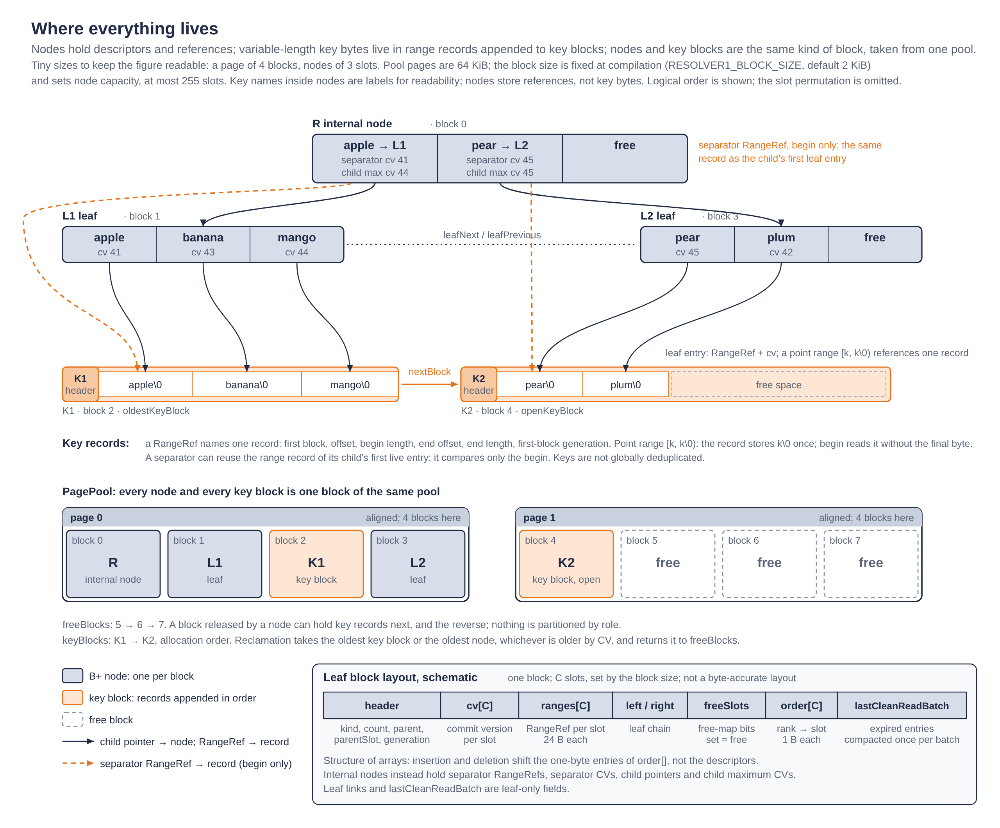

*Figure 3. Nodes hold descriptors and references; key bytes reside in linked key blocks. Both use interchangeable blocks from one pool. Separators can reuse range records and compare only their begin.*

Records can cross linked key blocks. Comparisons skip block headers. Key-block generations increase in allocation order; a reference is valid while its first-block generation exceeds the last reclaimed key-block generation. This validity test does not dereference the referenced block. Since later blocks cannot be reclaimed first, a surviving first block also protects the continuation of its record.

Node generations serve a different purpose: deferred cleanup records hold `(node,generation)`. Release clears the node generation. Its field lies beyond the first bytes overwritten by the pool free-list link, so a later cleanup can recognize a released node without interpreting the link as a generation.

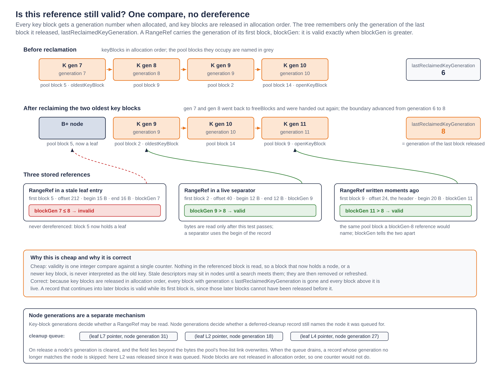

*Figure 4. A stored RangeRef remains valid while its blockGen exceeds the generation of the last reclaimed key block; checking this condition reads nothing from the referenced block. Node generations separately validate deferred leaf-cleanup records.*

### 2. Building the read sequence

`buildBeginIndexes` scans already-sorted endpoints; it does not sort keys again. It extracts begin endpoints and maps them to `{rangeIndex,transaction}`. For reads, `rangeIndex` addresses the global read vector. Write records are also collected in `writeBegins`, using transaction-local indices, but that sequence does not participate in v2 traversal or write application.

The scan skips already-too-old transactions, empty reads, and reads of already-conflicted transactions unless complete reporting is requested. An RV below the cutoff marks the whole transaction too old, sets its conflict status, and increments the counter. A final compaction removes earlier collected reads of a transaction found too old later in endpoint order.

The resulting `readBegins` is sorted by begin; equal begins are permitted. `readStillNeeded` checks the transaction's too-old flag, the individual read's conflict bit, and whether complete reporting overrides transaction-level rejection. This predicate is reevaluated as tasks advance: another task can reject the transaction in the meantime.

### 3. Internal partition searches

For an internal node with n children, separator rank zero names its first child's minimum; it is not a boundary between two children. Initial partition bounds are `[1,n)`. A task with separator bounds `[lo,hi)` covers child ranks `lo-1` through `hi-1` inclusive. When `lo==hi`, exactly one child remains, at `lo-1`.

With fixed `mid=midpoint(lo,hi)`, search bounds `[readLo,readHi)` locate `lower_bound(read.begin, separator[mid])`. A read begin below the separator moves the lower bound to `midRead+1`; every other result moves the upper bound to `midRead`. Equality cannot terminate early because duplicate read begins must all be routed to the right.

When the boundary is found, the separator itself is resolved:

| Result | Separators still to search | Assigned read slice |
|---|---|---|
| Left partition | `[lo,mid)` | `[readBegin,split)` |
| Right partition | `[mid+1,hi)` | `[split,readEnd)` |

Only nonempty read slices survive. The current task becomes the left partition when both survive; its right sibling is copied into `newTasks` with its parent's position in the current round order.

Example: child minima `[5,20,40,60]` and read begins `[10,25,40,45,70]`. Boundary 40 divides reads into `[10,25]` and `[40,45,70]`. Remaining boundaries are 20 and 60. Final child assignments are `[10]`, `[25]`, `[40,45]`, `[70]`; reads equal to 40 go to the child whose minimum is 40. Their later scans may continue beyond that child's subtree.

**Deriving the routing comparison bound.** Let C(s,r) count key comparisons, with zero comparisons when either sequence is empty. A partition uses `O(log(r+1))` comparisons and creates subproblems satisfying `sL+sR=s-1`, `max(sL,sR)<=floor(s/2)`, and `rL+rR=r`. Thus:

`C(s,r) <= O(log(r+1)) + C(sL,rL) + C(sR,rR)`.

At partition depth d, there are at most `min(2^d,r)` nonempty subproblems; their read lengths sum to at most r. Concavity of the logarithm bounds the level's comparisons by `O(kd log(1+r/kd))`, where `kd=min(2^d,r)`. There are `O(log(s+1))` levels because the separator range is halved.

For `r<=s`, levels up to depth `log r` sum to `O(r)`; the remaining `O(log(s/r))` levels cost at most `O(r)` each, giving `O(r log(1+s/r))`. For `r>=s`, summing the levels gives `O(s log(1+r/s))`. Together these yield `O(m log(1+M/m))`. The bound is independent of task scheduling. Scanning writes overlapped by long reads remains a separate cost.

### 4. Task state and one dispatch per visit

The resident task array has G slots. `order[0..active)` identifies occupied slots in visitation order; `FreeSlots<G>` tracks free slots. `pending` contains copied suspended tasks, with the next task at the back. `newTasks` contains copied right siblings created during the current round.

| State | Access or work consumed | Next action |
|---|---|---|
| `InspectNode` | Prefetched node | Clean/initialize a leaf or start internal partitioning |
| `CompareKeys` | Separator and midpoint read | Continue the binary search, split, or descend |
| `CompareLeafKey` | Leaf entry begin and first read begin | Continue the leaf search or establish scan position |
| `FindPrev` | Prefetched leaf to the left | Locate its last live entry or move left again |
| `CheckPrev` | Previous write end and a read begin | Check overlap/CV and select another read |
| `StartScan` | Saved leaf position and pending-read links | Initialize scanning and enter `scanLeaf` directly |
| `ScanLeaf` | Prefetched scan leaf | Scan all its relevant pairs, finish, or prefetch its successor |
| `Empty`, `Done` | No further work | Release the slot at round end |

Continuations such as `toCompareKeys` issue hints and set the consuming state. `runRound` contains one state dispatch per resident task. Some local handlers call another handler directly when no new memory wait is needed; this is not a second scheduler dispatch. Initial root prefetch occurs before the loop. New siblings issue their first hint when created and begin execution only in a later round.

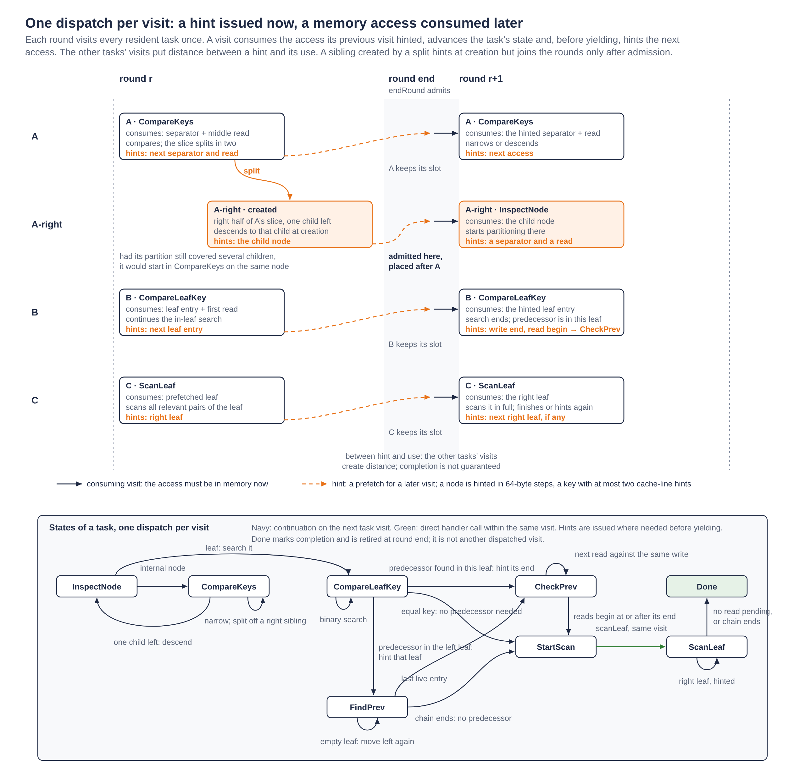

*Figure 5. A task visit consumes previously hinted data and normally issues the next hint before yielding. Other tasks provide distance between hint and use, without guaranteeing completion. New siblings begin after round-end admission; direct handler continuations execute within the same visit.*

Node prefetch walks the node block in 64-byte steps. External input keys and stored keys receive at most two cache-line hints. The stored-key fast path uses direct addresses when those hints fit in the first block; the slow path checks validity before reading a header and follows links as needed. Prefetching does not copy a complete long key or guarantee that comparisons will avoid demand misses.

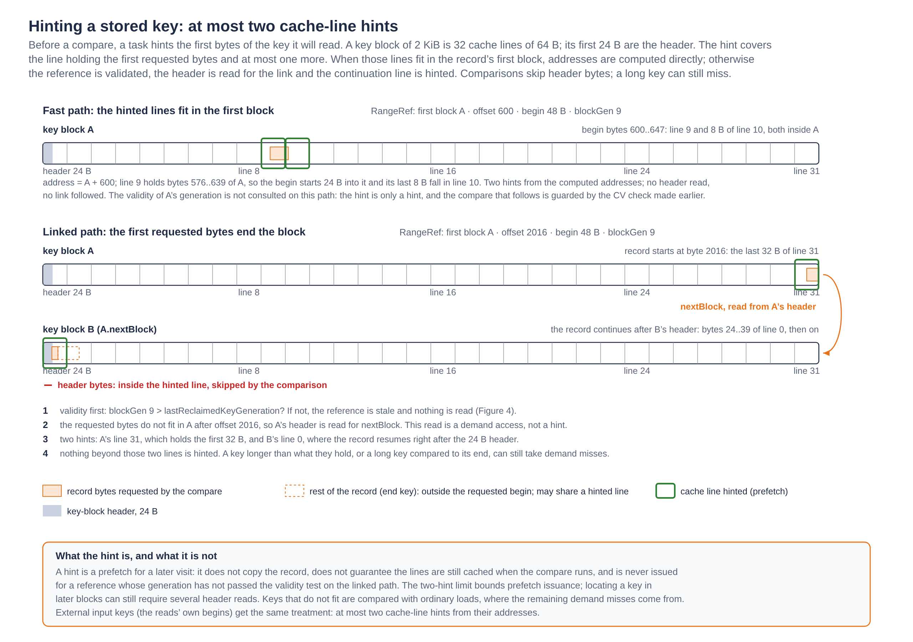

*Figure 6. Stored-key prefetch issues at most two cache-line hints. The common path computes addresses within one key block; a cross-block access checks reference validity and follows block links, skipping headers. Hints neither fetch the entire record nor guarantee cache residency.*

### 5. Round-end admission and range priority

`endRound` returns immediately if no task completed and no sibling appeared. Otherwise it stages **indices**, not an entire new task array, interleaving each new right sibling immediately after its surviving left partition. Encodings below G identify resident slots; larger encodings identify entries in `newTasks`.

It admits the first G entries of this combined sequence. It copies the excluded suffix to `pending` in reverse order, freeing excluded resident slots before copying selected new tasks into those slots. Selected resident tasks retain their physical slots. Finally, it fills remaining holes from `pending` and reissues the access associated with each resumed task's state; the old prefetched data may have been evicted.

For G=3, let the ordered tasks own read slices A=`[0,8)`, B=`[8,16)`, C=`[16,24)`. A splits at 4 and B at 12. The combined sequence is A-left, A-right, B-left, B-right, C. The first three stay active. C is pushed before B-right, so B-right resumes first. This preserves range priority across the suspended suffix without moving surviving resident records. A `newTasks` entry records its parent's **order position**, not its slot index.

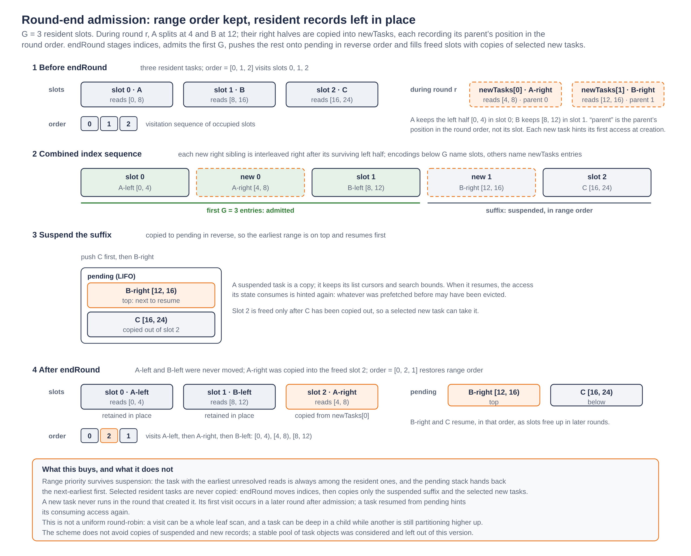

*Figure 7. Round-end admission interleaves each new right task after its left half and selects the first G tasks. The remaining suffix is copied onto a LIFO stack in reverse order. Selected resident tasks stay in place; new tasks occupy freed slots, and the order array restores visitation by read range.*

All unfinished tree work is represented by resident, new or suspended tasks. The scheduler can deepen a resolved child partition while another task remains higher in the tree. A full leaf scan can make a visit longer than other visits; the scheduler is not a uniform-work round-robin system.

### 6. Leaf search and the predecessor

On first entry to a leaf in a batch, `cleanReadLeaf` removes expired entries and stamps `lastCleanReadBatch`. The task then searches the cleaned leaf for the first write begin at or after its first read's begin.

Equality can terminate this binary search: live history ranges are disjoint, so an earlier write cannot extend across a write beginning at the read begin. Scanning starts at the equal entry. Without equality, the insertion rank is also the forward scan start, but the immediately preceding live write may extend into the read and must be considered first.

The saved forward scan location is `task.node.leaf/task.rank`. The predecessor location is independently held in `prevLeaf/prevRank`. `prevRank` is an exclusive cursor: decrement before inspection. At a newly reached left leaf, `UINT32_MAX` signals that the cursor should start at the cleaned leaf's count. The first decrement selects its last entry, at count minus one.

`checkPrev` can test the same previous write against several sorted reads. Once a needed read begins at or after that write's end, all later reads do too. Before that point, overlap is established by `read.begin < previous.end`, since the previous write already begins before the first read. Its CV decides conflict. The write-end hint is not repeated for each successive read; each next read begin is prefetched.

### 7. Fused forward scan and pending reads

Each task owns a disjoint slice of read indices. `nextRead` initially links index i to i+1; `readEnd` is that slice's sentinel. `readHead`, `readIndex` and `readPrev` maintain a linked subset of unresolved reads in begin order. Removing a read does not move input records or alter routing boundaries. A suspended task retains its list cursors.

Within a leaf, writes are visited in key order. For each current pending read:

1. If the read is no longer needed, unlink it.
2. If its begin has not already been reached, compare it with the write end. A begin at or beyond that end means this read and all following reads need later writes; advance the write.
3. If `read.end <= write.begin`, unlink the read permanently: no later write can overlap it.
4. Otherwise overlap exists. A newer write CV marks conflict and unlinks the read; an older/equal CV leaves it pending for later writes.

After an entry, scanning restarts at the current pending head, not at all original reads. Read ends are not ordered, so an ended read may be removed from the middle rather than advancing a single global start index.

`readReachedEnd` marks the admitted prefix of the sorted begin sequence. Once a begin is below a visited write end, it stays below subsequent write ends because live write intervals are disjoint and ordered. Those begins need no repeated begin/end comparison. The field shares storage with the internal search's `readLo`; the two phases do not overlap.

The scan runs directly through relevant pairs for the whole leaf. There is no scheduler round or explicit pair-level prefetch between each comparison. At a leaf boundary it prefetches the right leaf and yields. A task finishes when its pending list is empty or the leaf chain ends. Long reads continue beyond their initial destination leaf, and different tasks can scan the same physical leaf for different read slices.

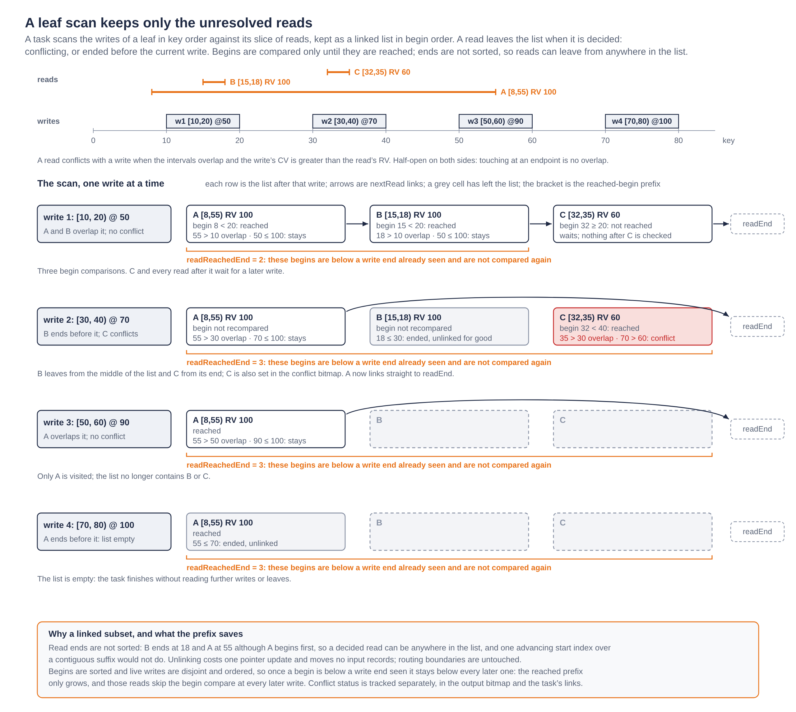

*Figure 8. Reads remain linked in begin order until they conflict, end before the current write, or become unnecessary. Unlinking removes resolved reads without moving input records. The reached-begin prefix grows monotonically, avoiding repeated begin comparisons. All shown writes are processed within one leaf-scan visit.*

### 8. Expired separators and deferred cleanup

An internal separator is a copied reference to a child's former minimum. Reclaiming key blocks can invalidate that reference even when the child still contains live history. Checking an old separator without refreshing it can read reused bytes and route incorrectly.

`toCompareKeys` checks the chosen separator's CV **before issuing a key hint**. If it is expired and not already marked empty, `refreshSeparatorDeferred` searches for the child's first live key, reading versions before key bytes. A live result replaces the reference and CV. The refresh can descend synchronously without prefetching and stall the visit. Refreshing only the selected separator avoids visiting children whose keys the partition search may never use.

If a child has no live entry, the helper can borrow a live neighbor's reference and mark an empty run with `EmptyChildCV`. If no child is live, it marks every child empty and leaves all old key references unread. **An empty marker is not a key to compare.** Partitioning treats it as above the current reads and narrows toward the left. Forward scans through the linked leaves can recover later live writes; routing to the right could skip an overlapping predecessor.

A task must survive even when its current subtree has no live entries: a long read can extend into a live subtree to its right.

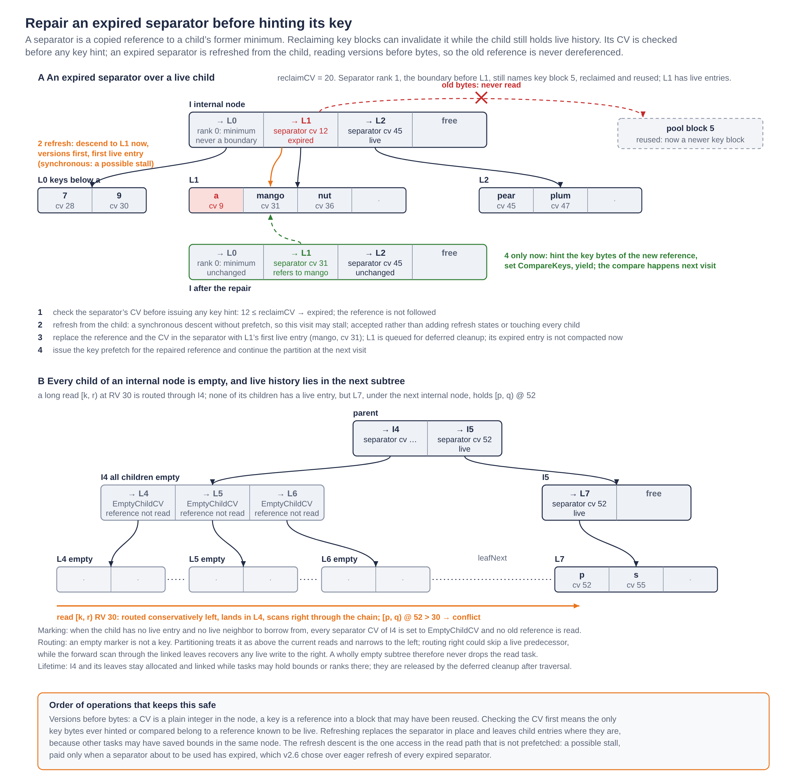

*Figure 9. Before hinting a selected separator key, the traversal checks its CV and refreshes an expired reference from live history. The synchronous refresh may stall, but never reads reclaimed key bytes. If every child is empty, empty markers route reads conservatively left; forward leaf scans can still discover overlapping writes in later subtrees.*

Refreshing does not erase child entries from internal nodes while tasks have saved bounds there. `firstLiveKey` queues leaves for cleanup; it does not compact their ranks immediately. Actual leaf-entry compaction occurs on that leaf's first traversal visit and then only once per batch. The cutoff is fixed, no writes are added, and later visits see the same cleaned ranks. Empty leaves remain linked and allocated through traversal, preserving predecessor and successor paths.

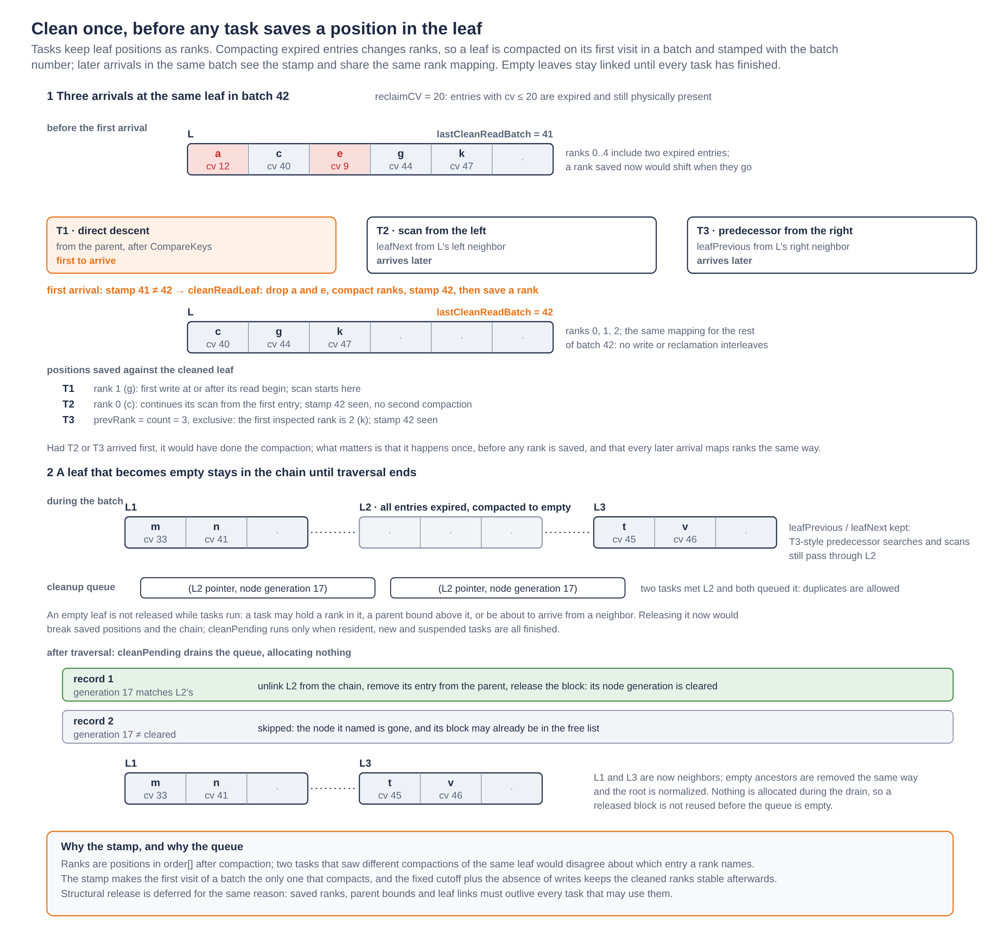

*Figure 10. The first traversal visit cleans expired entries and stamps the leaf with the read-batch number. Later visits preserve the same rank mapping. Empty leaves remain linked until all tasks finish; deferred cleanup then removes them, using node generations to skip duplicate records for released leaves.*

Once all resident and suspended tasks finish, `cleanPending` checks each queued node generation, cleans expired entries, removes empty leaves and empty ancestors, and normalizes the root. Duplicate cleanup records for an already released node are skipped. No allocations occur during this drain, so released blocks are not reused before the queue empties.

### 9. Write maintenance and reclamation retained from v1

`addWrite` reserves a conservative block allowance, descends with separator refresh, identifies the deepest node on the path still needing a split, splits at most that existing node, and inserts the new range. It preserves a left exterior before insertion and a possible right exterior after removing covered entries. The prepared leaf remains the insertion destination even when the overlapping predecessor is in its left neighbor.

A leaf needs a split when it lacks room for both a new write and a possible right exterior. Internal nodes reserve one free child slot per child needing a split; equality between free slots and pending child splits marks the internal node as needing a split. Splitting a child consumes one free slot and removes one pending split, preserving the parent's reservation balance. Internal splitting uses child weight, counting children needing splits twice. Root creation can accompany the one existing-node split.

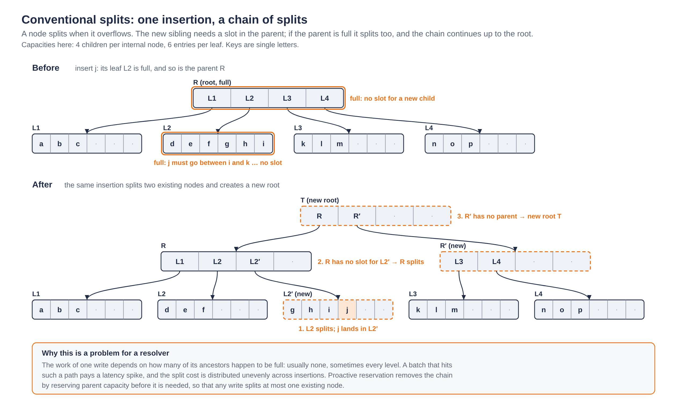

*Figure 11. A conventional split can cascade upward: inserting j splits leaf L2, then its full parent R, and creates a new root T. Proactive capacity reservation prevents this cascade, as Figure 12 illustrates.*

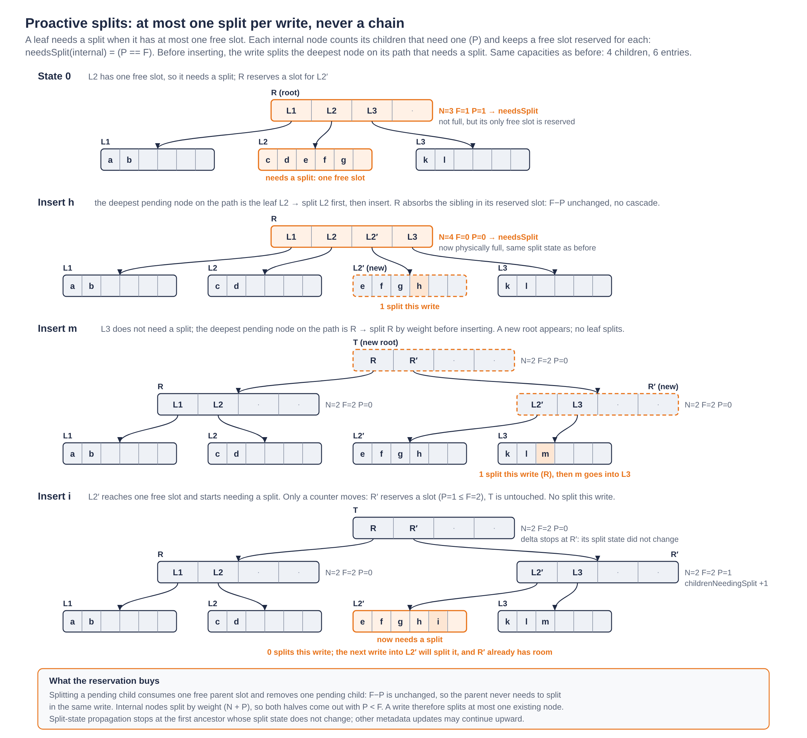

*Figure 12. Proactive capacity reservation limits each write to splitting at most one existing node. Inserting h splits L2; inserting m splits R and creates a new root; inserting i only updates the pending-split count. Splitting a child consumes one free parent slot and removes one pending split, preserving F−P.*

Reclamation compares the oldest key-block age with the oldest node age and advances `reclaimCV_` monotonically. Whole expired subtrees can be detached and released; expired leaf entries are later removed without reading their key bytes. Node and subtree maximum CVs remain conservative upper bounds. The pool budget determines how much history can be retained; transaction admission must respect the resulting cutoff.

## Alternatives considered

| Alternative | Reason for the implemented choice |
|---|---|
| One read per descent | Simple reference path, but repeats navigation and offers less batch reuse |
| Breadth-first frontier or two G-sized groups | Replaced during development by a single G-slot task set plus staged/suspended work |
| Scheduler transitions for every scan pair | Too much dispatch and prefetch overhead; scans now run to leaf boundaries |
| Separate prefetch and work dispatches | One consuming-state dispatch reduced measured scheduler overhead |
| Contiguous suffix of unresolved reads | Read ends are not sorted; a linked subset removes ended reads anywhere in a slice |
| Eager refresh of every expired separator | Can touch unneeded subtrees; v2 refreshes only a separator about to be used |
| Immediate removal of empty nodes | Invalidates saved ranks, parent bounds and leaf links; structural release is deferred |
| Stable pool of all task objects | Not implemented: resident tasks stay in place when selected, but suspended/new tasks are copied |
| Unified read/write traversal | Requires deferring write application until transaction acceptance and maintaining write destinations; reserved for v3 |

The [design history](04-decisions-and-evolution.md) records the experiments behind these choices, including the move from per-pair scheduling to whole-leaf scans and a single dispatch per task visit.

## Testing considerations

The main correctness cases are half-open boundaries, duplicate begins, unordered read ends, complete reporting, transaction-level skipping and too-old admission. Traversal tests also need root leaves, cross-leaf predecessors, long scans, more than G tasks, and cleanup when several tasks visit the same leaf. Differential tests compare per-read and transaction decisions against a direct history model or `hasConflict`, using the same admission rules.

Separator tests must reclaim old key bytes and reuse their pool blocks; merely marking entries expired can leave a stale reference readable and hide the bug. Cases include a surviving child, empty runs beside a live child, and wholly empty internal subtrees followed by live history to the right. Sanitizers help detect invalid accesses, but generation and version guards are still needed when a pool address is reused.

The [validation report](07-evidence-and-validation.md) describes the tests performed, the source versions they cover, and the remaining gaps.

## Observability and supportability

Performance measurements separate read checking from write application and record transaction decisions, per-read conflicts, too-old counts, pool usage, batch memory, reclamation events and retained age. Diagnostic counters for key comparisons, node and leaf visits, task copies and resumptions, scheduler visits and separator refreshes help explain changes. Runs with those counters should be reported separately from uninstrumented timings unless their overhead has been measured.

Each result needs its workload, seed, key distribution, interval lengths, read-version ages, commit rate, G, block size, pool backing and budget. Paired runs in the same session reduce the effect of machine load and frequency changes. IPC should be read alongside instruction counts and memory events: similar IPC can conceal different amounts of work or memory waiting.

The [evaluation](06-evaluation.md) compares read and write performance across the benchmark workloads and examines history retention under a fixed memory budget. Grouped reads improve several workloads, while write application accounts for most of the measured long-trace runtime. Results vary by workload; v2 does not consistently outperform FDB.

## Integration and migration

The tree is held in memory, so replacing v1 requires no on-disk format migration. The FDB adapter and the tree share batch-record definitions through `ResolverBatchTypes.h`. The build must link an explicit `checkReads<G>` instantiation for the selected task capacity.

The adapter must supply transaction statuses and read offsets and translate the returned conflict bitmap into FDB's per-read reporting format. Integration tests must compare transaction decisions, per-read reporting and too-old counts against the native resolver path.
