# Resolver v2 · Evaluation

Resolver v2 improves read checking over the sequential B+ tree, while write application remains a substantial cost. Against FoundationDB's original conflict set, the result depends on the workload: v2 reads ranges faster in the integrated synthetic benchmark, but its writes are slower. On the long trace, it retains the same final minimum history as v1 under the same memory contract.

The experiments below keep four benchmark paths separate: FDB's `conflictset/benchmark`, `skiplisttest`, the custom benchmark integrated into FDB, and that benchmark's standalone executable. Ratios compare candidates within one machine and session. They are not comparisons of absolute speed between Intel, AMD and Apple processors.

## Implementations and measurement method

The candidates are FDB's original skip-list conflict history, the sequential B+ tree (v1), and resolver v2. V2 uses G=16; both B+ trees use 2 KiB blocks in these campaigns. FDB runs with the paged conflict history disabled.

The measured v2 sources are development commit `dc2802fc2f6d76035e9d97bc621263e8b4f59cec`, integrated into the fork at `22a8ae9fba943b73cf149d21b05dfe6b07c6e013`. Commit `3ba52abba955998757fa939b731fc3d2b8fa25b1` adds the integrated benchmark. Of the 39 files of `resolver1`, 38 match the development snapshot; the test file `tests/tempconflictbtreetests.cpp` corresponds to an earlier development state and is not part of the measured FDB executables. The campaign manifest, which reports 39 matching files, is kept as received; the [public correspondence](evaluation/PUBLIC-CORRESPONDENCE.md#how-the-correspondence-was-checked) gives the correction. These are the identities of the measured sources; a later public commit or a matching decision hash does not by itself identify the same executable.

All the measurements in this document predate one later change to the component: the reservation of room for a write's longest keys before it is stored, which the public source series adds as a separate commit. On the benchmark workloads the corrected code makes the same decisions, but that does not make these results measurements of it. The [evidence register](07-evidence-and-validation.md#write-reservation-after-the-measurements) describes the change.

The [AMD campaign of 30–31 October](#amd-controlled-campaign-of-3031-october) measured other revisions and records its own correspondence with the published history; the identities above apply to the Intel, Apple M3 and 29 October AMD results.

The sequential fork reference is `5a07ab1936aaa6c01b5f36191c5446dee0a3d674`. Its `resolver1` directory was checked against public commit `c44fd2247be51c26ca48c56dcc0587fb7b54ea04`; that correspondence concerns the component sources, not the whole executable. The [Intel manifest](evaluation/hp/MANIFEST.md) records the measured integration commits, binary hashes, build commands and timer definitions. Later correspondence updates are recorded in the [source notes](evaluation/SOURCE-NOTES.md).

Short benchmarks have three measured rounds. Unless stated otherwise, tables give medians of the absolute values. Ratio tables and plotted ratio markers give the median of the three same-round quotients, which can differ from the quotient of the absolute medians. Dots show individual rounds and horizontal marks show medians; they are not confidence intervals. Throughput ratios above one are faster; time ratios below one are faster.

The short campaigns do not exercise reclamation. The long trace and the separate small-pool validation runs cover memory pressure.

## Intel: FDB conflictset benchmark

The Intel machine is an HP workstation with a Core Ultra 9 285K. Runs are pinned to CPU 6. The builds use Clang 19.1.5 in Release mode. Working files and outputs stay in memory during the timed runs; separate `strace` checks found no disk writes in those intervals.

The 29 October campaign uses seed 1, 2,000 batches, 1,000 warm-up batches and 1,000,000 measured transactions per workload. The B+ tree pools contain 16,384 pages. Range reads span 1–1,000 keys and range writes span 1–10 keys.

| Candidate | Point transactions/s | Range transactions/s |
|---|---:|---:|
| FDB | 210,774 | 435,219 |
| v1 | 134,014 | 468,079 |
| v2 | 187,711 | 420,858 |

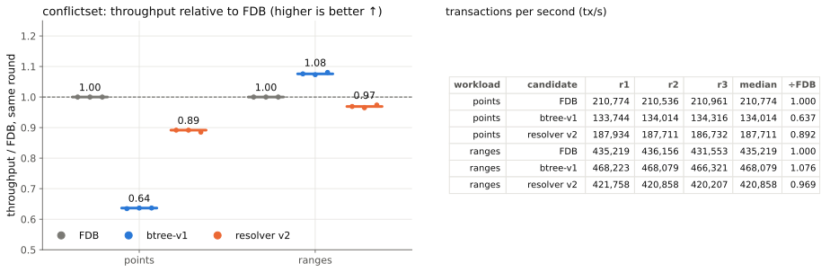

*Figure E1. Intel conflictset throughput, normalized against FDB within each round. V2 reaches 0.89× FDB on points and 0.97× on ranges. Higher is better.*

| Workload | Phase | v1 time / FDB time | v2 time / FDB time |
|---|---|---:|---:|
| Points | Read checking | 2.109 | 0.912 |
| Points | Write merging | 1.565 | 1.913 |
| Ranges | Read checking | 0.890 | 1.017 |
| Ranges | Write merging | 1.240 | 1.434 |

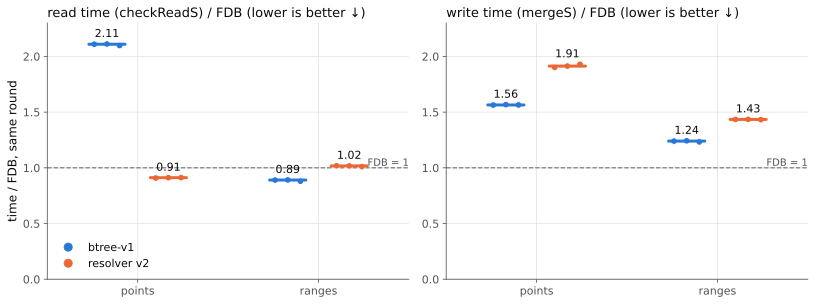

*Figure E2. Read and write times from the same conflictset runs. V2's read time is below FDB's on points and close to it on ranges; write time is higher on both. Lower is better.*

Every candidate accepts 962,526 point transactions and 164,926 range transactions, with zero too-old rejections. The benchmark does not print a decision hash: equal counts do not prove that the same individual transactions were accepted. The low range acceptance rate, 16.5%, also makes early transaction rejection more valuable than in a low-conflict workload.

The session followed compilation. Its 5- and 15-minute load averages were still decaying from 19 and 31; the 1-minute load before the conflictset and integrated runs was 1.06–1.83. Candidates were interleaved, but this was not a session with fully documented isolation of every core.

## Custom benchmark integrated into FDB

This benchmark runs the custom point/range generator through FDB's resolver batch path, allowing all three implementations to process the same inputs. It is a different workload from the conflictset benchmark above. The figures separate read checking from write application.

### Intel

The Intel runs belong to the same 29 October campaign as conflictset. Each workload has 3,000 batches and 12,000,000 reads; the tree pools contain 16,384 pages.

| Candidate | Point reads/s | Point writes/s | Range reads/s | Range writes/s |
|---|---:|---:|---:|---:|
| FDB | 2,511,944 | 1,400,574 | 3,021,975 | 2,495,459 |
| v1 | 839,297 | 847,362 | 1,989,057 | 1,765,195 |
| v2 | 2,253,380 | 731,064 | 3,439,944 | 1,623,771 |

The median paired v2/FDB throughput ratios are 0.896 for point reads, 1.138 for range reads, 0.522 for point writes and 0.651 for range writes.

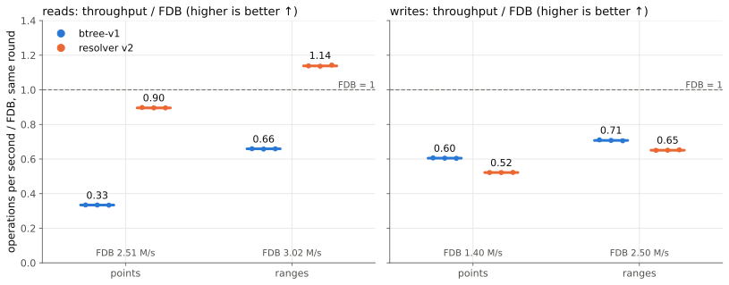

*Figure E3. Intel throughput in the custom workload through FDB's resolver. V2 exceeds FDB's read rate for ranges, while write throughput remains below FDB for both workloads. Ratios are paired within each round; higher is better.*

All runs produce decision hash `4787dbf4af9b9ca8` with 29,209 conflicts for points, and `df42a6e5c89796ea` with 3,479,753 conflicts for ranges.

### AMD: 29 October session

The AMD machine has a Ryzen 7 7700 and runs Linux 6.8. Its campaign of 29 October uses the same workload, 3,000 batches and 12,000,000 reads per run, and pools of 16,384 pages. Each run executes in the `foundationdb/build:rockylinux9-latest` container, pinned to CPU 7, with its working files in memory. The builds use Clang 19.1.5 in Release mode. Each binary is a fork commit plus one commit that adds the benchmark; the [AMD and Apple M3 note](evaluation/amd-m3/NOTE.md) records the commits and `fdbserver` hashes. Values are recalculated from the [run CSV](evaluation/amd-m3/data/amd-fdb-integrated-bench-runs.csv).

| Candidate | Point reads/s | Point writes/s | Range reads/s | Range writes/s |
|---|---:|---:|---:|---:|
| FDB | 2,584,290 | 1,534,894 | 3,072,748 | 2,519,023 |
| v1 | 906,635 | 889,155 | 2,033,537 | 1,826,478 |
| v2 | 1,811,036 | 806,980 | 3,211,232 | 1,758,157 |

The median paired v2/FDB throughput ratios are 0.702 for point reads, 1.047 for range reads, 0.526 for point writes and 0.699 for range writes. For v1 they are 0.351, 0.662, 0.580 and 0.727.

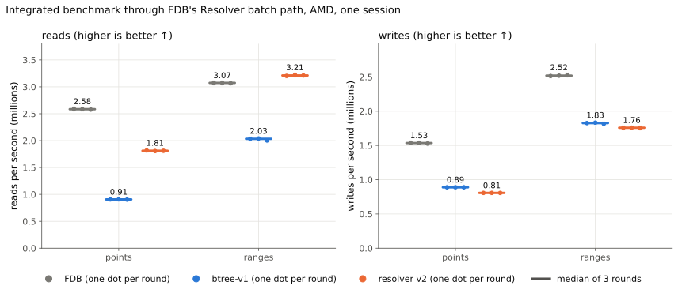

*Figure E11. AMD read and write rates in the custom workload through FDB's resolver, three rounds (dots) and their median (bar). V2 reads ranges faster than FDB and points at about 70% of its rate; its writes remain below both FDB and v1. Higher is better.*

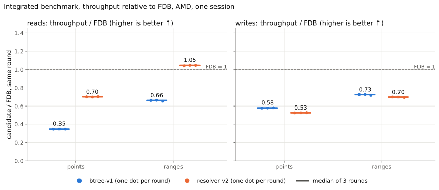

*Figure E12. The same runs, normalized against FDB within each round. Higher is better.*

The same records give these medians of same-round time ratios:

| Workload | Timed phase | v2 / v1 | v2 / FDB |
|---|---|---:|---:|
| Points | Read checking | 0.499 | 1.425 |
| Points | Write application | 1.102 | 1.902 |
| Points | Read plus write | 0.621 | 1.567 |
| Ranges | Read checking | 0.633 | 0.955 |
| Ranges | Write application | 1.039 | 1.431 |
| Ranges | Read plus write | 0.721 | 1.067 |

Lower is better. V2 halves v1's point-read time and cuts its range-read time by about a third, but its write time is higher than v1's and FDB's. All runs produce the same decision hashes as on Intel, `4787dbf4af9b9ca8` for points and `df42a6e5c89796ea` for ranges.

The session lasted about five minutes, with three rounds and no warm-up. Candidate order was fixed within every round, and the run also included development candidates outside this comparison, which are not reported. The load on the other cores was not recorded. Read plus write is the sum of two instrumented phases, not wall-clock execution time.

## Custom standalone benchmark

The standalone executable measures the B+ trees directly; FDB's original conflict set is not included. Its read rates describe prepared-input checking: v2's endpoint construction and stable sort occur before the read timer. They therefore do not include the full cost of preparing a batch for grouped processing.

### Intel: sequential fork baseline

This campaign ran on 30 October after correcting the reference implementation. Both executables use one benchmark source from `dc2802fc2f`, generator seed 1234, 3,000 batches, a 1,024 MiB budget and 2 KiB blocks. The read call selects each implementation's API: v1's sequential `checkReads(span, status)` or v2's `checkReads<16>`. Both builds use Clang 19.1.5, libc++ and `-std=c++20 -O3 -DNDEBUG`.

One warm-up run per candidate and workload is excluded. Three measured rounds alternate candidate order on CPU 6. The values below are recalculated from rows marked `kind=timed` in the distributed CSV.

| Workload | Operation | v1 operations/s | v2 operations/s | Paired v2 / v1 throughput |
|---|---|---:|---:|---:|
| Points | Reads | 1,068,353 | 2,251,547 | 2.107 |
| Ranges | Reads | 2,379,989 | 3,467,170 | 1.463 |
| Points | Writes | 1,082,668 | 960,959 | 0.884 |
| Ranges | Writes | 2,059,940 | 1,862,846 | 0.909 |

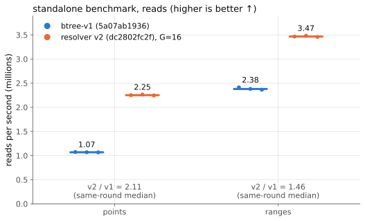

*Figure E4. Intel standalone read throughput using v1 from fork commit `5a07ab1936` and v2 from `dc2802fc2f`. V2 reaches 2.11× the point-read rate and 1.46× the range-read rate. Endpoint preparation and sorting are outside v2's read timer.*

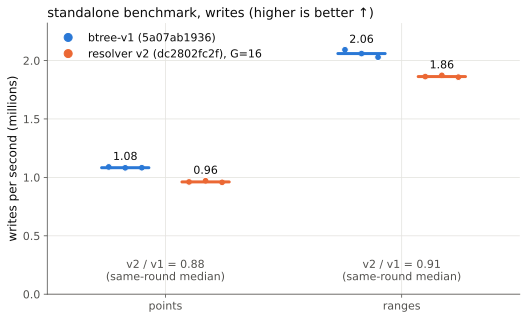

*Figure E5. Write throughput from the same standalone runs. V2 reaches 0.88× v1's point-write rate and 0.91× its range-write rate. Both implementations still apply writes individually; these results cover all source changes between the measured versions.*

All 16 warm-up and measured executions exit successfully, retain `reclaimCV=0` and produce the expected decision hashes. The previous standalone campaign used `073fcbb9af`, whose source differs from the sequential fork baseline. Its records are preserved in a separate historical CSV and are excluded from these tables and figures. The earlier 2.23×/1.58× Intel read ratios are superseded by this campaign.

### Apple M3: standalone campaign

The Apple M3 Pro campaign ran on 29 October under macOS 27.0.1, with Apple clang 15.0.0 and `-std=c++20 -O3 -DNDEBUG`, 3,000 batches, a 1,024 MiB budget and 2 KiB blocks. Its v2 executable is `dc2802fc2f` with the benchmark's task count set to 16. Its baseline is the standalone v1 at development commit `073fcbb9af`, the same baseline as the earlier Intel standalone campaign, not the fork baseline `5a07ab1936` of the Intel tables above. Its algorithm and decisions are v1's, but its source differs. The M3 ratios are therefore kept separate from the Intel fork-v1 comparison. Values are recalculated from the [run CSV](evaluation/amd-m3/data/m3-standalone-runs.csv).

| Workload | Operation | v1 operations/s | v2 operations/s | Paired v2 / v1 throughput |
|---|---|---:|---:|---:|
| Points | Reads | 1,059,376 | 2,357,646 | 2.226 |
| Ranges | Reads | 2,203,399 | 3,301,089 | 1.504 |
| Points | Writes | 1,102,537 | 1,049,776 | 0.952 |
| Ranges | Writes | 1,903,179 | 1,752,533 | 0.919 |

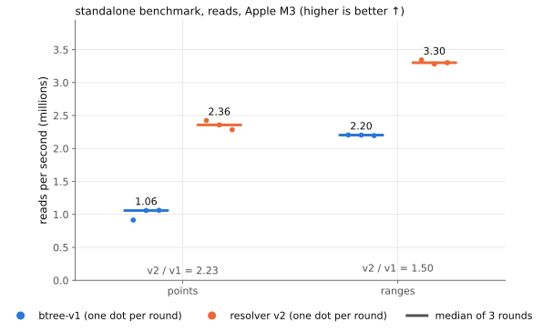

*Figure E13. Apple M3 standalone read throughput against the standalone v1 baseline `073fcbb9af`. V2 reaches 2.23× the point-read rate and 1.50× the range-read rate. Higher is better.*

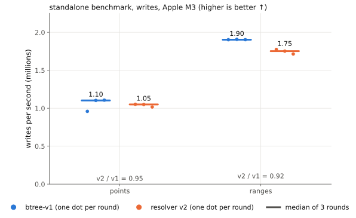

*Figure E14. Write throughput from the same runs: 0.95× v1 on points and 0.92× on ranges. Higher is better.*

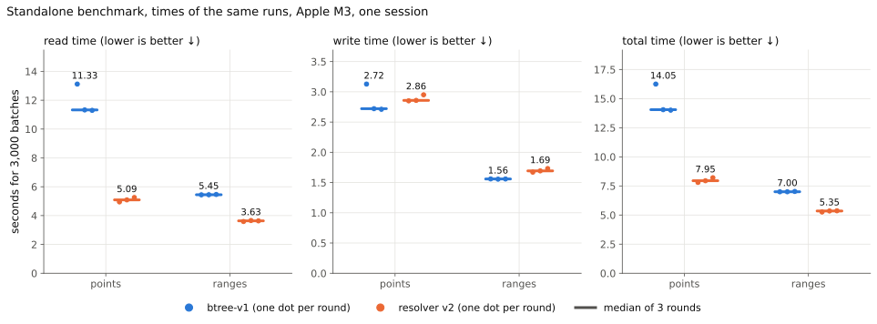

*Figure E15. Read, write and total times of the same runs, for 3,000 batches. The paired v2/v1 total-time ratio is 0.566 for points and 0.764 for ranges. Lower is better.*

Runs were interleaved by round and workload, one at a time, but not pinned, and the machine was in normal use. Load before each run was not recorded. In round 1, v1's point-read rate is about 14% below rounds 2 and 3; the figures show that round as a separate dot. All runs keep `reclaimCV=0` and produce the expected decision hashes.

## Intel: skiplisttest

The campaign uses seven key layouts, seed 1, 500 batches of 40,000 transactions, span 10 and tree pools of 262,144 pages. Each configuration has three interleaved measured rounds; separate warm-up runs are excluded. All candidates have the same decision hash within each configuration and every execution exits successfully.

The table gives median paired time ratios. `Total` is the benchmark's `Detect only` interval, `Read` is `checkReadS`, and `Write` is `mergeS`.

| Configuration | Total v2/FDB | Read v2/FDB | Write v2/FDB | Total v2/v1 | Read v2/v1 | Write v2/v1 |
|---|---:|---:|---:|---:|---:|---:|
| head16 | 1.070 | 0.626 | 2.217 | 0.620 | 0.280 | 1.102 |
| head32 | 1.203 | 0.770 | 2.506 | 0.640 | 0.302 | 1.116 |
| tail32 | 1.177 | 0.773 | 2.516 | 0.668 | 0.302 | 1.115 |
| head64 | 1.224 | 0.762 | 2.578 | 0.639 | 0.290 | 1.122 |
| tail64 | 1.144 | 0.753 | 2.586 | 0.702 | 0.281 | 1.106 |
| head128 | 1.284 | 0.795 | 2.803 | 0.635 | 0.288 | 1.120 |
| tail128 | 1.085 | 0.729 | 2.618 | 0.767 | 0.291 | 1.079 |

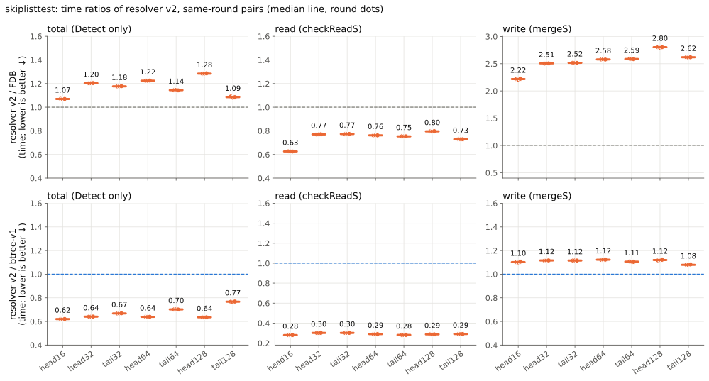

*Figure E6. Intel skiplisttest time ratios across seven key layouts. V2 spends 20–37% less time checking reads than FDB, but 2.22–2.80× as much time merging writes. Its total is 1.07–1.28× FDB's. Against v1, the read savings outweigh the higher write time. Lower is better.*

## Long trace: equal counted-history budget

The Intel retention comparison uses `pilot-2000M-l0-7200.trace`, segment `[57,600, 230,400)`: 172,800 batches and 5,400 seconds of logical trace time, starting cold. The counted-history budget is 6,442,450,944 bytes (6 GiB). V1 and v2 use ordinary memory, 2 KiB blocks and pools of 98,300 pages, totaling 6,442,188,800 bytes.

V2 was measured on 30 October; the archived v1 reference is from 23 October. Before overlaying their curves, the campaign checked the same commit-version sequence, offered hash `11334b1aea22e641`, decision hash `5001114085b550fb`, and zero rejections for window or memory. FDB's archived reference uses a configured 265-second window. That line denotes its configuration, not measured per-batch retention.

### Retention and memory

| Metric | v2 result |
|---|---:|
| First discard, trace seconds | 702.91 |
| Final minimum retained age, seconds | 582.938 |
| Late retention slope, seconds per 600 trace seconds | −3.89 |
| Peak counted history, bytes | 6,442,190,848 |
| Pool allocation within that count, bytes | 6,442,188,800 |
| Rejections for age or memory | 0 |

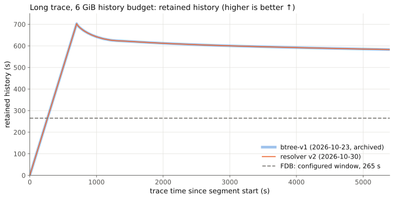

*Figure E7. Retention under the same counted-history budget and trace segment. V1 and v2 have nearly overlapping curves and the same final minimum of 582.9 seconds. FDB's configured 265-second window is shown as a dashed reference.*

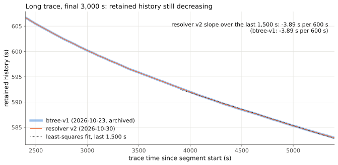

*Figure E8. Retention over the final 3,000 trace seconds. A least-squares fit over the last 1,500 seconds gives approximately −3.89 seconds per 600 trace seconds for both trees. The measured trajectory is still declining; it does not establish a stationary retention limit.*

The curves agree within one batch, 31.25 ms, except for 518 of 172,800 batches. Their final retained age is about 2.20× FDB's configured window. This compares retention under the stated memory contract; it is not a throughput or latency speedup.

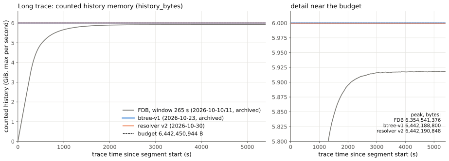

*Figure E9. Counted history memory on the same segment. V1 peaks at 6,442,188,800 bytes, v2 at 6,442,190,848 bytes, and the archived FDB accounting run at 6,354,541,376 bytes. The B+ trees count their whole pools from the first batch.*

The extra 2,048 bytes counted for v2 belong to its deferred-cleanup vector. `history_bytes` is the harness's history accounting, not process RSS or a bound on all input vectors and task queues. A separate checked run covers 200 logical seconds at the full pool size and at 300 pages; the smaller pool starts reclaiming at batch 71 and reports no mismatches.

### Native v2 time

Three native timing runs without memory-accounting instrumentation were performed in the v2 session. Over the full segment, the median sum of the per-batch `total_s` intervals is 2,289.517 seconds, with a range of 2,287.856–2,294.522 seconds. The timers separate read checking, write application and the other named phases.

| Round | Read, s | Write, s | Other timed phases, s | Unattributed, s | Total, s |
|---|---:|---:|---:|---:|---:|
| 1 | 525.818 | 1,659.744 | 102.676 | 1.279 | 2,289.517 |
| 2 | 525.236 | 1,658.602 | 102.725 | 1.293 | 2,287.856 |
| 3 | 525.818 | 1,660.753 | 106.668 | 1.284 | 2,294.522 |

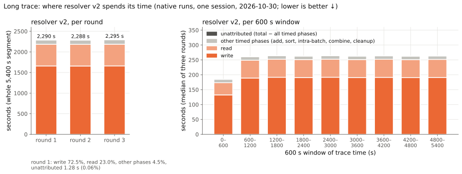

*Figure E10. V2 runtime by round and by 600-second trace window. In round 1, writes account for 72.5% of total time, reads for 23.0%, and the other timed phases for about 4.5%; 1.28 seconds remain unattributed. These native timings are separate from the memory-accounting run.*

The other timed phases cover add, sort, intra-batch checking, combine and cleanup. Read checking and write application execute sequentially on one thread; G=16 interleaves tasks without adding threads. The unattributed category is the total interval minus all seven phase counters. Its existence is reported separately: defining a remainder does not itself prove that the timers are disjoint. Their boundaries are described in the [timer notes](evaluation/hp/NOTE.md).

V1 and FDB long-trace timings are from other sessions and are not used to calculate a controlled speedup against these v2 runs. The separate archived AMD long trace contains FDB and v1, but no measured final-v2 result; it does not establish v2 retention on AMD.

## AMD: controlled campaign of 30–31 October

This campaign repeats the benchmark paths on the AMD Ryzen 7 7700 (8 cores, Linux 6.8) in one session: conflictset, the integrated custom benchmark, the standalone executable, skiplisttest and the long trace. Every timed run ran alone on CPU 7 with its SMT sibling, CPU 15, idle, inside the `foundationdb/build:rockylinux9-latest` container (Clang 19.1.5), with its output in memory. Each block has one warm-up run per candidate, excluded, and three rounds whose candidate order rotates; ratios are paired within each round. All 148 timed runs exited successfully. The [campaign note](evaluation/amd/NOTE.md) records the binaries, harness, protocol and commands, and its package holds the run records, CSVs, scripts and checksums.

### Measured sources and the published history

| Candidate | Measured revision | Published equivalent | Difference |
|---|---|---|---|
| FDB | `1dfa7ffe6a5210c66e36a628552d10a7046649d0` | the same commit, an ancestor of the published head | none |
| v1 | `a8921c3babbaea00099cc8c4c8608e942e921120` | the same commit, an ancestor of the published head | none |
| v2 | `22d9bb7a670037fe40070a0164fd6885dc981276` | `7c7638a92ca780eb6d8622b2dc84c1c9d128e7c9` | tests only: `resolver1/tests/tempconflictbtreetests.cpp` (+279, −1) |

The measured v2, `22d9bb7a67`, is an earlier hash of the public series and is not in the published history. The published head, `491d3f5a6fd02bea43b7b02502e35469afc2a53a`, adds after `7c7638a92c` the write-reservation fix `36dcc1a9d53e7277a3299672021c49f62a16799e`, which changes production code, and documentation. For this campaign's key lengths, at most 128 bytes, the fix reserves the same 35-block minimum that the measured revision always reserved; the cost of executing the new computation on every write has not been measured. These results are those of the measured revision, not a measurement of `491d3f5a6f`. [`public-correspondence.csv`](evaluation/amd/public-correspondence.csv) gives the same mapping as a table. It applies to this campaign only.

### conflictset benchmark

Seed 1, 1,000 warm-up batches and 2,000 measured batches of 500 transactions, pools of 16,384 pages.

| Candidate | Point transactions/s | Range transactions/s |
|---|---:|---:|
| FDB | 238,676 | 493,592 |
| v1 | 136,795 | 515,620 |
| v2 | 183,655 | 414,002 |

Paired ratios of measured batch time: v2/FDB 1.298 for points and 1.194 for ranges; v2/v1 0.746 and 1.244. On ranges v1's read check, 1.377 s, is faster than FDB's 1.469 s, while v2's takes 1.829 s. All candidates accept 962,526 point and 164,926 range transactions with the same decision hashes, `41ccf929e519502f` and `224f4d48ebf2cb5d`.

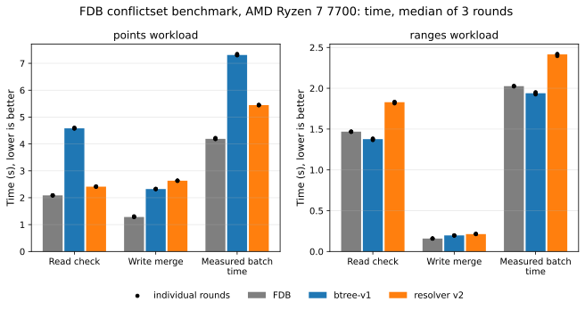

*Figure E16. AMD conflictset times: read check, write merge and measured batch time, medians of three rounds (bars) and the rounds (dots). Lower is better.*

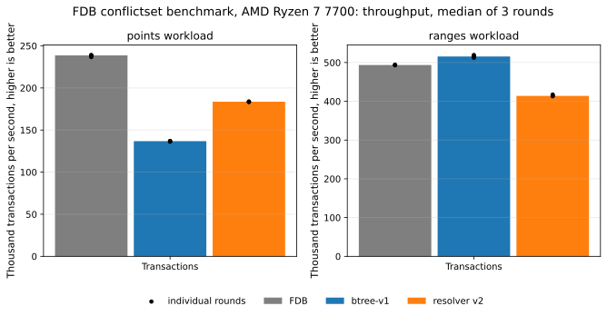

*Figure E17. The same runs as transactions per second. Higher is better.*

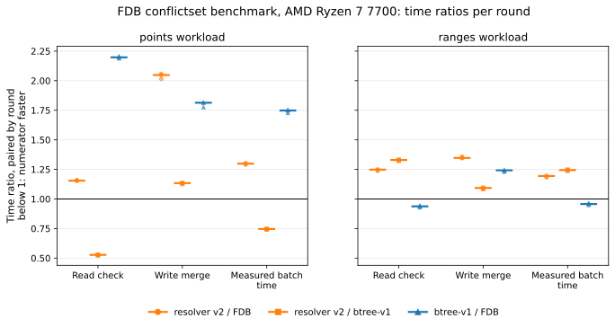

*Figure E18. Time ratios paired within each round (v2/FDB, v2/v1, v1/FDB). Below 1 the numerator is faster.*

### Integrated custom benchmark

3,000 batches, pools of 16,384 pages. The total is the sum of the timed phases (read check, write merge and combine), not the batch path's wall time.

| Candidate | Point read check, s | Point write, s | Point total, s | Range read check, s | Range write, s | Range total, s |
|---|---:|---:|---:|---:|---:|---:|
| FDB | 4.724 | 1.992 | 6.746 | 3.922 | 1.187 | 5.141 |
| v1 | 13.417 | 3.417 | 16.867 | 5.976 | 1.657 | 7.677 |
| v2 | 6.589 | 3.812 | 10.421 | 3.744 | 1.694 | 5.470 |

Paired total-time ratios: v2/FDB 1.545 for points and 1.065 for ranges; v2/v1 0.619 and 0.713. V2's range read check takes 0.955 of FDB's time. Decision hashes are `4787dbf4af9b9ca8` and `df42a6e5c89796ea`, as on the other machines. This session is separate from the [29 October session](#amd-29-october-session), which measured a different v2 revision.

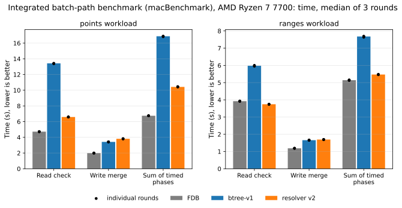

*Figure E19. AMD integrated custom benchmark: read check, write merge and total of timed phases. Lower is better.*

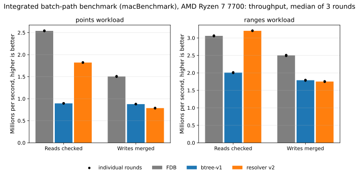

*Figure E20. The same runs as read and write rates. Higher is better.*

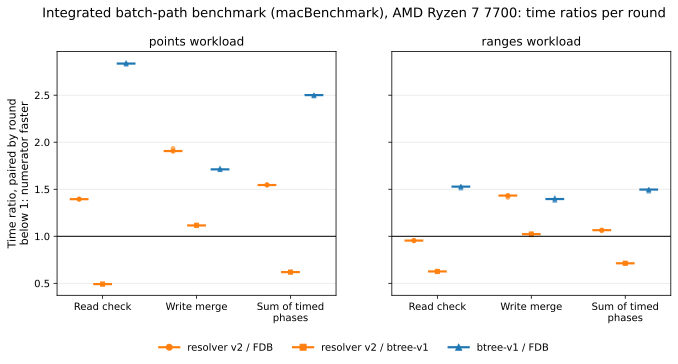

*Figure E21. Paired time ratios of the same runs. Below 1 the numerator is faster.*

### Standalone custom benchmark

`blocksizebench <workload> 3000 1024`, 2 KiB blocks; v1 and v2 only. The v1 executable uses the benchmark file as first written for the sequential tree, since v1's commit does not contain one; every `resolver1` source compiled for it is that of `a8921c3bab`.

| Workload | v1 total, s | v2 total, s | Paired v2/v1 total | v2/v1 read check | v2/v1 write |
|---|---:|---:|---:|---:|---:|
| Points | 12.414 | 9.159 | 0.738 | 0.647 | 1.093 |
| Ranges | 6.074 | 4.996 | 0.820 | 0.759 | 1.034 |

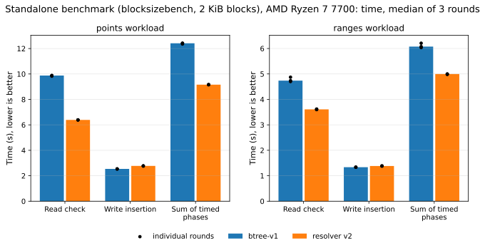

*Figure E22. AMD standalone read, write and total times. Lower is better.*

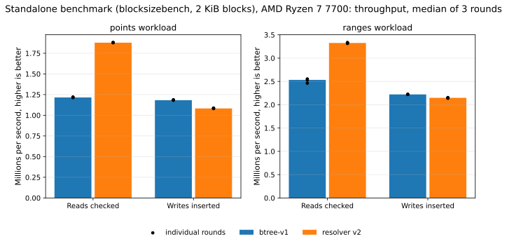

*Figure E23. The same runs as read and write rates. Higher is better.*

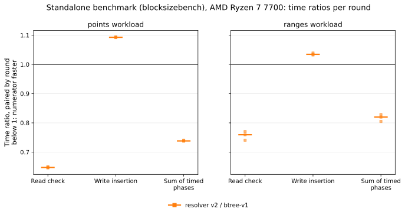

*Figure E24. Paired v2/v1 time ratios. Below 1 v2 is faster.*

### skiplisttest

Seven key layouts, seed 1, 500 batches of 40,000 ranges, span 10, pools of 262,144 pages. `Detect only` times, medians of three rounds, with paired ratios:

| Configuration | FDB, s | v1, s | v2, s | v2/FDB | v2/v1 |
|---|---:|---:|---:|---:|---:|
| head16 | 16.215 | 28.025 | 19.438 | 1.199 | 0.694 |
| head32 | 16.531 | 29.526 | 20.800 | 1.257 | 0.704 |
| tail32 | 17.841 | 31.020 | 22.177 | 1.243 | 0.714 |
| head64 | 17.865 | 31.728 | 22.221 | 1.239 | 0.698 |
| tail64 | 23.466 | 37.284 | 27.478 | 1.171 | 0.737 |
| head128 | 19.915 | 35.543 | 26.617 | 1.337 | 0.746 |
| tail128 | 36.484 | 52.155 | 41.963 | 1.150 | 0.802 |

By phase, v2's read check takes 0.81–0.96 of FDB's time and its write merge 2.30–2.60; against v1, 0.41–0.48 and 1.10–1.13. In every configuration the three candidates commit 7,176,921 transactions with the same decision hash. For this battery the harness generates the test data before constructing the conflict set, so that all candidates resolve the same data; the campaign note explains why.

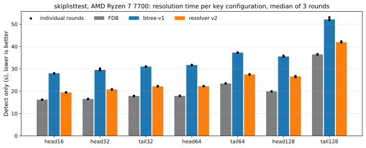

*Figure E25. AMD skiplisttest `Detect only` time per key layout. Lower is better.*

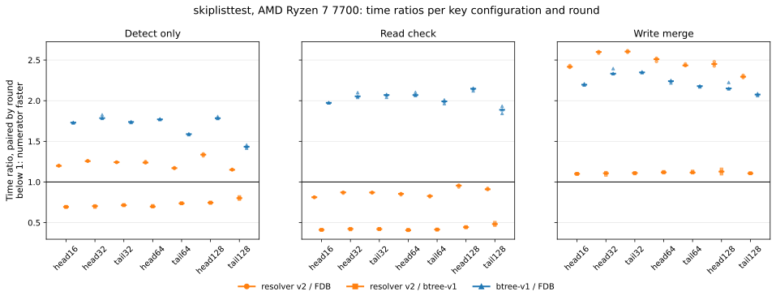

*Figure E26. Paired ratios per layout for `Detect only`, read check and write merge. Below 1 the numerator is faster.*

### Long trace

The same trace segment as on Intel, `[57,600, 230,400)` of `pilot-2000M-l0-7200.trace`, under the same 6 GiB counted-history budget: pools of 98,300 pages, ordinary memory. The v2 accounting pass is new; the v1 run is the archived accounting run of 23 October on the same machine. Checked batch by batch before overlaying, both runs have the same versions, offered and decision hashes (`11334b1aea22e641`, `5001114085b550fb`), acceptances, conflicts, rejections and history bytes in all 172,800 batches; v2 had no walk mismatch. Their capacity floor differs in 518 batches by exactly one 31.25 ms step, in both directions.

Both trees discard for the first time 702.9 seconds into the segment, and the minimum retention observed afterwards is 582.94 seconds, at the end of the segment; retention has not stabilized. Short validation runs with checking, at the full pool and at 1,000 pages, found no model or walk mismatch. Only retention, memory and decisions are compared: no time from these runs is used.

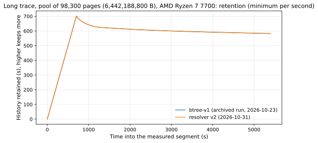

*Figure E27. AMD retained history over the 5,400-second segment under the 6 GiB budget: v2 new, v1 archived. The curves coincide except for the 518 one-step differences.*

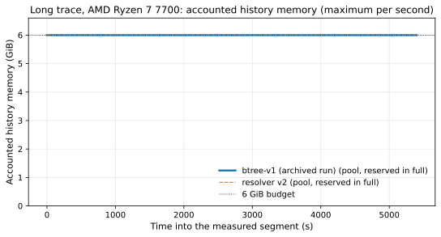

*Figure E28. History bytes over the same segment.*

### Scope of this campaign

One machine and one session; no value here is compared with the Intel or Apple M3 results or with the 29 October session. The timings are of the batch path and the harness on one core, not cluster throughput. The results are those of the measured revisions listed above.

## Reproducing the figures

The Intel figure package contains the original short-benchmark records, extracted CSVs, source and binary manifests, and `make_figures.py`. The warm-up rows remain in the standalone CSV and are filtered out by the plotting script. The earlier standalone reference is retained only in its historical CSV.

Two larger per-batch datasets are distributed as compressed assets of the release [`resolver-v2-evaluation`](https://github.com/ricardojimenezperis/fdb-beyond-5s/releases/tag/resolver-v2-evaluation). Download them into `evaluation/hp/data/`, check them against `ASSETS.sha256`, and regenerate:

```sh
cd evaluation/hp/data
curl -LO https://github.com/ricardojimenezperis/fdb-beyond-5s/releases/download/resolver-v2-evaluation/longrun-per-batch.csv.gz
curl -LO https://github.com/ricardojimenezperis/fdb-beyond-5s/releases/download/resolver-v2-evaluation/longrun-resolver-v2-time-per-batch.csv.gz
sha256sum -c ../ASSETS.sha256
cd ..
python3 make_figures.py --from-csv
```

To re-extract the short-benchmark CSVs from the included raw records, use `python3 make_figures.py --campaign-root raw`. Re-extracting long-trace data requires the original long-trace campaign directories. The script leaves the distributed long-trace CSVs in place when those directories are absent.

The package records a clean regeneration with Python 3.12.3 and Matplotlib 3.10.8, with `/data` hidden: all ten SVGs and ten PNGs were byte-identical to the distributed figures. That result is recorded in [REGENERATION.txt](evaluation/hp/REGENERATION.txt). Different plotting-library versions can change rendered bytes without changing the underlying values.

The AMD and Apple M3 package in [`evaluation/amd-m3/`](evaluation/amd-m3/NOTE.md) contains the run CSVs, `make_figures.py`, its note and `SHA256SUMS`. `python3 make_figures.py --from-csv` redraws its five figures from the CSVs; a second run with Python 3.12.1 and Matplotlib 3.11.2 gave byte-identical files. Its raw run records are not distributed, because they also contain development candidates outside this comparison.

The AMD package of 30–31 October in [`evaluation/amd/`](evaluation/amd/NOTE.md) contains its run records, CSVs, `make_figs.py`, `make_tables.py` and `SHA256SUMS`; its note records a byte-identical regeneration of the figures and tables from `data/`. Its four largest files are release assets; [ASSETS.md](evaluation/amd/ASSETS.md) explains how to restore and check them.

Original records preserve their execution paths and machine-load readings. Those paths describe the measurement environment; regenerating figures from the distributed CSVs does not require that directory layout. Per-file checksums protect the supplied records, while the manifests identify the code and measurement conditions.

## Scope of the processor comparisons

Intel has the full set of benchmarks: conflictset, skiplisttest, the integrated and standalone custom benchmarks, and the long trace. AMD has the same set in its campaign of 30–31 October, plus the earlier integrated session of 29 October. Apple M3 has the standalone custom benchmark, against a different v1 baseline from Intel's. Each campaign keeps its own source identities, and no ratio combines machines or sessions.

V2's read improvements span several workloads, but its current write path remains individual `addWrite` calls. In skiplisttest, write time offsets the read savings against FDB; on the long trace, writes dominate total time. The [design](03-resolver-v2-design.md) explains the traversal and maintenance algorithms behind these results.
