# Temporal conflict B+ tree · Final Resolver v3 design

[Index](README.md) · [Current Resolver design](../../design/02-resolver.md) · [v2 snapshot](../v2/README.md)

**Selected implementation:** [resolver-v3](https://github.com/ricardojimenezperis/foundationdb/tree/resolver-v3), production commit `f866c98d8585a77280adbf44c72650f16e975f86`, released as [`resolver-v3-final`](https://github.com/ricardojimenezperis/foundationdb/releases/tag/resolver-v3-final). This document describes final v3 and its default two groups of eight write tasks. It specifies the complete resolver, including the storage and maintenance mechanisms used by its read and write paths. V3.8 (`55d5f98974`) is its historical base.

## 1. Purpose, semantics and interface

The Resolver retains *write-conflict history*, not database values. Each live history entry is a half-open key interval `[begin,end)` with the commit version (CV) of the write that established its current coverage. Live entries are disjoint and ordered by begin key. A transaction reading `[rb,re)` at read version RV conflicts with an entry `[wb,we)@CV` exactly when

```text
rb < we  &&  wb < re  &&  CV > RV
```

Equality at either excluded endpoint is not an overlap. A write replaces the covered part of older history while preserving uncovered *exteriors* with their original CV. For example, applying `[30,60)@120` to `[10,90)@100` leaves `[10,30)@100`, `[30,60)@120` and `[60,90)@100`. A read at RV 110 over `[20,70)` conflicts because it intersects the middle entry; a read ending at 30 does not conflict with that entry.

`TempConflictBTree` has two batch phases:

1. `checkReads<G>` consumes sorted native endpoints and transaction records. It checks eligible read ranges and locates the leaves for both read and write begins in one mixed descent. It records speculative write destinations, but does not insert writes, advance `reclaimCV_`, or reclaim key blocks.
2. Once transaction decisions are complete, `addWrites(decisions,CV)` filters rejected and too-old transactions, unions their accepted write intervals, and applies the result in increasing accepted-begin order. The call uses one CV; CVs in successive calls must not decrease. Reservation for a write may reclaim history and advance `reclaimCV_`.

The caller keeps endpoints, transaction records and borrowed key bytes alive through both phases and supplies the admission results. A per-write reservation failure may throw after earlier writes or reclamation have taken effect; the batch is not transactionally rolled back. The pool budget applies to retained history blocks, not temporary vectors, scheduler slots or deferred-cleanup records. Storage Server data-version retention and distributed read-version protection are separate obligations.

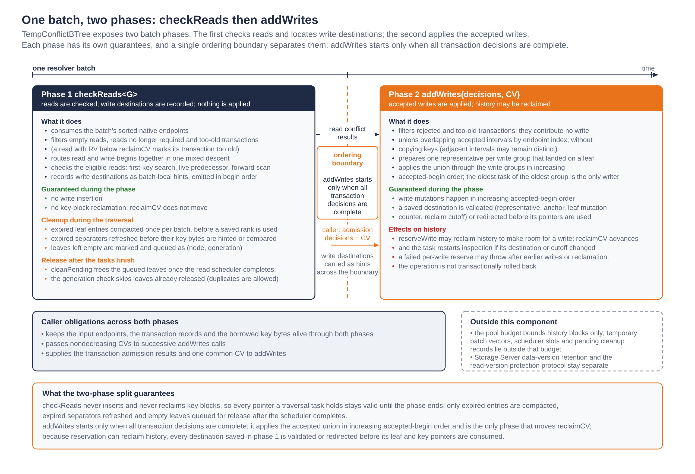

*Figure 1. checkReads checks eligible reads and records write destinations without applying writes or advancing reclaimCV. Once transaction decisions are complete, addWrites filters and unions accepted intervals, validates their destinations, and applies them in begin order. Empty leaves queued during read traversal are released after its tasks finish.*

### Transaction and read-status rules

A read whose RV is below `reclaimCV_` makes its transaction too old; equality with the cutoff remains admissible. Existing conflict flags are never cleared. Empty reads and reads no longer needed under the transaction/reporting policy are omitted. If complete per-read reporting is requested, other reads of a transaction may remain eligible after one has conflicted; otherwise work on an already rejected transaction can stop. A conflict test compares the entry CV before using potentially expired key bytes. The read phase may compact expired entries and refresh separators, so it is logically read-only with respect to *write history* but can maintain the physical tree.

The read-conflict result is per read range; the native adapter maps it to transaction decisions and optional conflict-range reporting. Admission results are finalized before `addWrites` filters writes. The tree does not itself protect a read version on Storage Servers.

## 2. Physical representation and pool

`PagePool` owns a common budget of 64 KiB pages divided, by default, into interchangeable 2 KiB blocks. `BNodeStore` manages nodes, `KeyStore` manages key records, and `TempConflictBTree` owns their pool, the root, the reclamation cutoff and the algorithms that coordinate them. A freed node block can next hold keys, or vice versa; there is no fixed partition between the two stores. Allocation pops an intrusive free-block list and release returns a block to it. The default geometry supplies 32 blocks per page. Transient batch vectors and task storage lie outside that pool.

Leaf blocks contain `RangeRef` descriptors and their CVs, a physical-slot free bitmap, `order[]`, and left/right links in global key order. Internal blocks contain child pointers, separator references and separator CVs, conservative per-child maximum CVs, the free bitmap and `order[]`. A node header carries kind, count, parent and physical parent slot, conservative maximum CV, generation, intrusive age-list links and `childrenNeedingSplit`. The root may be a leaf. Capacity is computed from the actual structure layout fitting a block; with the 2 KiB campaign build, an internal node supports 40 children and a leaf 59 entries. Those numbers depend on the compiled layout.

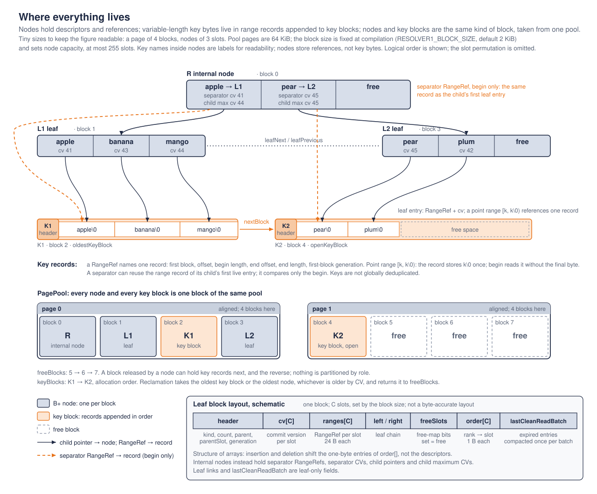

*Figure 2. Node blocks hold descriptors, versions and references; linked key blocks hold key bytes. Both block types draw from one interchangeable pool. Internal separators reuse stored range records rather than owning copies of their key bytes.*

### Logical order versus physical slots

`order[rank]` maps a logical sorted rank to a physical slot. A set free-bitmap bit means that slot is free. Insertion selects a free slot, writes the new descriptor there, and shifts one-byte indices in `order[]`; deletion removes an index and frees its slot. Surviving descriptors stay in their slots during ordinary insertion and deletion, although a split moves descriptors between nodes. `parentSlot` identifies a physical slot, not a logical rank; `parentRank()` finds its rank by scanning the parent's order array. Children moved by a split have their parent and slot updated.

For example, physical slots 2, 0 and 4 may hold logical keys 10, 30 and 50, giving `order=[2,0,4]`. Inserting 20 into free slot 1 makes `order=[2,1,0,4]` without moving the old descriptors. Removing 30 then leaves `order=[2,1,4]`.

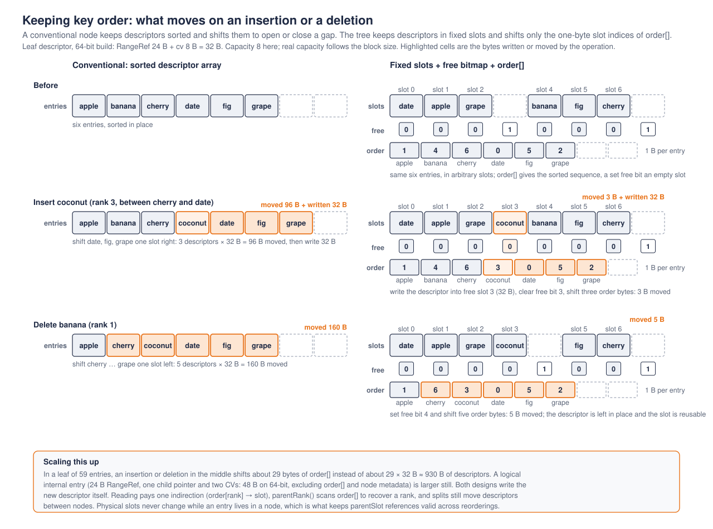

*Figure 3. The order array maintains sorted ranks with one-byte indices. Insertion and deletion shift indices, not all surviving range descriptors; the bitmap tracks reusable physical slots.*

### Key records, ranges and point intervals

Key bytes append to linked `KeyBlock` records, independently of tree order. A record can cross blocks; continuation skips each block's header. A `RangeRef` stores the first block pointer, offset, begin length, end start and length, and the first block's generation. It occupies 24 bytes in this layout. An internal separator reuses the range's reference and compares its begin key; it has no separate inline prefix or separately owned key bytes. Comparisons use chunks of `memcmp`, follow continuation blocks when required, and use total length to break equal-prefix ties. Address arithmetic inside one block cannot locate an arbitrary byte beyond a block boundary.

A point interval `[k,k\0)` stores the endpoint `k\0` once and treats its prefix `k` as the begin key. For a key of length `L`, its endpoint payload is `L+1` bytes rather than `2L+1`; descriptors, block headers, occupancy and slack still contribute to total memory. Appending a record computes and obtains all required new blocks before modifying existing key storage, and copied exteriors retain their old entry CV even when their bytes are appended later.

### Versions, generations and lifetime

Logical expiry, physical reclamation and pointer validity are different facts. An entry with CV at or below the cutoff may still occupy a leaf. A key block has a conservative maximum CV for its records and can remain allocated after some records expire. Key blocks are reclaimed in allocation order; the first-block generation in a nonempty key reference is valid only if it exceeds `lastReclaimedKeyGeneration_`. This test does not dereference a possibly reused block. While the first block of a record survives, continuation blocks cannot have been reclaimed ahead of it. Before reading an expired entry or separator, the algorithm tests its CV and refreshes or skips it instead of dereferencing freed key bytes.

Node generations serve another purpose: deferred cleanup stores `(node,generation)`, checks that pair before releasing the node, and skips duplicate records for a node already released. Final v3 assigns node and key-block generations from disjoint value spaces. They cannot compare equal merely because a pool block was released in one role and reused in the other.

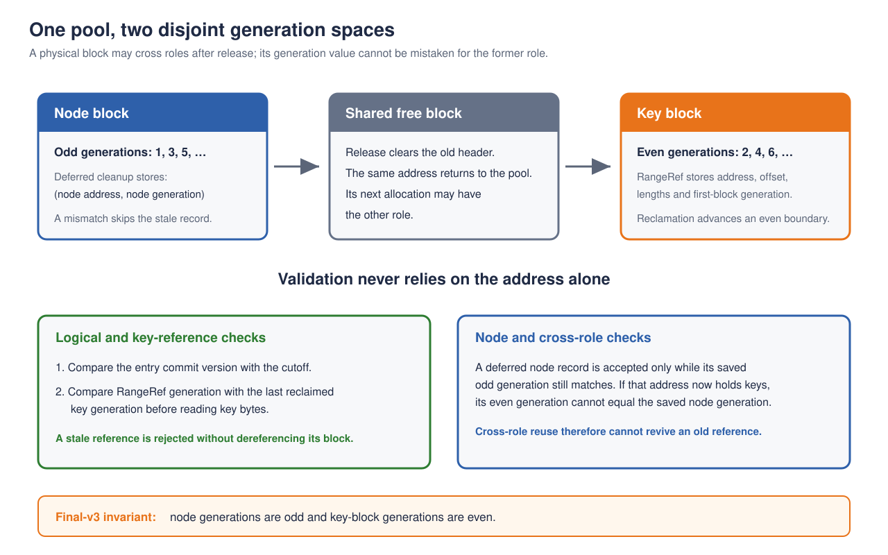

*Figure 4. A stored range reference is checked against the last reclaimed key-block generation without reading its target. Node generations independently guard deferred empty-leaf cleanup against duplicate or stale records.*

### Reducing TLB misses with HugeTLB

The 64 KiB `Page` is the pool's **logical allocation unit**, not an operating-system huge page. On Linux, `PagePool` can back many consecutive logical pages with 2 MiB HugeTLB pages. At the default geometry, one 2 MiB mapping spans 32 logical pages and therefore 1,024 interchangeable 2 KiB node/key blocks. Neither B+ tree navigation nor the free-block format changes with the backing mode. Fewer address translations can cover the pool, reducing TLB pressure during irregular node and key accesses; a reduction in misses or elapsed time depends on the workload and has to be measured.

`RESOLVER1_PAGE_MODE` selects the backing when the pool is constructed:

| Mode | Allocation and meaning |
| --- | --- |
| unset or `legacy` | `new Page[]`; the source default, without an explicit huge-page request. |
| `base` | A 2 MiB-aligned anonymous mapping with `MADV_NOHUGEPAGE`, for an explicit base-page control on Linux. |
| `thp` | A 2 MiB-aligned anonymous mapping with `MADV_HUGEPAGE`; the advice requests transparent huge pages but does not prove the kernel supplied them. |
| `hugetlb` | An anonymous `mmap` with `MAP_HUGETLB` explicitly requesting 2 MiB HugeTLB pages on Linux; failure to reserve or map them raises an error, with no silent fallback. |

The explicit Linux mappings round the backing length up to a multiple of 2 MiB, while the usable pool still contains `floor(budget / 64 KiB)` logical pages. The padding can make the mapped length slightly greater than the counted pool storage. The mode backs **only the shared history pool**: temporary batch arrays, task slots, pending cleanup records and other process allocations are outside it. It does not change the history cutoff or reclaim policy. On non-Linux platforms the explicit modes are unavailable; `legacy` remains usable.

The final publication measurements select `RESOLVER1_PAGE_MODE=hugetlb` and verify that the complete history pool uses HugeTLB pages in every timed run. That is the published deployment configuration, not the source default. FDB, v1 and v2 use their native ordinary-memory implementations, so the comparison represents deployed configurations and does not isolate the effect of page mode. `thp` would need its own backing verification before attributing a result to actual huge-page coverage.

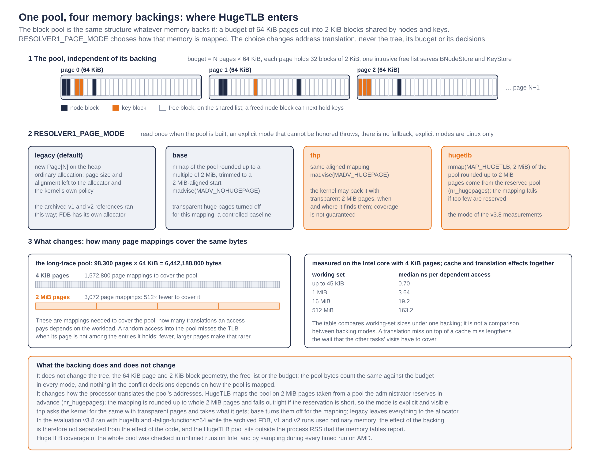

*Figure 5. The same logical pool can use ordinary allocation, an explicit base-page mapping, transparent huge-page advice or explicit 2 MiB HugeTLB backing. HugeTLB increases the address range covered by each page translation without changing tree operations or the logical budget. Final v3's published performance configuration uses HugeTLB, but the evaluation does not isolate its effect.*

For precision when reading the diagram, the 4 KiB and 2 MiB counts are **page mappings needed to cover the pool**, not the number of translations executed or a 512-fold speedup. `MADV_NOHUGEPAGE` disables transparent huge pages for the `base` mapping; it does not pin memory. Archived FDB uses its own allocator rather than the `legacy` mode of this `PagePool`. The latency table includes cache effects as well as address translation and is not a direct comparison between backing modes.

## 3. Tree invariants and navigation

The tree maintains these invariants across completed operations:

| Invariant | Consequence |
| --- | --- |
| Live leaf intervals are ordered and disjoint | One predecessor and a forward scan suffice for overlap queries. |
| Every live logical rank names an occupied physical slot | `order[]` and the free bitmap agree. |
| Parent pointers and physical parent slots agree with child pointers | Upward propagation and removal can locate the correct descriptor. |
| Leaf links follow global key order | Reads and writes can continue across leaf boundaries. |
| Live separator minima route to the appropriate child | Binary partitioning and point descent preserve key order. |
| Internal free slots cover pending child splits | A child split has a reserved parent slot and does not cascade. |
| Node/subtree maximum CVs conservatively bound their contents | Reclamation does not discard a subtree with newer entries. |
| `reclaimCV_` never decreases | Expired history cannot reappear as valid. |
| Empty nonroot leaves and ancestors are removed at the operation boundary | Saved cursors and successor links have defined maintenance rules. |

Separators may be stale *between* maintenance points. An internal separator refers to the minimum key of its child and carries that key's CV, rather than the CV of a split that promoted it. The conservative node maximum CV and the allocation age play different roles. A search must refresh an expired separator before hinting or comparing its bytes.

## 4. Mixed routing during `checkReads`

The caller's native endpoints are sorted by key. `checkReads` extracts a compact, begin-sorted `readWriteBegins` sequence, with each item tagged as a read or a write and represented by an index into the caller's arrays. `nextBegin` links the next begin of the same type; `nextOther` finds the next begin of the other type. No endpoint key bytes are copied for this routing. Empty and unnecessary reads, already-too-old transactions, and reads excluded by the reporting policy are filtered before or during traversal; eligibility is rechecked as task work proceeds because another read task may reject the same transaction.

A task owns a consecutive half-open slice `[opBegin,opEnd)` and a current tree node. At an internal node, separator rank zero denotes the minimum of the first child, not a boundary. The task partitions its mixed slice around a selected remaining separator by finding the first begin at or above it. Equal begins go right, including duplicate begins. The current task can retain the left nonempty slice while a new task receives the right one; an empty slice creates no task. A slice with no remaining separator descends to its single child. A task can descend several levels; a new task is created by partitioning, not by every descent. The initial task spans the root and all eligible begins, and a root that is already a leaf goes directly to leaf processing.

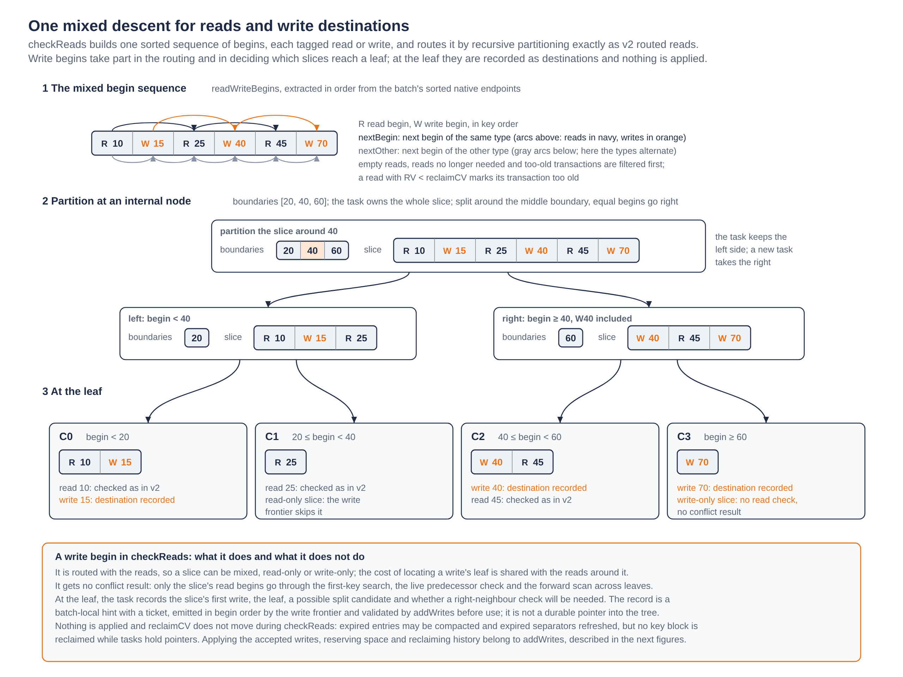

*Figure 6. Mixed, key-ordered begins are partitioned at each internal node, with equality routed right. A leaf task checks its reads and records the first write destination in its slice. A write begin receives no read-conflict result and no write is applied during this phase.*

At a node with `s` child boundaries and `r` begins, independent binary searches need `O(r log(s+1))` routing comparisons. Recursive partitioning searches progressively smaller slices and skips empty ones; its bound is `O(m log(1+M/m))`, where `m=min(s,r)` and `M=max(s,r)`. With similar sequence lengths this becomes linear, while with one begin it remains logarithmic. This is a *per-node key-comparison bound*, not a batch-time guarantee: external key bytes, separator refresh, leaf scans, scheduling and prefetch all add work.

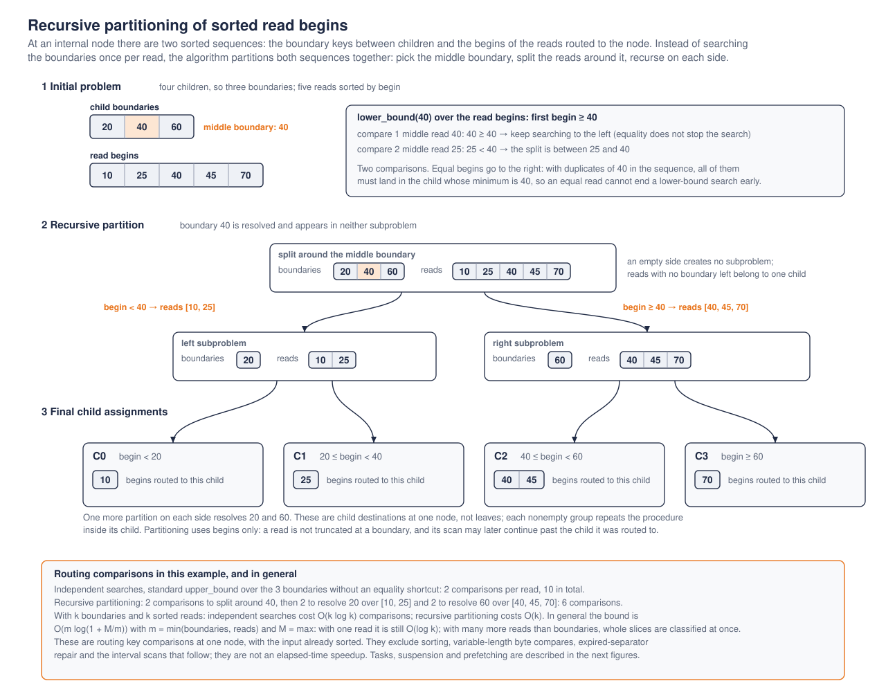

*Figure 7. The middle child boundary divides the sorted begin slice into smaller subproblems. A resolved boundary is excluded from further comparisons and equal begins go right. The drawing illustrates routing; final v3 routes both read and write begins by this rule.*

### Read-scheduler tasks and prefetch

The grouped read scheduler has `G` resident slots, a visitation-order array, a free-slot bitmap, new right siblings and a LIFO collection of suspended tasks. All unfinished tree work is resident, newly created or suspended. At a round boundary, right siblings are interleaved immediately after their surviving left partitions; the first `G` tasks in key-range order are admitted. The excluded suffix is saved in reverse order so the earliest suspended task resumes first. Selected resident tasks keep their physical slots. A resumed task reissues the prefetch for its saved state because its earlier hinted data may have been evicted. No OS thread or parallel mutation is created by this scheduler.

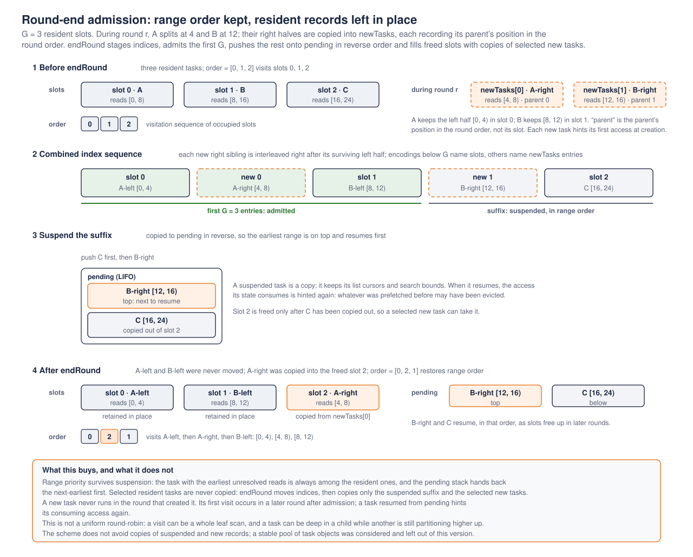

*Figure 8. The scheduler interleaves new right tasks after their left partitions, admits the first G tasks and suspends the rest. It retains selected resident slots while restoring visitation order and re-hints a resumed task's needed data.*

Each visit performs one state dispatch for its resident task. A handler may chain directly to another handler when its data is already local; this is still one scheduler visit. A dependency on a node or key issues a software prefetch hint and yields to other tasks. The root is hinted before the initial loop, and new siblings issue a hint when created but begin only after admission. A whole leaf scan can make a visit much longer than others: this is not uniform-work round robin. Prefetch gives a chance for memory latency to overlap with other work, without promising that the line will be resident when consumed.

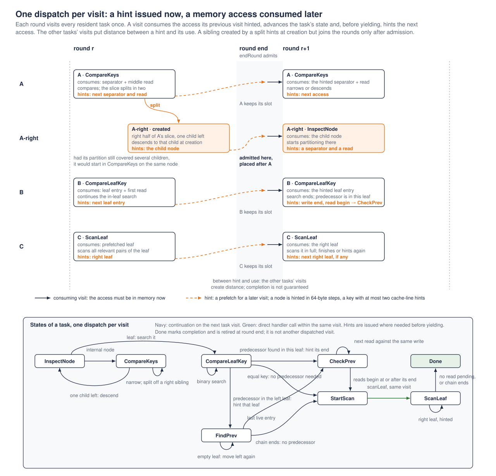

*Figure 9. One dispatch advances a task and often hints its next dependency before yielding. Direct continuations with local data stay in that visit; sibling admission occurs at a round boundary. Other visits give hinted memory time to arrive but do not guarantee completion.*

Node hints walk cache-line positions across the node block. During read traversal, stored-key hints cover at most two cache lines; a cross-block hint checks the first-block generation before following a link. The writer's short input or stored-key span hints its first and last byte, covering at most two lines. Its longer spans hint successive lines, one linked block at a time, with a yield before consuming the next block's link. The writer tests the entry CV before hinting possibly expired stored bytes and validates its destination before using saved pointers. Prefetch does not copy the key or guarantee its arrival.

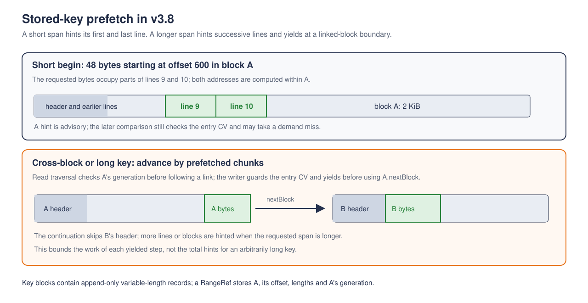

*Figure 10. The common short-key path hints at most two lines. A writer can hint more lines for a long key over successive visits. Read traversal checks first-block generation before following a cross-block link; the writer guards its key with a live-CV check. Hints do not guarantee a cache hit.*

### Leaf search, predecessor and forward read scan

On the first read-phase visit to a leaf in a batch, expired entries are compacted and the leaf is stamped; later visits use the same rank mapping. The task binary-searches the cleaned leaf for the first stored begin at or after its first read begin. An equal live begin can end that search: disjoint history prevents an earlier interval from crossing an entry beginning exactly there. Otherwise the insertion rank becomes the forward-scan start, but the immediately preceding live entry may extend into the read. The predecessor may be in the previous linked leaf. Its end is compared only after its CV has been checked; an overlapping predecessor conflicts when its CV exceeds the read's RV.

Read ends need not be sorted even though begins are. Within each task, unresolved read indices remain linked in begin order. A read is unlinked when it conflicts, ends before the current write begins, or is no longer needed under the transaction/reporting policy. An older or equal-CV overlapping write leaves the read pending for later candidates. A reached-begin prefix avoids repeating comparisons known to hold against later disjoint history entries. The scan processes the relevant pairs in a leaf in one visit, then hints the right leaf and yields; it ends when no pending read remains or the leaf chain ends. Thus a long read can cross leaf and subtree boundaries without restarting at the root.

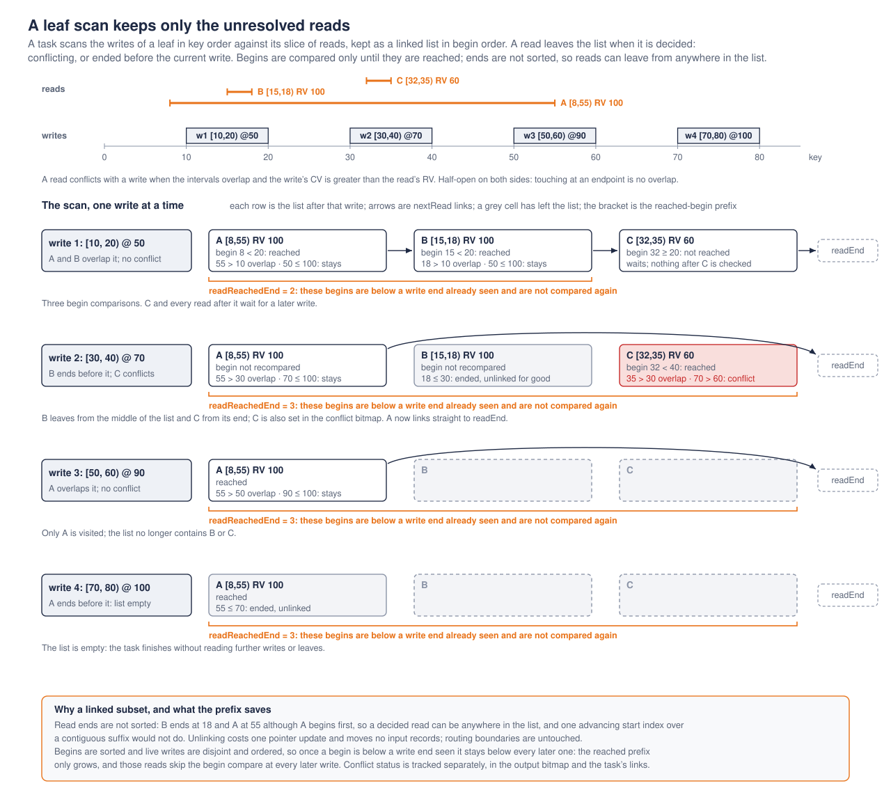

*Figure 11. Sorted read begins keep a linked pending subset while history entries are scanned in key order. Resolved reads are unlinked without moving input records; the reached-begin prefix avoids repeating established comparisons. A scan may continue across leaves.*

### Write-leaf results and the ordered frontier

Write begins help route slices but are never themselves read-conflict queries. At a leaf, a task records its slice's first write, the leaf, a possible split candidate and a right-neighbour-check flag. Leaf tasks can finish out of order. Their write-leaf results carry tickets in begin order, and the write frontier emits only the known ordered prefix. A read-only slice supplies no write result and its ticket can be skipped. An early result waits until all older tickets are released; only then can its buffer slot be recycled. Emitted destinations are batch-local hints, not durable tree pointers. `addWrites` will validate or redirect them before using saved leaf or key pointers.

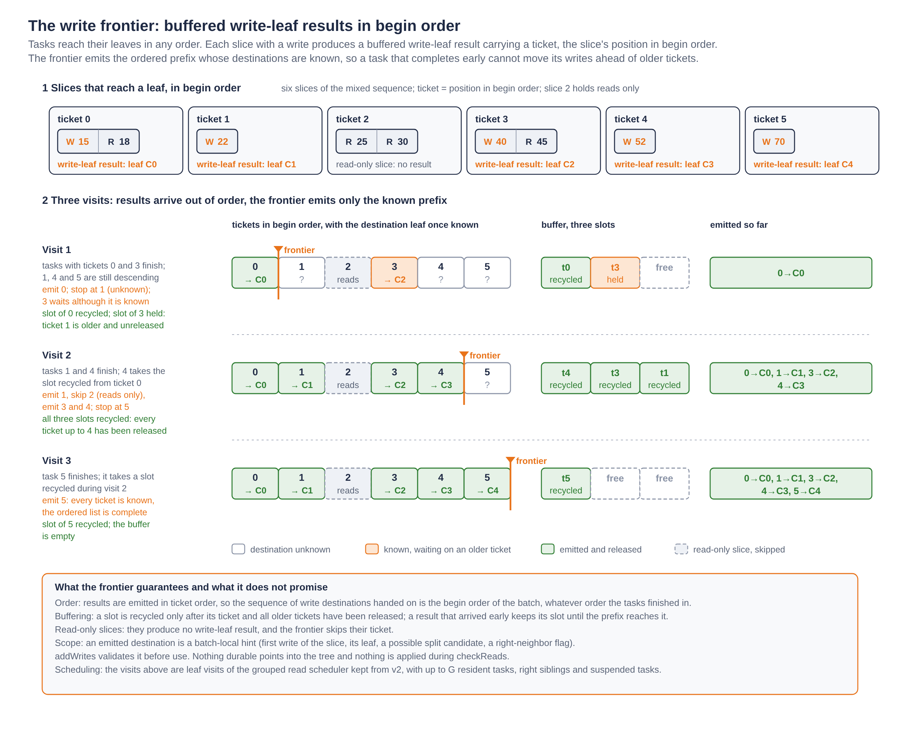

*Figure 12. Leaf tasks may discover destinations out of order. The frontier buffers their ticketed results, skips read-only slices and releases only the known ordered prefix. A slot is recycled after its ticket and all earlier tickets have been released.*

### Separator repair and cleanup during reads

An internal separator can reference bytes later reclaimed even if its child still contains live history. Before hinting a selected separator, `checkReads` checks its CV. An expired reference is refreshed from the child's first live key; this may descend synchronously and stall that visit. Only the selected separator is repaired, avoiding work on keys the partition search will never compare. If a child contains no live entry, an empty marker or a borrowed live neighbor's reference represents it. An empty marker is not a comparable key: routing takes a conservative direction so a forward leaf scan can still find later overlapping history. A task must survive an empty subtree if a long read could continue to the right.

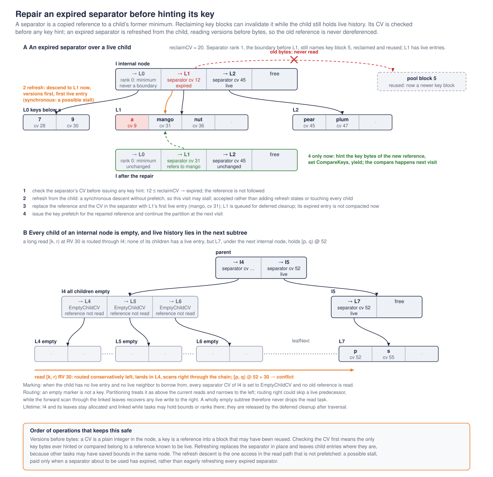

*Figure 13. The selected separator's CV is checked before its key bytes are hinted or compared. An expired reference is replaced from live history. Empty markers avoid dereferencing reclaimed bytes while preserving the possibility of finding an overlap by scanning later leaves.*

Separator repair does not erase internal child slots while read tasks have saved bounds there. A search for a live minimum can queue an empty leaf without compacting its ranks immediately. First traversal of that leaf compacts its expired entries, stamps it for this batch, and subsequent visits use those stable ranks. Empty leaves remain linked and allocated until all traversal tasks retire. Then `cleanPending` drains `(node,generation)` records, skips duplicates, removes empty leaves and ancestors, repairs surviving separators and normalizes the root. It does not reclaim key blocks or advance `reclaimCV_`. This is maintenance during and after a read phase, not pressure reclamation.

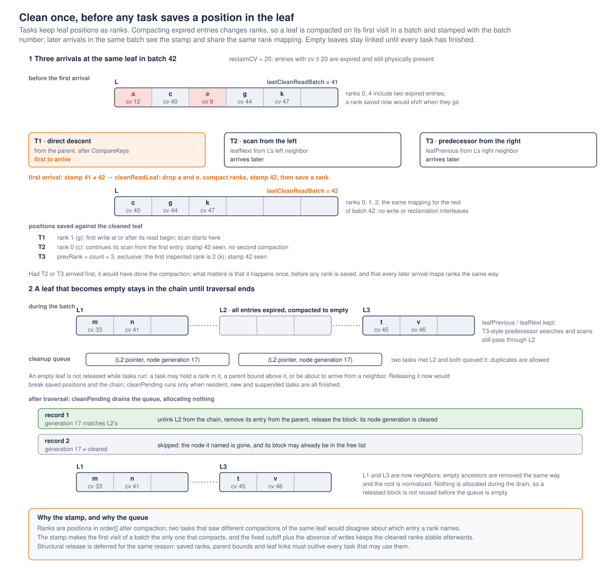

*Figure 14. First traversal compacts a leaf and stamps its batch number before any saved rank is used. Later visits retain the same rank mapping. Empty leaves stay linked until the read scheduler completes; generation-checked cleanup then releases them.*

## 5. From transaction decisions to accepted writes

`addWrites` sees the admission decisions only after `checkReads` has finished. A rejected or too-old transaction contributes no write. The accepted begins are streamed in the input's sorted endpoint order. The union maintains the first begin index and a running end index; overlapping intervals merge, while adjacent intervals may stay separate. It uses indices into the caller's endpoint array, without copying endpoint bytes or allocating an interval object per input interval. All output intervals from one call carry its common CV.

Before applying the union, one representative is prepared for each destination leaf named by the read phase's write groups. Several groups can share the same leaf and representative. A representative retains a right-neighbour-check requirement from a write destination and the first accepted begin relevant to it. Each saved write rank records the destination leaf generation and mutation epoch at which that rank was computed. When one input interval is absorbed into a merged interval, its begin does not create another write; the merged interval keeps the prepared destination of its *first* begin. A previously rejected begin can precede an accepted one on the same leaf, so the representative must be updated to the first *accepted* begin rather than blindly reusing the first write seen during the read phase.

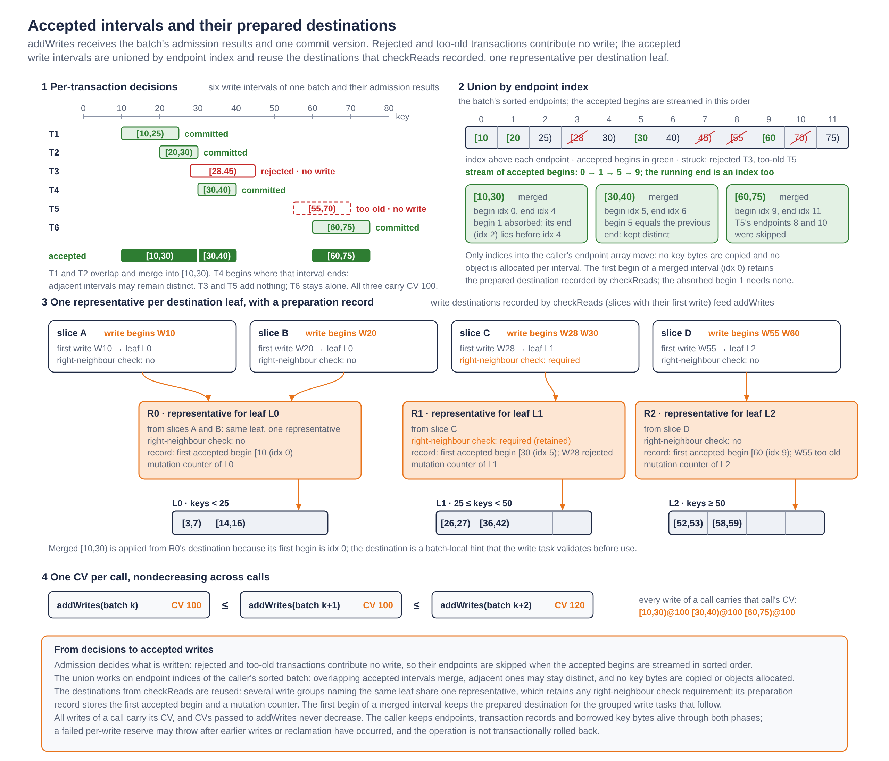

*Figure 15. Rejected and too-old transactions contribute no writes. Overlapping accepted intervals merge through endpoint indices, while adjacent ones may remain distinct. Write groups naming the same leaf share a representative; the first begin of a merged interval retains its prepared destination. Each write in the call uses the same CV.*

The outcome is an ordered sequence of disjoint writes for this call. Applying each write can still overlap intervals from older calls, and the history-update algorithm must preserve the older exteriors at their original CV. The positions prepared during reads are speculative because older writes in this same call, splits, leaf removal and pressure reclamation can change them before use.

## 6. Cooperative write scheduling

The selected build has `RESOLVER1_WRITE_GROUPS=2` and `RESOLVER1_WRITE_LG=8`: two groups of eight slots, at most 16 write tasks. The optional three-group policy and a scalar fallback with zero LG are different source configurations, not the selected final-v3 policy. The scheduler runs on one thread and is non-preemptive: one visit advances one task until it hints a memory dependency, parks, or completes. No two tree mutations occur concurrently.

The oldest task of the oldest group is the **only writer**. Younger tasks can locate their destination, prefetch leaf and stored-key data and stop at `SearchReady`. A parked task leaves the runnable bitmap and is woken when it becomes oldest; repeatedly polling it would waste visits. The successor group is filled early and its leaves hinted, but its searches become runnable when the oldest group's first index reaches its halfway point. Once the oldest group finishes, that slot is refilled and group roles rotate. This overlaps independent memory waits with useful work on older tasks while preserving write order. Number of tasks trades prefetch lead time against cache pressure and scheduler work.

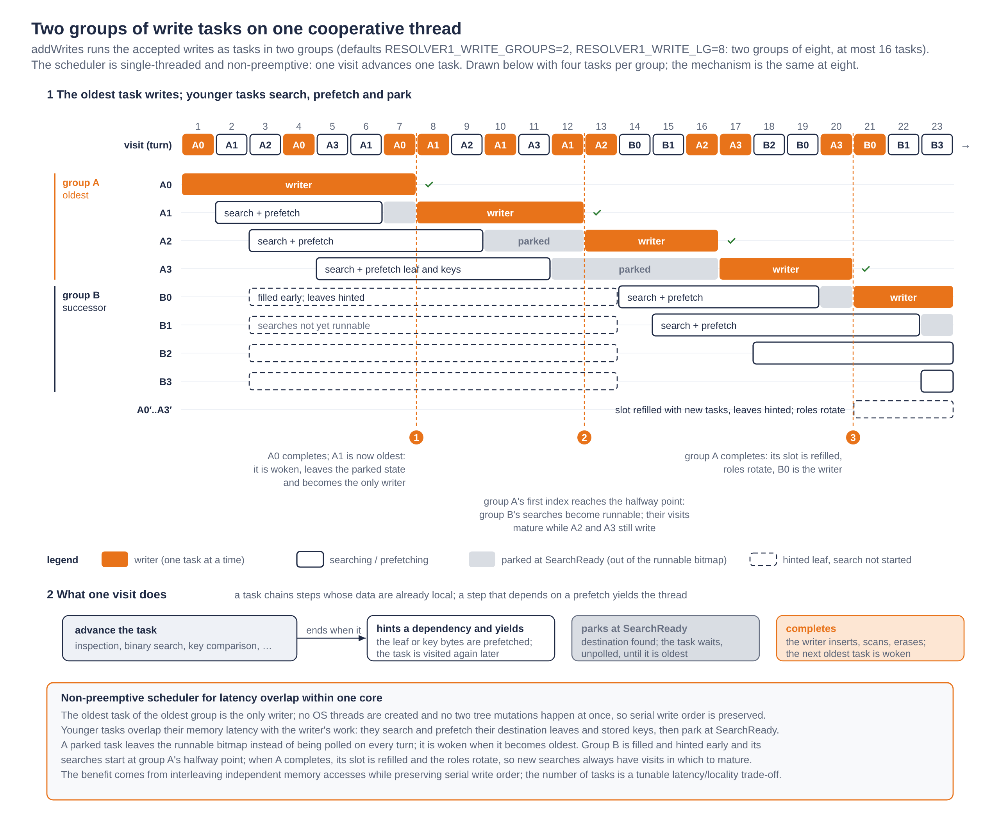

*Figure 16. Four tasks per group illustrate the policy; the selected configuration uses eight. Visits share one thread. Younger tasks search and park, the successor group's searches start halfway through the oldest group, and group roles rotate after the oldest group finishes.*

A write task carries its current accepted interval, destination cursor, leaf-search bounds, scan position, current step, and metadata needed to validate the destination. Inspection can move to the right neighbour when the old leaf boundary is insufficient. Binary search and stored-key comparison establish a candidate position before the task parks. On becoming oldest, it reserves space before modifying the tree; if reclamation changes the destination or cutoff, it restarts inspection. With a valid reservation it prepares a possible split, inspects the predecessor, inserts the new interval, then scans and erases covered history. The same task can take the next accepted interval in its prepared write group and reserves afresh for it. It may continue through linked key blocks by hinting the next block and yielding. Several already-local handlers can chain inside one visit; a step waiting for prefetched data yields to another task.

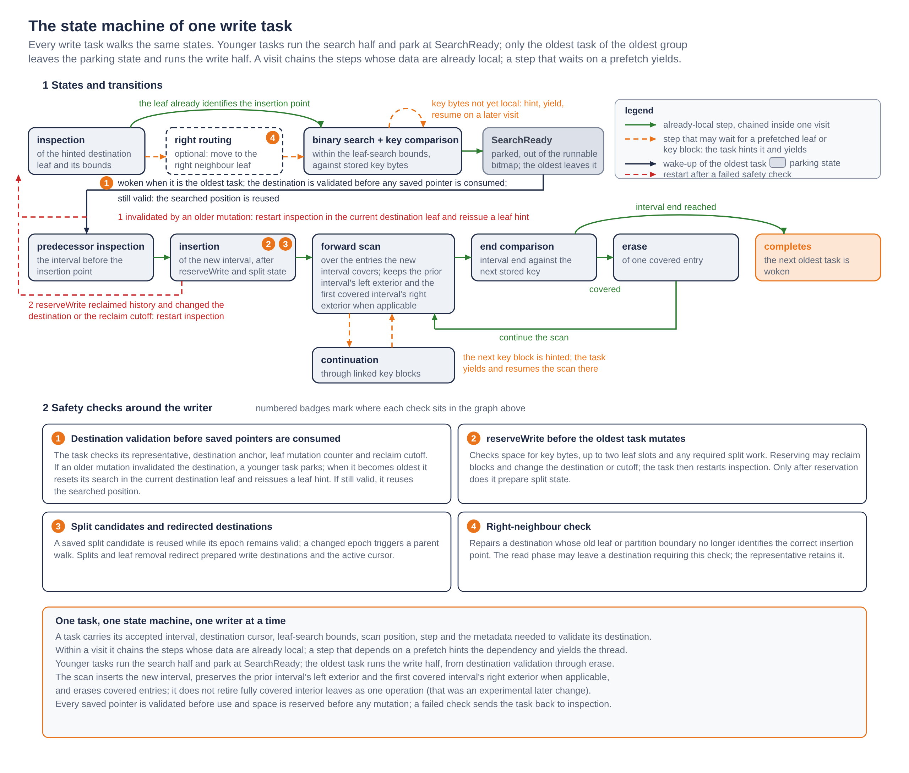

*Figure 17. Younger tasks search and park at SearchReady. The oldest validates its destination, reserves capacity before mutation, inserts and scans forward. An invalidated position or a reservation that changes the destination or cutoff restarts inspection; prefetch-dependent steps yield.*

### Applying one write: predecessor, insertion and exteriors

The input interval `[b,e)@newCV` may overlap a previous history interval whose begin is *before* `b`. Search locates the insertion leaf and checks that predecessor, potentially in its left neighbour. An overlapping predecessor `[a,z)@oldCV` with `a<b` leaves a left exterior `[a,b)@oldCV`; if `e<z`, it also leaves a right exterior `[e,z)@oldCV`. The old CV stays on both. The new interval `[b,e)@newCV` covers even gaps that previously had no entry. The insertion destination is the prepared leaf for `b`, even if the overlapping predecessor resides in the leaf to its left.

After insertion, the scan walks entries in key order. Expired entries are erased without reading their key bytes. Fully covered live entries are erased. If the first survivor is only partially covered, its begin becomes `e` while its old end and CV remain. For example, `[10,40)@100`, `[50,90)@110` plus `[30,60)@120` produce `[10,30)@100`, `[30,60)@120` and `[60,90)@110`, including coverage of the old gap `[40,50)`. When a leaf minimum changes, the surviving separator is propagated upward. Removing the last entry of a nonroot leaf unlinks it, repairs the parent and neighbour chain, and may remove empty ancestors.

Final v3's forward scan compares and erases covered entries individually. It does **not** retire a fully covered interior leaf as one operation. The v3.17 experiment added that different operation and is not part of the selected tree.

## 7. Capacity reservation and proactive splits

There are two related reservations. `reserveWrite` establishes a conservative free-block allowance before the oldest task mutates, accounting for key records and possible node allocations. Its estimate uses the longest key seen so far, the current write's endpoints, a floor of 35 blocks, and a smaller write-specific threshold if that floor cannot be met. Separately, each internal node keeps spare *child slots* reserved for children that may need to split. The first can reclaim history; the second prevents a structural split from cascading through full ancestors.

### Predicting split demand

A leaf needs a split when it has at most one free physical entry slot, because one write can add both its own interval and a surviving right exterior. Two free slots suffice for that local insertion. For an internal node, let `C` be its capacity, `N` its number of children, `F=C-N` its free child slots, and `P=childrenNeedingSplit` the count of immediate children whose `needsSplit` predicate is true. The maintained invariant and the proactive threshold are

```text
P <= F
needsSplit(leaf)     = (freeSlotCount <= 1)
needsSplit(internal) = (P == F)
```

An internal node at `P==F` is not necessarily physically full: all free slots are *spoken for* by pending child splits. A search records candidates on its path; after cleanup it rechecks them because removals can change demand. The destination leaf is preferred if it needs a split; otherwise the deepest still-pending internal node is selected. Splitting that one existing node before the write restores slack. A root split may additionally allocate a new root.

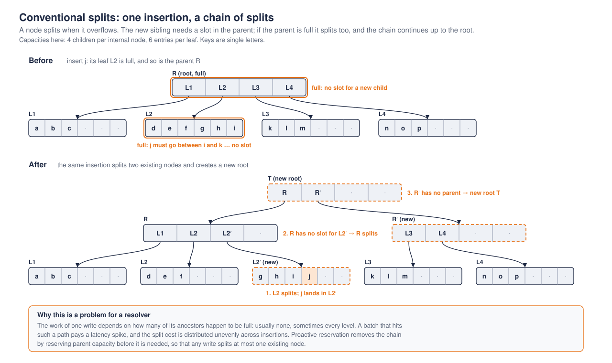

*Figure 18. Without reserved parent capacity, inserting into a full leaf can also split its parent and create a new root in the same write.*

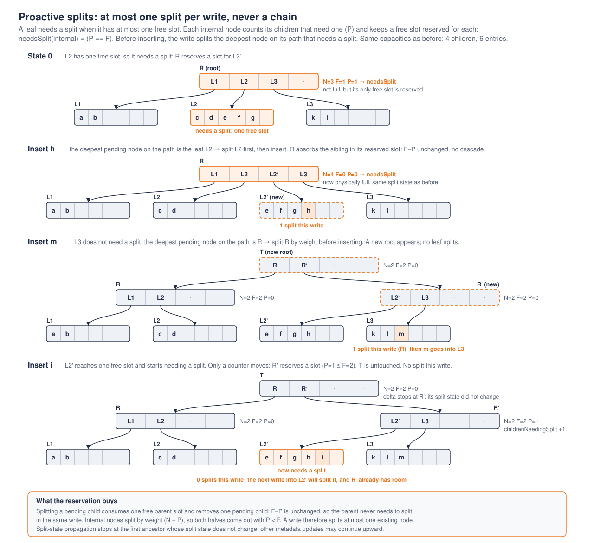

*Figure 19. A pending child split has a reserved parent slot. Proactive splitting limits one write to splitting at most one existing node, although it can also create a new root and update split-state metadata along ancestors.*

Why does the selected child not force its parent to split? That child already contributes one unit to `P`. Installing its new sibling consumes one free parent slot, while the split removes the original child's pending contribution:

```text
F' = F - 1
P' = P - 1
F' - P' = F - P
```

Thus the balance of spare slots against demand is unchanged and the invariant ensures the parent has a slot. A subsequent insertion can make a different child pending; `propagateUpdates` carries `+1` or `-1` for a child entering or leaving `needsSplit`, adjusting parent counts and continuing upward only if the parent's own predicate changes. This may walk ancestors but does not split them in a cascade.

A leaf split moves the upper portion of its ordered entries into a new right leaf, repairs both neighbour links and adjusts the active leaf/rank cursor. An internal split distributes children by weight, counting pending-split children twice to leave room for their future siblings. Children moved to the new internal node get new parent pointers and physical parent slots; each half recomputes its pending count and separator minima. A split candidate saved during the read phase has an epoch: if the epoch still matches, the candidate can be reused; otherwise the writer walks parents again to prepare the correct split state. This is a bounded-*structural-split* guarantee, not a constant-time bound for copying keys, scanning covered ranges, refreshing separators or reclaiming memory.

### Reservation before the first mutation

The oldest task validates its saved destination, then calls `reserveWrite`. If there is room and no history is released, it can keep the validated position and prepare split state before mutation. If obtaining capacity reclaims blocks, the leaf, its anchor or the cutoff can have changed; it returns to inspection, revalidates and reserves again. The task prepares split state only once its reservation holds. A failed reservation can throw, leaving earlier writes of the call and any completed reclamation in place.

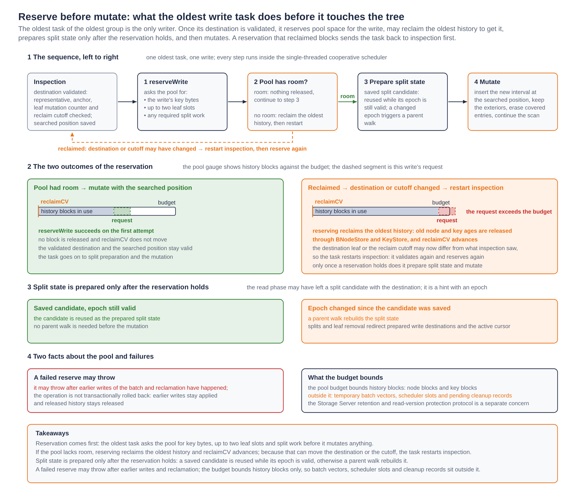

*Figure 20. Space for key bytes, leaf slots and required split work is requested before mutation. Reclamation can change the destination or cutoff and requires inspection to restart. Split state is prepared only after reservation succeeds; a later failure does not roll back earlier writes.*

## 8. Speculative destinations, pointer safety and structural repair

A prepared destination from `checkReads` is a hint, not a guarantee that its pointers and rank will remain valid. Older write tasks may insert, erase, split or remove leaves, and a pool reservation may reclaim history and reuse the freed block. Before the oldest task consumes a saved rank or leaf pointer, it checks the representative and destination anchor, the reclaim cutoff, and the saved leaf generation and mutation epoch. The rank can be reused only while the block still holds that leaf generation and the leaf has not mutated since the rank was computed. Otherwise the task restarts its search. Because node and key-block generation spaces are disjoint, reuse of the same pool block for keys cannot make this leaf check pass. A younger task remains parked until oldest before performing any required restart.

A split can leave a write begin in the original left leaf while invalidating only its rank. It can also place the insertion point beyond that leaf's new upper boundary. A right-neighbour check then moves the search into the new right leaf. Splits and leaf removal redirect prepared write destinations and the active cursor; subsequent validation still precedes pointer use. A saved split candidate is separately guarded by its split epoch. A changed epoch requires rebuilding that candidate from the parents.

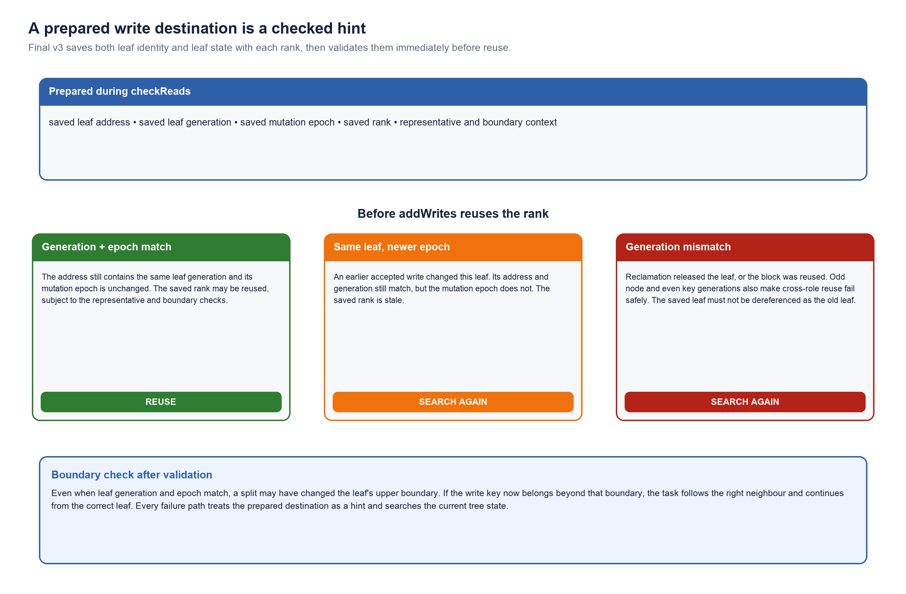

*Figure 21. A still-valid destination reuses the searched position. An older write can change the rank while the insertion leaf remains allocated; reclamation can free and reuse the block; and a split can require a right-neighbour correction. The saved generation and mutation epoch distinguish all three cases before the rank is used.*

During `checkReads`, no write insertion or key-block reclamation occurs, and queued empty leaves are not released until tasks finish. During write maintenance, a CV check precedes any dereference of possibly reclaimed key bytes. The two protections solve different lifetime problems: stable traversal pointers during reads, and renewed validation after speculative write searches.

## 9. Deletion, age tracking and pressure reclamation

Deleting a leaf entry removes its logical-order index and frees its physical slot. If a nonroot leaf becomes empty, structural removal unlinks it from its neighbours, removes its parent child slot, redirects any prepared write cursor or destination pointing to it, updates pending-split counts and propagates the first surviving separator. Empty parents are removed recursively, and the root is normalized; an empty root leaf may remain. Deleting or compacting expired entries can reduce a node's split demand and release a reservation held in its ancestors.

Nodes participate in an intrusive age list ordered by a conservative maximum CV. Allocation appends at a nondecreasing CV. When a node maximum rises, the node moves towards the tail; deletion does not lower that maximum. A node can therefore remain longer than its live contents strictly require, trading reclamation precision for cheaper maintenance. Key blocks carry their own conservative maximum CV and advance in allocation order. The node and key-block ages are compared when space must be reclaimed.

`reclaimOldest` chooses the older of the oldest node and oldest key block, raises `reclaimCV_` monotonically to cover the reclaimed age, releases eligible nodes and possibly whole subtrees, and releases eligible key blocks. A subtree is detached only when its conservative maximum CV says no newer history will be lost. `reclaimUntilAvail(n)` repeats until enough free blocks exist or no eligible history remains. Logical expiry can leave descriptors in surviving nodes after their bytes are reclaimed: separator refresh, leaf cleanup and CV-first tests are what prevent those descriptors from becoming unsafe comparisons. Because nodes and key blocks share a pool, releasing either can satisfy a later allocation of the other kind.

The local pool policy cannot by itself guarantee an old transaction's read version remains usable. Transaction admission must reject RVs below the resulting `reclaimCV_`, and protection of active reads and Storage Server data versions must be coordinated outside this component. Final v3 uses this age-based mechanism; it has no separate queue of batched `reclaimOldest` tasks.

## 10. Costs, limits and selected configuration

Key routing within a node is logarithmic in the node's child count for an individual begin, while recursive partitioning shares routing comparisons among many begins. Descent can incur separator repair and local cleanup. Read ranges add predecessor and forward-scan work, potentially spanning many leaves. A write adds key copying, covered-entry comparisons and erasures, parent metadata updates, possible split work and occasional pressure reclamation. Prefetch can overlap latency but cannot force cache residency or make dependent comparisons independent.

The two-by-eight write configuration is a latency/locality trade-off within one core, not a parallel thread count. The default read task capacity `BTREE_V3_TASKS=16` in the integration is a separate setting. `BTreeV3.cpp` compiles resolver1 within the `btree_v3` namespace and the native ConflictSet adapter selects it. Tag `resolver-v3-final` identifies the selected release; the older tag `resolver-v3` identifies the v3.8 milestone, and the later experimental branches are outside this design.

Correctness requires matching conflict bits, transaction decisions, too-old counts and accepted write order for half-open boundaries, equal begins, expired separators, long and cross-block keys, splits, removed leaves, right-neighbour redirects, memory pressure and complete per-read reporting. Performance claims require measured whole workloads and the exact source and compilation configuration; the algorithmic bounds and diagrams in this document are explanations of mechanisms, not speedup claims.
